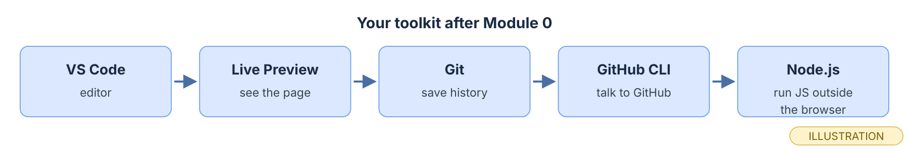
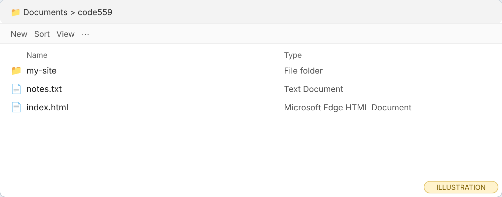
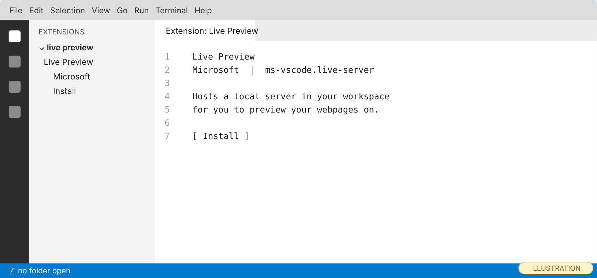
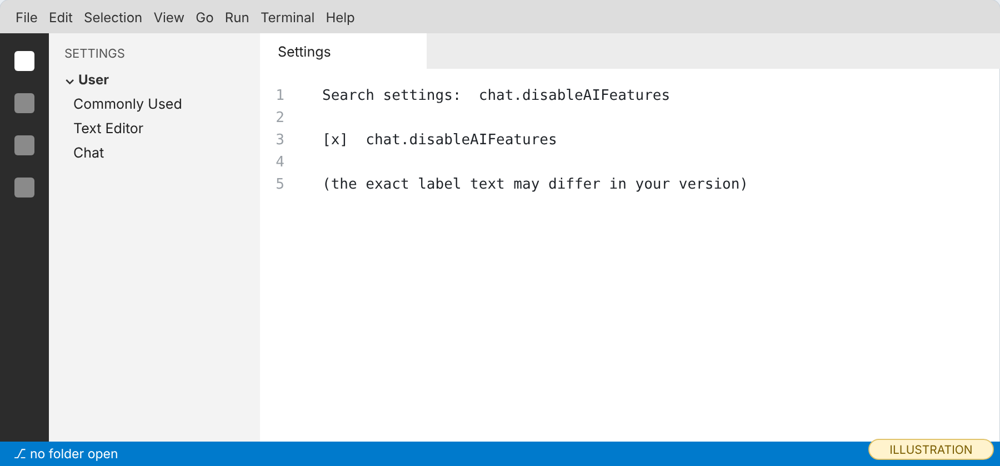
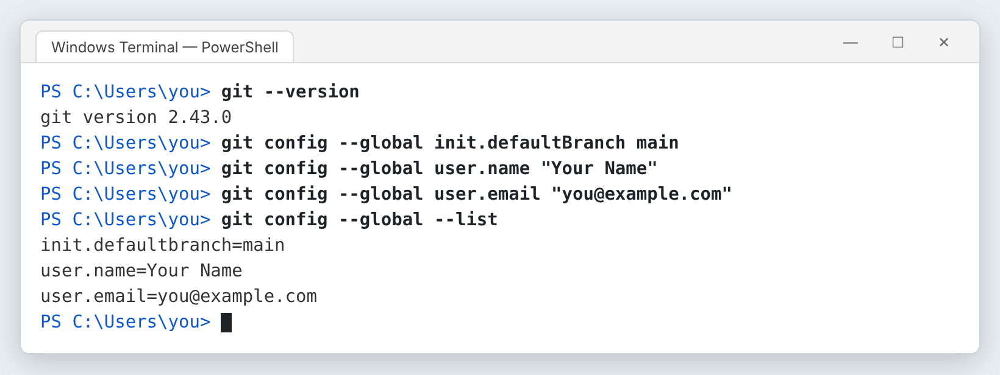
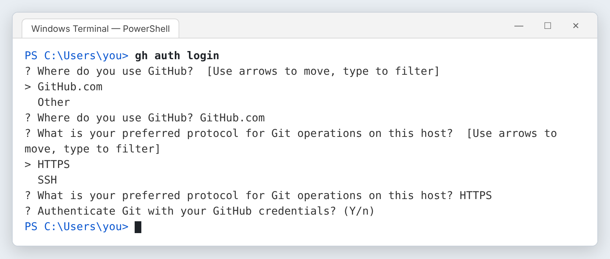
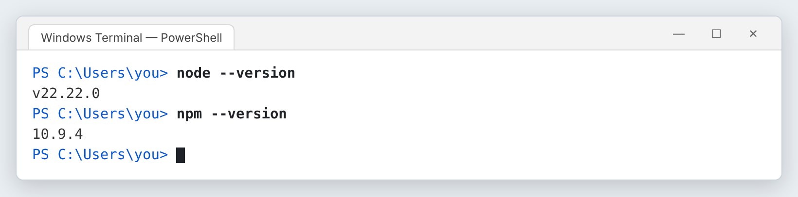
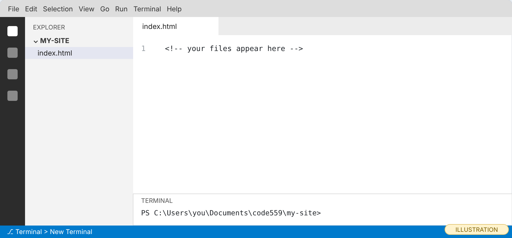
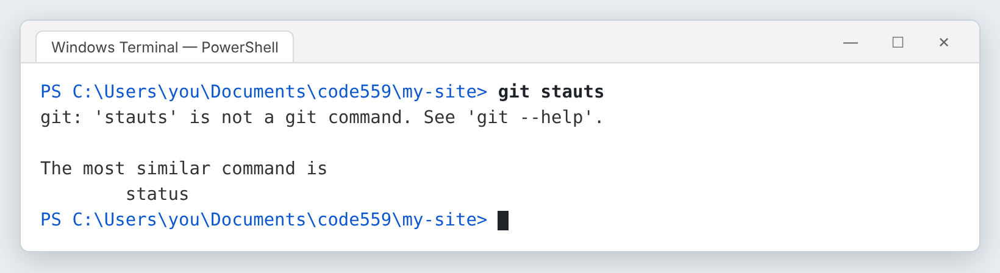

# Module 0 — Setup

*Install every tool once, so no later module stops for an install.*

**In this module you will learn:**

- What each tool in a front-end developer's kit does, and why you need it
- How to show file extensions in File Explorer
- How to install VS Code and the Live Preview extension
- How to turn off VS Code's built-in AI features, and why this course asks you to
- How to install Git and set your name, email and default branch
- How to install the GitHub CLI and sign in to GitHub from the terminal
- How to install Node.js so you can run JavaScript outside the browser
- How to open a terminal in the right folder

## Why this matters

Every developer works inside a small set of tools. You write code in an editor, you look at the result in a browser, you save your history with Git, and you publish with GitHub. If one of those is missing in the middle of a lesson, you stop learning and start troubleshooting. This module puts everything in place first.

You will also make one decision that shapes the rest of the course: you will turn off the AI assistant in your editor. That is not because AI tools are bad. It is because this course asks you to explain every line you commit, and the simplest way to explain a line truthfully is to have written it yourself.

By the end you will have five tools installed and checked, and a folder ready for the site you build in Module 1.


*The five tools you install in this module and the job each one does. (illustration, not a screenshot)*

## Before you start

1. You need a Windows 11 computer with an internet connection and permission to install software. This course is written for Windows only.
2. Create a free GitHub account at github.com if you do not have one. Pick a username you would be happy to show an employer; it appears in your website address later.
3. Decide where your course work will live. Choose a folder with a **short name and no spaces**, for example a folder called `code559` inside Documents.

> **Checkpoint.** You can sign in to github.com, and you know the folder where your course work will live.

## Core concepts

### 1. What is each tool for?

*Introduce.* A front-end developer builds the part of a website that people see and use. To do that you need a place to write code, a way to see it, a way to keep its history, and a place to publish it.

*Explain.* **VS Code** is the editor where you type HTML, CSS and JavaScript. **Live Preview** is a VS Code extension that shows your page and refreshes it when you save. **Git** keeps a history of your project as a series of saved snapshots, called commits. **GitHub** is a website that stores a copy of that history online and can publish your site. The **GitHub CLI** (`gh`) lets you do GitHub tasks from the terminal. **Node.js** runs JavaScript outside the browser; you will use it in the JavaScript modules.

*Illustrate.* Look at the toolkit picture above. Every box is something you will use in almost every module.

*Apply.* Before you install anything, say out loud which tool you would use to (a) see your page, (b) save a snapshot, (c) publish. Check your answers against the paragraph above.

### 2. Why show file extensions?

*Introduce.* A file extension is the part of a name after the last dot: `.html`, `.css`, `.js`. Windows hides it by default.

*Explain.* When extensions are hidden, a file you meant to name `index.html` can quietly become `index.html.txt`, and the browser treats it as plain text. Showing extensions stops that mistake before it happens.

*Illustrate.*


*With extensions shown, you can see that the file really ends in `.html`. (illustration, not a screenshot)*

*Apply.* Open File Explorer. Select **View → Show → File name extensions** so it has a check mark.

### 3. What do VS Code and Live Preview do together?

*Introduce.* VS Code is free and made by Microsoft. Live Preview is a Microsoft extension that, in its own words, "Hosts a local server in your workspace for you to preview your webpages on" (VS Code Marketplace, *Live Preview*).

*Explain.* Without Live Preview you save a file, switch to the browser, and refresh. With it, the preview sits next to your code and updates when you save. Note that the Marketplace page labels it "still under development." If it ever misbehaves, opening the file in Edge or Chrome and pressing F5 always works.

*Illustrate.*


*Search the Extensions view for "Live Preview" and check that the publisher is Microsoft before you install. (illustration, not a screenshot)*

*Apply.* You will install both in the Exercise.

### 4. Why turn off AI features?

*Introduce.* Current VS Code includes GitHub Copilot features. VS Code's documentation says you can "disable the built-in AI features in VS Code with the `chat.disableAIFeatures`" setting (VS Code Docs, *Set up GitHub Copilot in VS Code*).

*Explain.* This course has one honesty rule: **if a tool wrote a line, you mark it and explain it.** While you are learning, it is much simpler to write every line yourself. You can turn AI features back on later, after you can read and explain code without help.

*Illustrate.*


*Type the setting name into the Settings search box and tick it. (illustration, not a screenshot)*

*Apply.* You will do this in step 4 of the Exercise.

### 5. What does Git need to know about you?

*Introduce.* Every commit records who made it. Git needs a name and an email for that.

*Explain.* You set three things once, with `git config --global`: your name, your email, and the name of the first branch in new projects. Git still names the first branch `master` unless you tell it otherwise; GitHub uses `main`. Setting `init.defaultBranch` to `main` keeps the two in agreement.

*Illustrate.*


*The three `config` commands print nothing when they work. `--list` proves they were saved. (real output, rendered; captured on Linux with Git 2.43.0. On Windows the version line ends in `.windows.1` or similar, and your version will be newer.)*

*Apply.* Predict: what will `git config --global --list` show if you skip the email line? (Answer: only two lines.)

### 6. Why sign in to GitHub from the terminal?

*Introduce.* The GitHub CLI can create a repository on GitHub and push your files to it with one command. It needs permission to act as you.

*Explain.* `gh auth login` asks a few questions, then opens your browser so you can approve the sign-in. You answer **GitHub.com**, then **HTTPS**, then **Yes** to "Authenticate Git with your GitHub credentials?", then choose **Login with a web browser**. GitHub shows a one-time code; you paste it in the browser page that opens.

*Illustrate.*


*The first three prompts as GitHub CLI 2.89.0 prints them. Use the arrow keys to move and Enter to choose. (real output, rendered; captured on Linux. The later "How would you like to authenticate" and one-time-code steps were not captured for this post.)* **[unverified: exact wording of the browser-login step in your version of `gh`.]**

*Apply.* After you sign in, `gh auth status` should say you are logged in to github.com. That is your proof.

### 7. Why install Node.js now?

*Introduce.* Node.js runs JavaScript on your computer instead of inside a web page.

*Explain.* In Modules 5 to 8 you will practice the JavaScript language before you touch a web page. Node lets you run a script from the terminal and see the result. Installing it now means those modules never stop for setup. Node's download page lists **v24.21.0** as the current LTS (Long-Term Support) version on the day this post was written; "LTS" is the version to choose.

*Illustrate.*


*Two version numbers mean both Node and npm (its package manager) are installed. (real output, rendered; captured on Linux with Node 22. Your numbers will be newer, for example v24.x.)*

*Apply.* After installing, run `node --version`. Any `v` followed by numbers is a pass.

## Exercise

*Apply — your hands, about 60 minutes (estimate).* Type every command. Do not paste. Typing is how your fingers learn the commands.

1. **Show file extensions.** In File Explorer: **View → Show → File name extensions**.
2. **Make your course folder.** Create the folder you chose (for example `Documents\code559`). Inside it, create a folder called `my-site`.
3. **Install VS Code.** Download it from code.visualstudio.com and run the installer. On the "Select Additional Tasks" screen, tick **Add "Open with Code" action to Windows Explorer file context menu** and **Add to PATH**. **[unverified: the exact wording of those installer checkboxes in the current installer.]**
4. **Turn off AI features.** In VS Code: **File → Preferences → Settings**. Type `chat.disableAIFeatures` in the search box and tick it.
5. **Install Live Preview.** Click the Extensions icon in the left bar (or press Ctrl+Shift+X). Search **Live Preview**. Check the publisher says **Microsoft**. Click **Install**.
6. **Open a terminal.** In VS Code: **File → Open Folder…**, choose `my-site`, then **Terminal → New Terminal**. The prompt should end in `my-site>`.

   
   *The prompt shows which folder the terminal is in. Always check it before you type a Git command. (illustration, not a screenshot)*

7. **Install Git.** In the terminal type:

   ```
   winget install --id Git.Git -e --source winget
   ```

   (This is the command on git-scm.com's *Install for Windows* page.) When it finishes, **close the terminal and open a new one** so Windows finds Git. Then type `git --version`.
8. **Configure Git.** Use your real name and the email on your GitHub account:

   ```
   git config --global init.defaultBranch main
   git config --global user.name "Your Name"
   git config --global user.email "you@example.com"
   git config --global --list
   ```

9. **Install the GitHub CLI.**

   ```
   winget install --id GitHub.cli --source winget
   ```

   (From the GitHub CLI manual's Windows install page.) Close and reopen the terminal. Type `gh --version`, then `gh auth login` and answer as in Core Concept 6. Finish with `gh auth status`.
10. **Install Node.js (LTS).**

    ```
    winget install --id OpenJS.NodeJS.LTS -e --source winget
    ```

    Close and reopen the terminal. Type `node --version` and `npm --version`. **[unverified in this build: the package id `OpenJS.NodeJS.LTS` is taken from winget.run, a third-party index of the winget catalog, not from nodejs.org. If winget says "No package found," download the LTS installer from nodejs.org instead.]**
11. **Break it on purpose.** In the same terminal, type `git stauts` (letters swapped). Read the message. Git says the command does not exist and suggests the closest real one.

    
    *Git names the real command it thinks you meant. Learning to read messages like this is a skill you will use every day. (real output, rendered; captured on Linux with Git 2.43.0)*

    Now try `git --verison`. This time Git only prints "unknown option" and its usage summary, with no suggestion. Same kind of typo, different help: always read the whole message.

## Project (in the full packet)

There is no build project in Module 0. The full packet adds a one-page **setup log** you fill in (each tool, its version number, and the command that proved it), plus a troubleshooting section for the five most common install problems. The full packet is the Module 0 packet. [Get the packet →](PACKET_LINK_MODULE_0)

## Common misconception

> *"Git and GitHub are the same thing."*

What would you say? Hint: one of them works with no internet connection at all.

## Summary

A front-end developer writes code in VS Code, sees it with Live Preview or a browser, records its history with Git, and publishes it through GitHub, using the GitHub CLI from the terminal; Node.js runs JavaScript outside the browser. Showing file extensions stops files from getting a hidden `.txt` ending. AI features are off so that every line you commit is a line you wrote and can explain. Git needs your name, your email and a default branch name of `main`. After every install, a fresh terminal and a version command prove the tool is ready.

## Check your understanding

1. You run `git --version` right after installing Git and get "not recognized." What is the most likely fix?
2. Why does this course set `init.defaultBranch` to `main`?
3. **What would you test** to prove the GitHub CLI is signed in?

## Before next module

- [ ] File extensions are visible in File Explorer
- [ ] `git --version`, `gh --version` and `node --version` all print a version
- [ ] `gh auth status` says you are logged in
- [ ] AI features are off in VS Code
- [ ] You have a `my-site` folder and can open a terminal in it

## Go further

- VS Code Docs: *Setting up Visual Studio Code* and *Set up GitHub Copilot in VS Code* (the section on hiding AI features)
- git-scm.com: *Install for Windows*; *Pro Git*, chapter 1.6 "First-Time Git Setup"
- GitHub CLI manual: `gh auth login`
- nodejs.org: *Download Node.js*
- GitHub Docs: *Creating an account on GitHub*
- [W3Schools Git Tutorial](AFFILIATE_W3SCHOOLS_GIT)

*Affiliate link: Code559 may earn a commission at no extra cost to you.*

## What to keep

Keep a note of the four version numbers you saw (Git, GitHub CLI, Node, npm) and the folder path of `my-site`. Then answer for yourself: **which step would be hardest to repeat without this post, and why?**

---

*Code559 is a 559 Solutions project. Portions adapted from Visual Studio Code documentation (CC BY 3.0 US), GitHub Docs (CC BY 4.0), and GitHub Skills (MIT). Screenshots used with permission from Microsoft.*

*Sources checked 2026-10-09: git-scm.com "Install for Windows"; GitHub CLI "Installing gh on Windows" (github.com/cli/cli docs); VS Code Docs "Set up GitHub Copilot in VS Code"; VS Code Marketplace "Live Preview"; nodejs.org "Download Node.js"; winget.run "NodeJS.LTS".*
