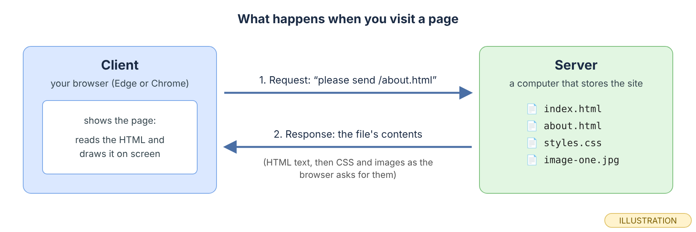
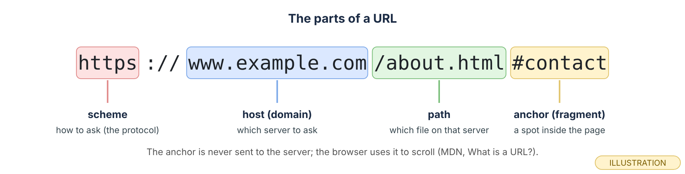
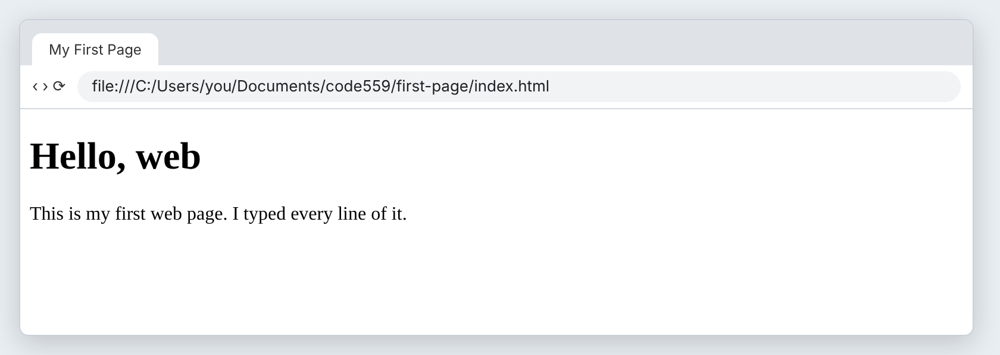
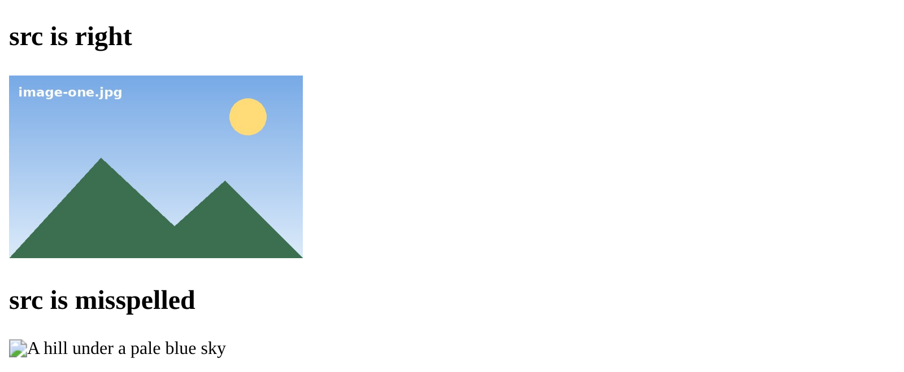
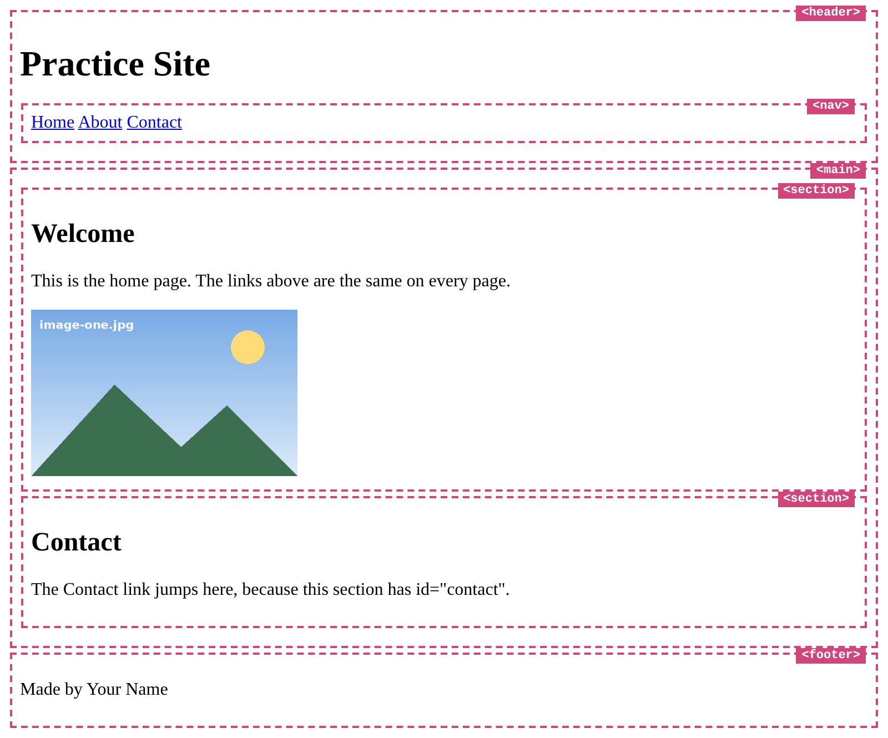
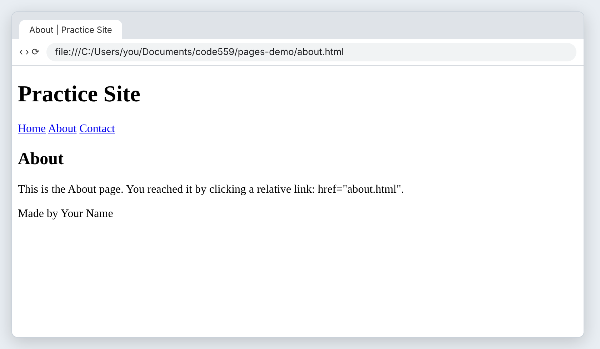
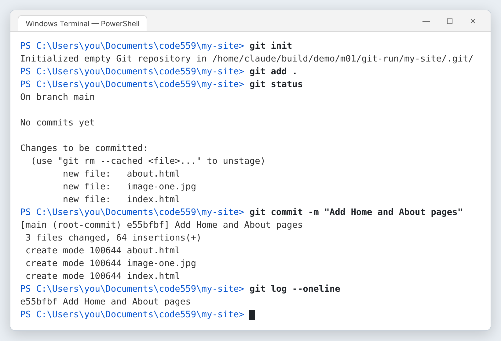
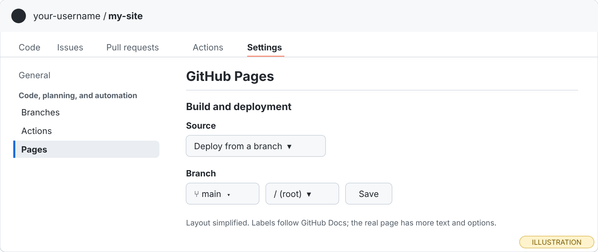
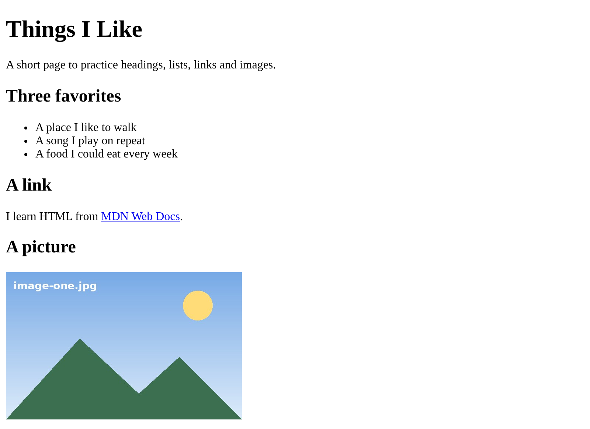
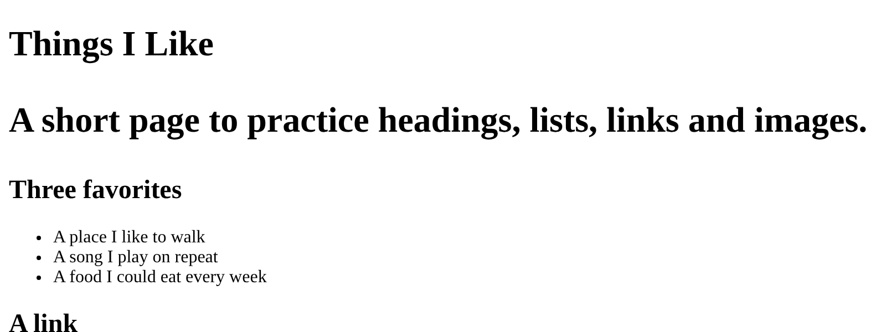

# Module 1 — HTML Foundations

*Write your first pages by hand, link them together, and put them on the web.*

**In this module you will learn:**

- How the web works: client, server, request and response
- The parts of a URL: scheme, host, path (and the anchor)
- How to create, save and open files in VS Code, and the save → refresh loop
- The structure of every HTML document: `<!DOCTYPE html>`, `<html lang>`, `<head>`, `<body>`, `<meta charset>`, `<meta name="viewport">`, `<title>`
- Headings, paragraphs and unordered lists
- Links and `href`, including same-page links to an `id`
- Images, `src` and `alt`
- The semantic elements `header`, `nav`, `main`, `section` and `footer`
- Multiple pages, relative paths, and shared navigation you test link by link
- **Publish your first page:** the GitHub Skills *Introduction to GitHub* exercise, then `git init`, your first commit, `gh repo create` and GitHub Pages

## Why this matters

Every web page you have ever opened started as a plain text file of HTML. The browser reads that file and turns it into headings, paragraphs, links and pictures. If you can write that file by hand, you understand what every website, framework and page builder is producing under the hood.

This module starts with how a page travels from a server to your screen. Then you write one page, then two pages that link to each other. You end by putting your work on the public web with your own address, so from the first week you have something live you can show someone.

You will not style anything yet. Plain black-and-white pages are the point: structure first, appearance in Module 2.

## Before you start

1. Finish Module 0. You need VS Code (AI features off), Live Preview, Git, the GitHub CLI signed in (`gh auth status`), and a `my-site` folder inside your course folder.
2. Make a second folder next to `my-site` called `practice-01`. This is your throwaway folder for the Exercise. Nothing in it gets published.
3. Find one picture you are happy to put on a public website (a photo you took, or a drawing). Copy it into `practice-01` and rename it `image-one.jpg`. If yours is a `.png`, keep the `.png` ending and use that name everywhere this post says `image-one.jpg`.

> **Checkpoint.** You have `my-site` and `practice-01` side by side, there is an image file in `practice-01`, and `gh auth status` says you are logged in.

## Core concepts

### 1. What happens when you visit a web page?

 The web is a conversation between two computers. Your browser is the **client**. The computer that stores the website is the **server**.

 When you type an address or click a link, the client sends a **request**: "please send me this file." The server sends back a **response** with the file's contents. For a web page, that is HTML text. The browser reads the HTML, notices it also needs a stylesheet or an image, and requests those too. Then it draws the page. While you are learning, you will often open a file straight from your own disk. Then there is no server at all; the browser reads the file directly, and the address starts with `file:///`.

<div role="separator" style="display:flex;align-items:flex-end;margin:1.5em 0;"></div>


 *Two messages: the request goes out, the response comes back. Everything else in this course happens inside one of these two boxes.*

 Open any website and click one link. Say out loud which part was the request and which part was the response.

### 2. What are the parts of a URL?

 MDN defines a URL as "the address of a unique resource on the internet" (MDN, *What is a URL?*).

 Read a URL left to right. The **scheme** (`https`) tells the browser which protocol to use to ask. After `://` comes the **host**, also called the domain (`www.example.com`), which says which server to ask. Then the **path** (`/about.html`) says which file on that server. An optional **anchor** (`#contact`) points to a spot inside the page. MDN notes that the part after `#` "is never sent to the server with the request"; the browser uses it to scroll.

<div role="separator" style="display:flex;align-items:flex-end;margin:1.5em 0;"></div>


 *One URL, four parts. You will write paths and anchors yourself in this module.*

 Look at your browser's address bar right now. Point to the scheme, the host and the path.

### 3. How do you create, save and see a file in VS Code?

 An HTML page is a text file whose name ends in `.html`. The home page of a site is called `index.html` by convention.

 In VS Code, use **File → Open Folder…** and choose the folder you want to work in. The Explorer panel on the left lists its files. Use the **New File** button at the top of the Explorer, type the full name including `.html`, and press Enter. When a tab shows a dot instead of an ✕, the file has unsaved changes. Press **Ctrl+S** to save. To see the page, open it in Edge or Chrome (double-click it in File Explorer) or use Live Preview. From then on you work in a loop: **edit → save → refresh**. If the browser does not show your change, the most common reason is that you did not save.

 The first page in the next concept was opened from disk, which is why its address starts with `file:///`.

 You will create your first file in the Exercise. Remember the loop: edit, **Ctrl+S**, then F5 in the browser.

### 4. What does every HTML document need?

 HTML is made of **elements**. Most elements have an opening tag, content and a closing tag: `<p>Hello</p>`. The closing tag has a `/`.

 Every page starts with the same skeleton. `<!DOCTYPE html>` tells the browser this is modern HTML. `<html lang="en">` wraps everything and states the page's language, which MDN says helps search engines and people using screen readers. The `<head>` holds information *about* the page: `<meta charset="utf-8">` sets the character encoding so any language's characters display correctly; `<meta name="viewport" content="width=device-width, initial-scale=1">` tells phones to use their real screen width instead of pretending to be a wide desktop; `<title>` is the text in the browser tab. The `<body>` holds everything visitors see.

```html
<!DOCTYPE html>
<html lang="en">
  <head>
    <meta charset="utf-8">
    <meta name="viewport" content="width=device-width, initial-scale=1">
    <title>My First Page</title>
  </head>
  <body>
    <h1>Hello, web</h1>
    <p>This is my first web page. I typed every line of it.</p>
  </body>
</html>
```

<div role="separator" style="display:flex;align-items:flex-end;margin:1.5em 0;"></div>


 *The `<title>` appears on the tab, not on the page. The `<h1>` and `<p>` are the only things in the body. Measured at 800 px wide. (page real: rendered in Chromium; browser frame drawn)*

 Predict: if you change only the text inside `<title>`, what changes on screen? (Only the tab.)

### 5. How do headings, paragraphs and lists work?

 Headings run from `<h1>` (most important) to `<h6>`. Paragraphs are `<p>`. A bulleted list is an **unordered list**, `<ul>`, with one `<li>` (list item) per bullet.

 Use one `<h1>` per page for its main title, then `<h2>` for sections and `<h3>` inside those. Choose a heading level for its meaning, not its size; size is CSS's job in Module 2. Every `<li>` must sit inside the `<ul>`.

```html
<h2>Three favorites</h2>
<ul>
  <li>A place I like to walk</li>
  <li>A song I play on repeat</li>
  <li>A food I could eat every week</li>
</ul>
```

 You will see this exact list rendered in the Exercise.

 Without looking, write the opening and closing tags of a list with two items on paper.

### 6. How does a link work?

 A link is an `<a>` (anchor) element. Its `href` attribute holds the address to go to. The text between the tags is what people click.

 `href` can be a full URL (`https://developer.mozilla.org/`), a **relative path** to another file in your site (`about.html`), or an anchor on the same page (`#contact`). For a same-page link, give the target element an `id` and put `#` plus that id in the `href`. MDN puts it this way: "Elements with an `id` attribute in the document automatically create a document fragment that can be linked to" (MDN, *Creating links*). An `id` must be unique on its page.

```html
<a href="#contact">Contact</a>
...
<section id="contact">
  <h2>Contact</h2>
</section>
```

 The pages in Concept 8 use all three kinds of `href`.

 Predict: what happens if the `href` says `#contacts` but the `id` is `contact`? (The link does nothing, because no element has that id.)

### 7. How does an image work, and what is `alt` for?

 An image is an `` element. It has no closing tag. `src` says which file to show. `alt` describes the picture in words.

 `src` is a path, just like `href`; if the image sits in the same folder as the page, the path is just the file name. `alt` is read aloud by screen readers and is shown when the image cannot load. Write what the picture shows, as you would describe it to someone on the phone.

```html

```

<div role="separator" style="display:flex;align-items:flex-end;margin:1.5em 0;"></div>


 *One wrong letter in `src` and the picture is gone. The `alt` text is what remains, so make it useful. (real: rendered in Chromium)*

 Write `alt` text for the picture you copied into `practice-01`. Keep it to one short sentence.

### 8. What are semantic elements, and how do pages share navigation?

 **Semantic** means "says what it is." `<header>`, `<nav>`, `<main>`, `<section>` and `<footer>` look like nothing at all on their own, but they tell browsers, search engines and screen readers what each part of the page is for.

 A typical page has a `<header>` with the site name and a `<nav>` of links, one `<main>` with the page's own content split into `<section>`s, and a `<footer>`. A site with several pages repeats the same header, nav and footer on every page. In plain HTML you do that by **copying the same block into each file**. Links between your pages use relative paths: `about.html` means "the file called about.html in the same folder as this page." Because each page has its own copy of the navigation, you must **click every link on every page** after any change. A link to `index.html#contact` goes to another page *and* jumps to a spot on it.

```html
<header>
  <h1>Practice Site</h1>
  <nav>
    <a href="index.html">Home</a>
    <a href="about.html">About</a>
    <a href="#contact">Contact</a>
  </nav>
</header>
```

<div role="separator" style="display:flex;align-items:flex-end;margin:1.5em 0;"></div>


 *The same page with each semantic element outlined and labeled. The outlines were added for this picture only; without CSS these elements are invisible. Measured at 800 px wide. (real: rendered in Chromium)*


*Captured after Chromium clicked the **About** link on the home page. Same header and links, different main content: that is shared navigation. (page real: rendered in Chromium; browser frame drawn)*

 For a two-page site, write down how many links you must click to test the navigation fully. (Three links × two pages = six clicks.)

### 9. How do you publish your first page?

 Your pages live only on your computer. To give them a public address you need three things: a Git history of your folder, a copy of that history on GitHub (a **repository**), and **GitHub Pages**, which serves a repository's HTML as a website.

 Start with the free **GitHub Skills** exercise *Introduction to GitHub*. Its page says it takes "less than one hour," needs no installs, and has the prerequisite "None." It introduces repositories, branches, commits and pull requests, and its four steps are: create a branch, commit a file, open a pull request, merge your pull request. You start it with its **Copy Exercise** button, which makes your own copy of the exercise repository; the page suggests making it public. You will not use branches or pull requests on your own site until Module 12, but seeing the whole cycle once now makes the rest of the course easier to follow.

Then you save your own folder's history with Git, on your computer:

```
git init
git add .
git commit -m "Add Home and About pages"
```

`git init` turns the folder into a repository. `git add .` stages every file in the folder (the `.` means "this folder"). `git commit` saves a snapshot with a message. `git status` and `git log --oneline` show you what Git sees.


*`git add .` prints nothing when it works; `git status` proves the files are staged; `git log --oneline` shows your first commit. Your commit id (the seven characters) will differ. (real output, rendered; captured on Linux with Git 2.43.0. On Windows the `Initialized` line shows a `C:/Users/...` path, and `git add` may also print a warning about line endings, which is not an error.)* **[unverified: whether the line-ending warning appears on your machine depends on Git for Windows settings.]**

Then one GitHub CLI command creates the repository on GitHub and uploads your commit:

```
gh repo create my-site --public --source=. --remote=origin --push
```

The GitHub CLI manual describes the flags: `--public` "Make the new repository public"; `--source` "Specify path to local repository to use as source" (`.` is this folder); `--remote` "Specify remote name for the new repository"; `--push` "Push local commits to the new repository." **[not run for this post: `gh repo create` and the push need a signed-in GitHub account, so no output is shown. Read what it prints on your screen.]**

Finally, turn on Pages. GitHub Docs (*Configuring a publishing source for your GitHub Pages site*) gives these steps: on your repository, click **Settings**; in the **Code, planning, and automation** section of the sidebar, click **Pages**; under **Build and deployment**, under **Source**, select **Deploy from a branch**; choose the branch **main** and the folder **/ (root)**; click **Save**. A project site's address has the form `https://your-username.github.io/my-site/` (GitHub Docs, *What is GitHub Pages?*). Pages is free for public repositories.

<div role="separator" style="display:flex;align-items:flex-end;margin:1.5em 0;"></div>


 *Where the Pages settings live. Labels follow GitHub Docs; the real page has more on it and GitHub changes its layout from time to time.* **[unverified: the exact look of the Pages settings page on the day you do this; the steps are from GitHub Docs.]**

 Before you run anything, say what each of the four commands above does in five words or fewer.

## Exercise

*Your hands, about 45 minutes (estimate).* Work in `practice-01`. Type every line. Do not paste. Typing is how you learn where the angle brackets and slashes go.

1. In VS Code, **File → Open Folder…** and choose `practice-01`. Check the Explorer shows your `image-one.jpg`.
2. Create a new file called `index.html`.
3. **Predict.** Before you type the body, say what you expect to see: how many headings, how many bullets, one link, one picture.
4. Type the skeleton from Concept 4. Change the `<title>` to `Practice Page`.
5. Inside `<body>`, type an `<h1>`, a `<p>`, and three `<h2>` sections: one with a `<ul>` of three `<li>` items, one with a `<p>` containing a link to `https://developer.mozilla.org/`, and one with your `` and its `alt` text. Choose your own words.
6. **Run.** Save with Ctrl+S. Open `index.html` in Edge or Chrome. Compare with your prediction.

   
   *One example of a finished practice page. Yours will have your words and your picture. Measured at 800 px wide. (real: rendered in Chromium)*

7. **Modify.** Add a fourth `<li>`. Save, refresh, and count the bullets. Click the link and use the browser's Back button.
8. **Break it on purpose.** Delete the closing `</h1>` tag. Save and refresh. Before you look, predict what will happen to the paragraph under it.

   
   *With `</h1>` missing, the browser keeps the heading open, so the paragraph becomes part of it. The browser stops the heading when it meets the next `<h2>`, so the rest of the page looks normal. (real: rendered in Chromium)*

   The browser did not show an error. It guessed. HTML mistakes rarely produce a message; they produce a page that looks wrong. Put `</h1>` back, save and refresh.
9. **Break it again.** Change `src="image-one.jpg"` to `src="imge-one.jpg"`. Save and refresh. You should see your `alt` text where the picture was, as in Concept 7. Fix it.
10. **Debug.** Change the link's `href` to `https://developer.mozilla.orgg/` (an extra `g`). Save, refresh and click. Instead of MDN you get the browser's own error page, because no server answers at that host. Which part of the URL was wrong: scheme, host or path? Fix it and click again.

## Project (in the full packet)

Your project is the start of the personal website you will build all course: a **Home** page and an **About** page in `my-site`, each with the full document skeleton, a header with shared navigation, a main area in sections, and a footer, with every link tested on both pages. Then you publish it, so anyone with the link can open `https://your-username.github.io/my-site/` and click between your two pages. The full brief, the step-by-step build, and the finishing work in Git are in the Module 1 packet. [Get the packet →](PACKET_LINK_MODULE_1)

## Common misconception

> *"If the page looks right in my browser, the HTML is correct."*

What would you say? Hint: think about step 8 of the Exercise, where the browser quietly guessed, and about who reads `alt` text.

## Summary

A browser (the client) requests files from a server and draws the HTML it gets back. A URL names the scheme, the host, the path and optionally an anchor inside the page. You work in a loop of edit, save and refresh, and an unsaved file is the most common reason a change does not show. Every page has the same skeleton: doctype, `html` with `lang`, a `head` with charset, viewport and title, and a `body`. Headings give a page its outline, paragraphs hold text, and `ul` with `li` makes a bulleted list. An `a` element's `href` can point to another site, another page by a relative path, or an `id` on the same page. An `img` needs a correct `src` and a useful `alt`. Semantic elements name the parts of a page, and shared navigation is copied onto every page and tested link by link. Git records your folder's history, `gh repo create` puts it on GitHub, and GitHub Pages serves it at a public address.

## Check your understanding

1. In `https://www.example.com/about.html#contact`, which part is never sent to the server, and what does the browser do with it?
2. You changed your page, refreshed, and nothing changed. Name two things to check, in order.
3. **What would you test** after adding a third page to a site with shared navigation, and how many clicks does it take?

## Before next module

- [ ] Your practice page has headings, a list, a link and an image, and you broke and fixed it
- [ ] You finished the GitHub Skills *Introduction to GitHub* exercise
- [ ] `git log --oneline` in `my-site` shows at least one commit
- [ ] Your repository exists on GitHub and Pages is set to deploy from `main`, `/ (root)`
- [ ] Your live page opens at `https://your-username.github.io/my-site/` and every link works

## Go further

- MDN: *What is a URL?*, *What's in the head? Web page metadata*, *Creating links*, and the reference page for `<meta name="viewport">`
- MDN: search "HTML elements reference" for `header`, `nav`, `main`, `section` and `footer`
- GitHub Skills: *Introduction to GitHub* (github.com/skills/introduction-to-github)
- GitHub Docs: *What is GitHub Pages?* and *Configuring a publishing source for your GitHub Pages site*
- GitHub CLI manual: `gh repo create`
- freeCodeCamp: the HTML section of the Responsive Web Design curriculum
- [W3Schools HTML Tutorial](AFFILIATE_W3SCHOOLS_HTML)

*Affiliate link: Code559 may earn a commission at no extra cost to you.*

## What to keep

Keep your `practice-01` folder, the address of your live page, and a note of the four commands you ran to publish it. Then answer for yourself: **which step would be hardest to repeat without this post, and why?**

---

*Code559 is a 559 Solutions project. Portions adapted from Visual Studio Code documentation (CC BY 3.0 US), GitHub Docs (CC BY 4.0), and GitHub Skills (MIT). Screenshots used with permission from Microsoft.*

*Sources checked 2026-10-09: MDN "What is a URL?"; MDN "What's in the head? Web page metadata"; MDN "<meta name="viewport">"; MDN "Creating links"; GitHub Skills "Introduction to GitHub" (github.com/skills/introduction-to-github); GitHub Docs "What is GitHub Pages?"; GitHub Docs "Configuring a publishing source for your GitHub Pages site"; GitHub CLI manual "gh repo create".*
