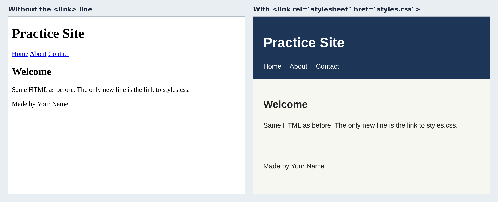
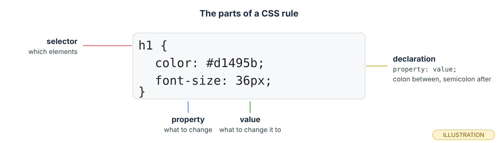
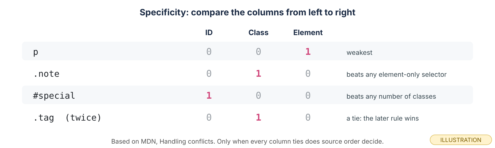
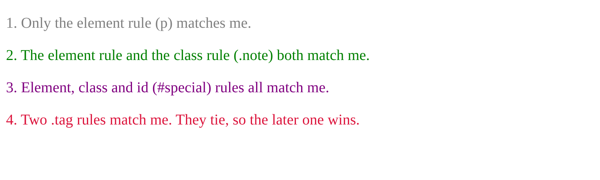
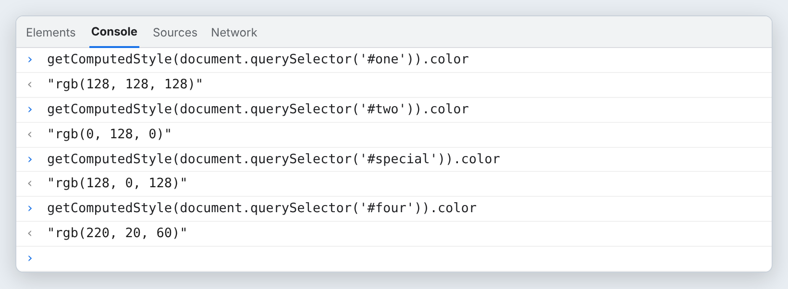
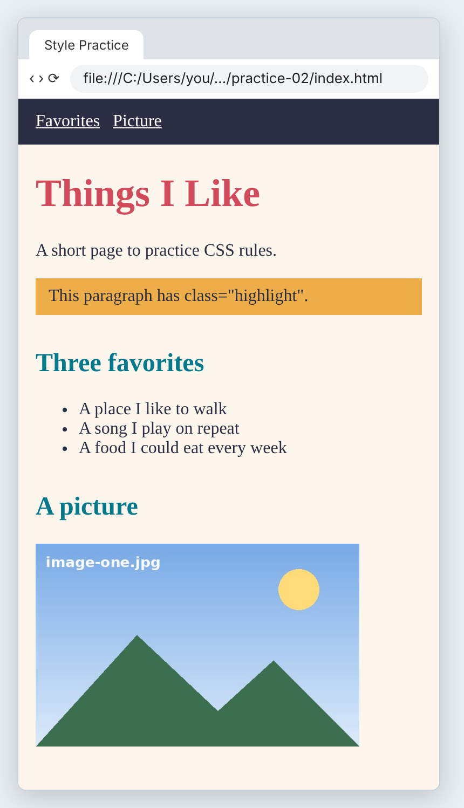
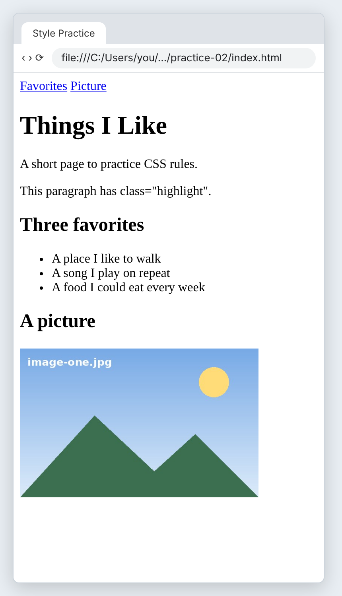
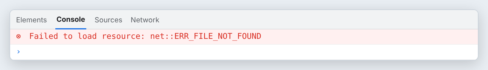

# Module 2 — CSS Foundations

*Give your pages color, type and spacing, and learn exactly which rule wins.*

**In this module you will learn:**

- How to link an external stylesheet with `<link rel="stylesheet">`
- The parts of a CSS rule: selector, property, value, declaration
- Colors, typography and spacing: `color`, `background-color`, `font-family`, `font-size`, `line-height`, `margin`, `padding`
- Element selectors vs class selectors, and writing reusable rules
- The cascade and specificity: which rule wins when two rules disagree
- Block boxes vs inline boxes in normal flow
- Flexbox for a navigation bar: `display: flex`, `gap`, `justify-content`, `align-items`
- Saving your work with the Git routine from Module 1

## Why this matters

In Module 1 you wrote structure. Every page looked the same: black serif text on white. CSS is the layer that decides how things look. It is also the layer where beginners lose the most time, because a rule they wrote "does nothing" and they cannot see why.

Almost every time, the reason is one of three things: the stylesheet is not linked, another rule is winning, or the element is a different kind of box than they thought. This module teaches all three on purpose, with pages rendered in a real browser so you can see each rule win or lose.

By the end you will style a page with one shared stylesheet and build a navigation bar with Flexbox.

## Before you start

1. Finish Module 1. Your `my-site` folder should have a Home and an About page and be live on GitHub Pages.
2. Make a throwaway folder next to `my-site` called `practice-02`. Copy your `practice-01/index.html` and your image into it.
3. Open `practice-02` in VS Code (**File → Open Folder…**) and open `index.html` in Edge or Chrome next to it.

> **Checkpoint.** You can edit `practice-02/index.html`, save, refresh, and see the change. Your live site from Module 1 still opens.

## Core concepts

### 1. How does a page get its styles?

*Introduce.* CSS lives in its own file, usually called `styles.css`, next to your HTML. A `<link>` element in the `<head>` tells the browser to fetch it.

*Explain.* `<link rel="stylesheet" href="styles.css">` has two parts. `rel="stylesheet"` says what kind of file it is. `href` is a relative path, exactly like the links you wrote in Module 1. The browser requests that file as a second request after the HTML. One stylesheet can be linked from every page of a site, so one change restyles all of them.

```html
<head>
  <meta charset="utf-8">
  <meta name="viewport" content="width=device-width, initial-scale=1">
  <title>Home | Practice Site</title>
  <link rel="stylesheet" href="styles.css">
</head>
```

*Illustrate.*


*The HTML is identical except for one `<link>` line. Each side was rendered at 560 px wide; the labels above them were added to the picture. (real: rendered in Chromium)*

*Apply.* Say which part of the `<link>` element you would check first if a page showed no styles at all. (The `href`.)

### 2. What are the parts of a CSS rule?

*Introduce.* A stylesheet is a list of **rules**. Each rule picks some elements and says how they should look.

*Explain.* The **selector** comes first and chooses the elements. Inside the curly braces are **declarations**. Each declaration is a **property**, a colon, a **value** and a semicolon. A missing colon or semicolon usually breaks only that one declaration, and the browser shows no error, so look closely when one line "does nothing."

*Illustrate.*


*Selector, then declarations in braces. Colon between property and value, semicolon after. (illustration, not a screenshot)*

*Apply.* Write a rule on paper that makes every `<h2>` green. Check it has a selector, braces, a colon and a semicolon.

### 3. Which properties give you color, type and spacing?

*Introduce.* A handful of properties do most of the work on a simple page.

*Explain.* `color` sets text color; `background-color` sets the color behind it. Colors can be names (`white`) or hex codes (`#2b2d42`). `font-family` lists fonts in order of preference, ending with a generic family such as `serif` or `sans-serif` as a fallback. `font-size` sets text size, and `line-height` sets the space between lines (a plain number like `1.5` means 1.5 times the font size). `padding` is space *inside* an element's edge; `margin` is space *outside* it. You will study the box model properly in Module 3. Some properties are **inherited**: MDN notes that `color` is, so setting it on `body` colors the text inside it, while `margin`, `padding` and `border` are not.

```css
body {
  font-family: Georgia, serif;
  color: #2b2d42;
  background-color: #fdf6ec;
  margin: 0;
  padding: 0 16px 24px;
}
```

*Illustrate.* The Exercise page later in this post uses exactly these properties.

*Apply.* Predict: if you set `color: purple` on `body`, what color will a paragraph be? (Purple, by inheritance, unless another rule sets the paragraph's color.)

### 4. What is the difference between an element selector and a class selector?

*Introduce.* An **element selector** is a tag name, such as `p` or `h2`. A **class selector** starts with a dot, such as `.highlight`, and matches any element with `class="highlight"`.

*Explain.* Element selectors style every element of that kind, which is right for site-wide basics. Class selectors style only the elements you mark, which makes them **reusable**: write the rule once, then add the class to any element that needs it, on any page. Choose class names for what something *is* (`.highlight`, `.note`), not what it looks like today (`.orange`), so the name still makes sense after a redesign.

```css
p { color: gray; }           /* every paragraph */
.highlight {                 /* only elements with class="highlight" */
  background-color: #edae49;
  padding: 8px 12px;
}
```

*Illustrate.* In the Exercise screenshot, only the paragraph with `class="highlight"` gets the orange background.

*Apply.* Name one element on your Home page that should use an element selector and one that should use a class.

### 5. When two rules disagree, which one wins?

*Introduce.* Often more than one rule matches the same element and sets the same property. The **cascade** is the browser's method for choosing one.

*Explain.* For the rules you write, two tests decide. First, **specificity**: MDN (*Handling conflicts*) describes an id selector as more specific than a class selector, and a class selector as more specific than an element selector. Compare the columns left to right: MDN says "a *million* **class** selectors combined would not be able to overwrite the specificity of *one* **id** selector." Second, only if specificity ties, **source order**: "the one that is defined last in the stylesheet is the one that will be used." So a later rule does not automatically win. It wins only against a rule of equal specificity.

*Illustrate.*


*Read the columns from left to right; the first column that differs decides. (illustration, not a screenshot)*

Here is a real test. The stylesheet sets `p` to gray, then `#special` to purple, then `.note` to green, then `.tag` to blue, and finally `.tag` to crimson. Notice that `#special` comes *before* `.note` in the file.

```css
p        { color: gray; font-size: 20px; }
#special { color: purple; }
.note    { color: green; }
.tag     { color: blue; }
.tag     { color: crimson; }
```


*Line 3 is purple even though the `.note` rule comes later: the id is more specific. Line 4 is crimson because the two `.tag` rules tie and the later one wins. (real: rendered in Chromium)*


*The same page, asking the browser which color it actually used for each line: gray, green, purple, crimson. You do not need to type this yet; the Console is taught in the JavaScript modules. (real output, rendered)*

*Apply.* Predict: if you move the `#special` rule to the very end of the file, does line 3 change color? (No. It already had the highest specificity; order only breaks ties.)

### 6. What is the difference between block and inline boxes?

*Introduce.* Every element is drawn as a box. In normal flow, most boxes are either **block** or **inline**.

*Explain.* Block boxes, such as `h1`–`h6`, `p`, `ul`, `section` and `nav`, start on a new line and, by default, stretch across the full width of their container. MDN (*Block and inline layout in normal flow*) says block elements in English "lay out vertically, one below the other," and even with a width set "they will continue to lay out one below the other." Inline boxes, such as `a`, `span`, `em` and `strong`, sit in the line of text like words. MDN (*The box model*) says that for an inline box, "The `width`, `height`, and top and bottom margins will have no effect." When a `width` rule seems to do nothing, check whether the element is inline.

*Illustrate.*


*Blue = block, orange dashes = inline. The `span` has `width: 300px` and ignores it. The narrow paragraph obeys it, and the next block still starts on a new line. Measured at 800 px wide. (real: rendered in Chromium)*

*Apply.* Add `outline: 2px solid red;` to a rule for `a` on any page and look at the shape of the boxes. Outlines are a quick way to see boxes without changing the layout.

### 7. How does Flexbox lay out a navigation bar?

*Introduce.* Your nav links sit in a line because they are inline. To control spacing and alignment you turn their container into a **flex container** with `display: flex`.

*Explain.* `display: flex` goes on the *parent* (the `nav`). Its children become **flex items** and line up in a row. `gap` puts a fixed space between items. `justify-content` places items along the row: the default packs them at the start of the row; other values include `flex-end`, `center` or `space-between`, which pushes the first and last items to the edges and spreads the rest. `align-items` lines items up across the row; its default stretches them to the tallest item, and `center` centers them. One thing changes when you switch: the spaces from the line breaks between your `<a>` tags no longer show, so you use `gap` instead.

```css
nav {
  display: flex;
  gap: 16px;
  justify-content: space-between;
  align-items: center;
}
```

*Illustrate.*


*Each bar adds one declaration. Compare 2 and 3 for `gap`, 3 and 4 for `justify-content`, and 4 and 5 for `align-items`: in 4 the links stretch to the height of the big label; in 5 they are centered. Measured at 800 px wide. (real: rendered in Chromium)*

*Apply.* Predict what `justify-content: center` would do to bar 3. Then try it in the Exercise.

## Exercise

*Apply — your hands, about 45 minutes (estimate).* Work in `practice-02`. Type every line. Do not paste.

1. Create a new file in `practice-02` called `styles.css`.
2. In `index.html`, add `<link rel="stylesheet" href="styles.css">` as the last line inside `<head>`.
3. Add a `<nav>` at the top of `<body>` with two same-page links to two of your `<h2>` headings (give each heading an `id`, as in Module 1). Add `class="highlight"` to one paragraph.
4. **Predict.** Before you write any CSS, say what will change when you add a `body` rule with a background color.
5. In `styles.css`, type a `body` rule (font, color, background, margin, padding), an `h1` rule and an `h2` rule with different colors, a `.highlight` rule, a `nav` rule with `display: flex`, `gap` and a background color, and a `nav a` rule that makes the links white. Use your own colors.
6. **Run.** Save both files and refresh.

   
   *One example, measured at 390 px wide, about the width of a phone. Your colors and words will differ. (page real: rendered in Chromium; browser frame drawn)*

7. **Modify.** Add `justify-content: center;` to the `nav` rule. Save, refresh, and check your prediction from Concept 7. Then add a second `.highlight` rule *below* the first with a different background color. Which one wins, and why?
8. **Break it on purpose.** In `index.html`, change `href="styles.css"` to `href="style.css"` (one letter missing). Save and refresh.

   
   *Every style is gone, but nothing on the page says why. The HTML still works; only the request for the stylesheet failed. (page real: rendered in Chromium; browser frame drawn)*

   Press **F12** to open DevTools and look at the **Console**.

   
   *The browser did report the problem, just not on the page. In real DevTools the line also names the file it could not find. (real output, rendered; captured from Chromium loading the broken page from disk)* **[unverified: the exact layout of this message in Edge and Chrome DevTools on Windows.]**

9. **Debug.** Fix the `href`, save and refresh. Then make a second, different mistake: delete the colon in one declaration, such as `color #d1495b;`. Which part of the page lost its style? Fix it.

## Project (in the full packet)

You will style your personal site: one shared `styles.css` linked from the Home and About pages, site-wide rules for color, type and spacing, a reusable class or two, and a Flexbox navigation bar that looks the same on every page. A visitor sees a consistent, readable site and can move between pages from a tidy nav bar, and the restyled site is live at your GitHub Pages address. The full brief, the step-by-step build, and the finishing work in Git are in the Module 2 packet. [Get the packet →](PACKET_LINK_MODULE_2)

## Common misconception

> *"The rule lower down in the stylesheet always wins."*

What would you say? Hint: look again at line 3 in the cascade test, and at which rule came last.

## Summary

A `<link rel="stylesheet">` in the `<head>` fetches a CSS file by a relative path, and a wrong `href` silently removes every style. A rule is a selector followed by declarations of property and value. `color`, `background-color`, `font-family`, `font-size`, `line-height`, `margin` and `padding` cover color, type and spacing, and some properties such as `color` are inherited. Element selectors style every element of a kind, while class selectors style only the elements you mark and can be reused anywhere. When rules conflict, the more specific selector wins (id over class over element), and source order decides only a tie. Block boxes start on a new line and stack, while inline boxes sit in the line and ignore `width` and `height`. `display: flex` on a parent lines its children up in a row, and `gap`, `justify-content` and `align-items` control their spacing and alignment.

## Check your understanding

1. Your page has no styles at all, but your CSS file is full of rules. What are the first two things you check?
2. A `<p>` has `class="note"`. The stylesheet has `.note { color: green; }` and later `p { color: gray; }`. What color is the paragraph, and why?
3. **What happens if this changes?** You add `width: 200px;` to a rule for `a`. What changes on the page, and why?

## Before next module

- [ ] Your practice page links `styles.css` and shows your colors, fonts and spacing
- [ ] You broke the `href`, saw the unstyled page and the Console error, and fixed it
- [ ] You can explain why line 3 in the cascade test is purple
- [ ] Your nav uses `display: flex` with `gap`
- [ ] Saved this module's work to GitHub with the routine: git status → git add . → git commit -m "…" → git push → check the live page

## Go further

- MDN: *Handling conflicts* (cascade, specificity and inheritance)
- MDN: *Block and inline layout in normal flow* and *The box model*
- MDN: search "Basic concepts of flexbox" and the reference pages for `justify-content` and `align-items`
- MDN: search "CSS selectors" for type and class selectors
- freeCodeCamp: the CSS section of the Responsive Web Design curriculum
- [W3Schools CSS Tutorial](AFFILIATE_W3SCHOOLS_CSS)

*Affiliate link: Code559 may earn a commission at no extra cost to you.*

## What to keep

Keep your `practice-02` folder, including the cascade test if you typed it, and a one-line note in your own words of the rule for "which rule wins." Then answer for yourself: **which step would be hardest to repeat without this post, and why?**

---

*Code559 is a 559 Solutions project. Portions adapted from Visual Studio Code documentation (CC BY 3.0 US), GitHub Docs (CC BY 4.0), and GitHub Skills (MIT). Screenshots used with permission from Microsoft.*

*Sources checked 2026-10-09: MDN "Handling conflicts" (MDN's Learn page on cascade, specificity and inheritance); MDN "Block and inline layout in normal flow"; MDN "The box model".*
