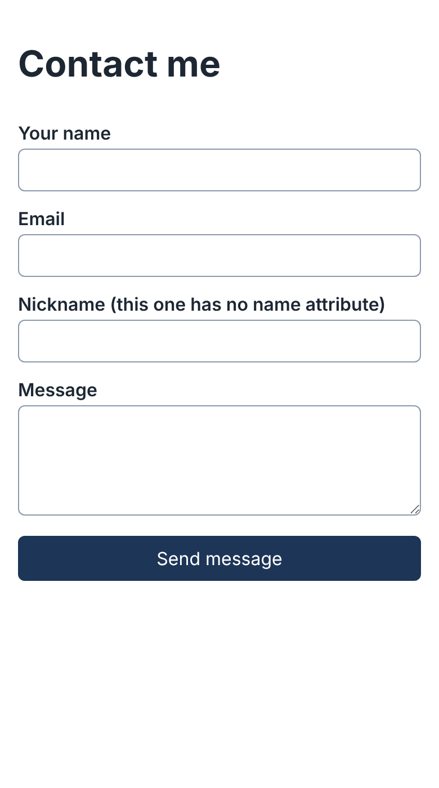
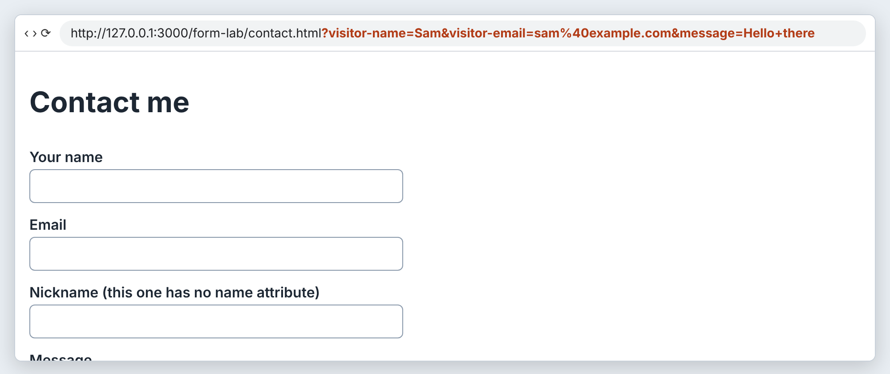
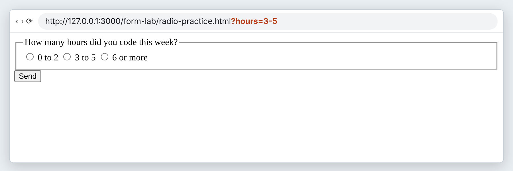
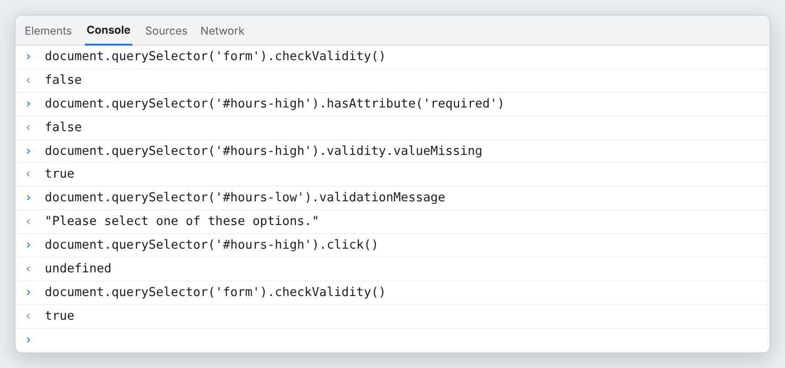
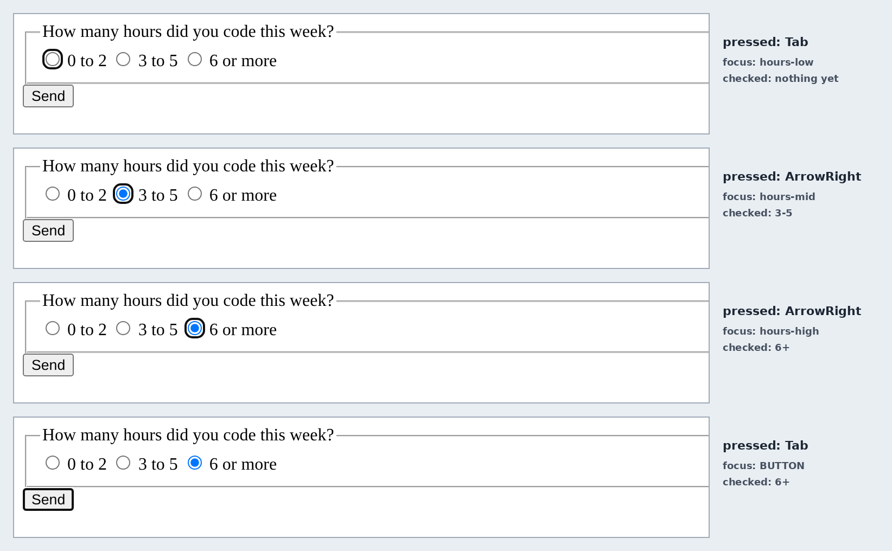
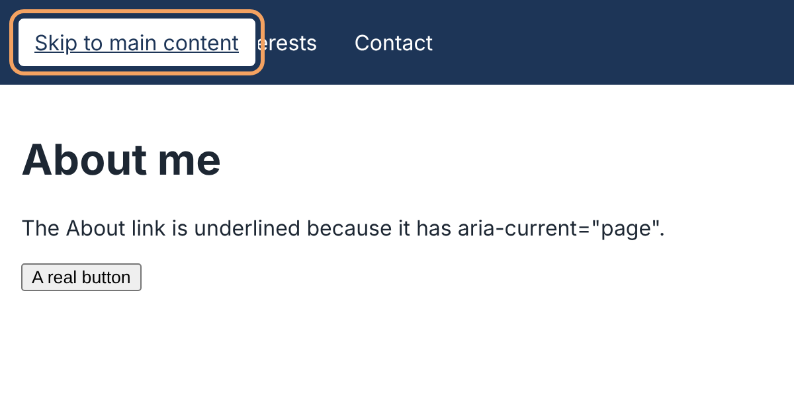
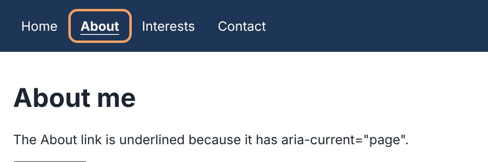
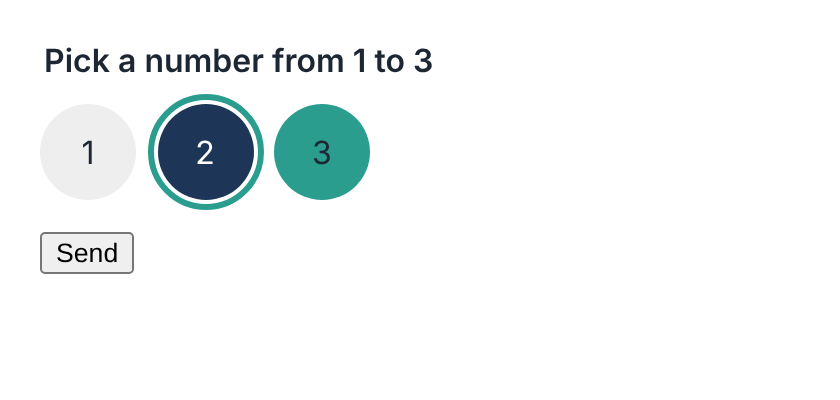
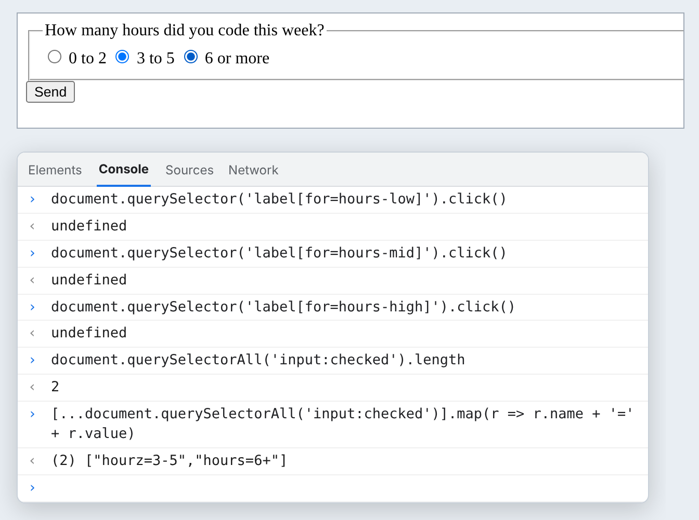
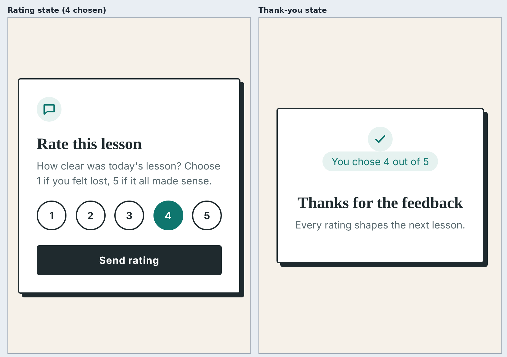

# Module 4 — Forms and Accessibility

*Forms that send the right data and work for every visitor, with or without a mouse.*

**In this module you will learn:**

- The parts of a form: `form`, `label` with `for`, `input` types, `textarea`, `button` and `required`
- The difference between `id` (for the page) and `name` (for the data)
- What a form sends when the browser submits it, and why only named controls send anything
- Radio buttons, where a shared `name` makes the group, and how `required` on one radio covers the whole group
- `fieldset` and `legend`, which give a group a title
- The `hidden` attribute
- Keyboard navigation: Tab between controls, arrow keys inside a radio group
- `:focus-visible`, `aria-current="page"` and the skip-link idea
- CSS custom properties (`:root`, `var()`), the state selectors `:checked`, `:hover` and `:focus-visible`, and a `.visually-hidden` class that hides a control without breaking it
- How to read a design brief and build the HTML before any CSS

## Why this matters

A form is where a visitor talks back to your site. If a label is not joined to its input, a screen reader user does not know what to type. If a control has no `name`, its value never leaves the page. If a custom-styled button cannot be reached with the Tab key, a keyboard user cannot use your form at all. None of those bugs show up when you test with a mouse.

The good news is that HTML already does most of the work. Real form controls come with keyboard behavior, validation and screen reader support built in. Your job is to use the right element, join the pieces correctly, and not break what the browser gives you when you add CSS.

By the end of this module your Contact page sends real data, and you have built the HTML and CSS of a small rating card from a written brief.

## Before you start

1. Module 3 is done: your pages use the viewport tag, `box-sizing: border-box`, and a mobile-first stylesheet.
2. In your course folder (for example `Documents\code559`), next to `my-site`, create a folder called `form-lab`. This is the throwaway folder for the Exercise. Nothing in it is published.
3. Put the mouse aside for a minute. Open any website and press **Tab** a few times. Watch where the focus goes. That is how many people use the web every day.

> **Checkpoint.** You have an empty `form-lab` folder, and you have moved through a page with the Tab key.

## Core concepts

### 1. What are the parts of a form?

*Introduce.* A form is a `<form>` element holding controls the visitor fills in and a button that sends them.

*Explain.* Each control is an `<input>` with a `type` (`text`, `email`, `tel`, `radio`, `checkbox` and more), a `<textarea>` for longer text, or a `<button>`. Every control needs a `<label>`. MDN's `<label>` page explains that the label's `for` value is "the `id` of the labelable form control" it belongs to. Two good things follow. Clicking the label focuses or activates the control, which gives a bigger target on a phone. And, in MDN's words, "a screen reader will read out the label when the user is focused on the form input." `required` tells the browser not to send the form until that control has a value. `type="email"` also makes the browser check that the text looks like an email address.

```html
<label for="visitor-email">Email</label>
<input type="email" id="visitor-email" name="visitor-email" required>
```

*Illustrate.*


*A contact form at 390 px. Every field has a visible label joined to it with `for` and `id`. The third field is missing something on purpose; Concept 2 shows what. (real: rendered in Chromium at 390 px)*

*Apply.* On your own Contact page, click each label's text. If the cursor does not jump into the field, that label's `for` does not match an `id`.

### 2. What does a form send, and why does `name` matter?

*Introduce.* `id` and `name` look alike, but they have different jobs. `id` is for the page: labels, CSS and, later, JavaScript. `name` is for the data.

*Explain.* A form with no `method` uses GET. MDN's `<form>` page lists `get` as the default and says the form data is "appended to the `action` URL with a `?` separator." With no `action`, the data goes back to the same page. Each control is sent as `name=value`, and pairs are joined with `&`. A control with no `name` is not sent at all.

*Illustrate.* The form above was filled in (name, email, a nickname and a message) and submitted for real in Chromium.


*Three pairs arrived. The nickname was typed but is missing, because its input has no `name`. The browser also encoded the text: `@` became `%40` and a space became `+`. (page real: rendered in Chromium; browser frame drawn. The address is the real URL Chromium reported, served from a local test server.)*

*Apply.* Predict: if you remove `name` from the message box too, how many pairs will the address show? (Two.)

### 3. What makes radio buttons a group?

*Introduce.* A radio button lets the visitor pick exactly one choice from a few.

*Explain.* The `name` makes the group. MDN's radio page: "A radio group is defined by giving each of radio buttons in the group the same `name`." Selecting one turns the others off. Each radio still needs its own `id`, so its label can point to it, and its own `value`, because the checked radio sends `name=value`. MDN warns that a radio with no `value` sends the string `on`, which tells you nothing.

`required` is unusual on radios. MDN says that if any radio in a same-named group has `required`, "a radio button in that group must be checked, although it doesn't have to be the one with the attribute applied." So you put `required` on one radio, and it covers the whole group.

```html
<input type="radio" name="hours" value="0-2" id="hours-low" required>
<label for="hours-low">0 to 2</label>
<input type="radio" name="hours" value="3-5" id="hours-mid">
<label for="hours-mid">3 to 5</label>
<input type="radio" name="hours" value="6+" id="hours-high">
<label for="hours-high">6 or more</label>
```

*Illustrate.* First, a real submit with "3 to 5" chosen:


*One group sends one pair: the group's `name` and the checked radio's `value`. (page real: rendered in Chromium; browser frame drawn. The address is the real URL. Opening the file straight from disk gave the same `?hours=3-5` ending.)*

Second, `required` checked in the Console with nothing selected:


*Only the first radio has `required`, yet the third radio also reports `valueMissing: true`. Checking any one radio makes the whole form valid. Pressing Send with nothing chosen left the address unchanged and moved focus to the first radio. (real output, rendered; Chromium 141. The message text may be worded differently in your browser or language.)*

*Apply.* Say out loud what `id`, `name` and `value` each do on one radio. Then check yourself against the paragraph above.

### 4. What do `fieldset` and `legend` add?

*Introduce.* A sighted visitor sees the question above the radios. A screen reader user moving into the group hears a label like "3 to 5," and nothing about what the numbers mean, unless the group has a title.

*Explain.* MDN's `<fieldset>` page says it is "used to group several controls," with "a nested `<legend>` element providing a caption." Wrap the radios in `<fieldset>`, and put the question in `<legend>` as the first thing inside it. It costs two tags.

*Illustrate.* In the keyboard picture in Concept 6, the box around the radios is the fieldset, and "How many hours did you code this week?" sits in its border because it is the legend.

*Apply.* Any group of radios or checkboxes you write from now on starts with `<fieldset>` and `<legend>`.

### 5. What does the `hidden` attribute do?

*Introduce.* Sometimes a page holds a part it is not showing yet, like a thank-you message that appears after a form is sent.

*Explain.* MDN's `hidden` page says "the browser will not render elements that are in the hidden state," and "if something is marked hidden, it is hidden from all presentations, including, for instance, screen readers." It is also out of the Tab order. One warning from the same page: a CSS `display` rule on the element (for example `display: block`) overrides `hidden`, so do not give a hidden element a `display` value in your stylesheet.

*Illustrate.* On the keyboard practice page in Concept 6, a `<section hidden>` holds a button. Chromium measured the section at `offsetHeight` 0 with computed `display: none`. Pressing Tab eight times visited the skip link, four nav links and the visible button, and never reached the hidden button.

*Apply.* Predict: you remove `hidden` from that section. Name two things that change. (It appears, and its button joins the Tab order.)

### 6. How does a keyboard user move through a form?

*Introduce.* Without a mouse, a visitor uses **Tab** to move forward, **Shift+Tab** to move back, **Space** or **Enter** to press, and the **arrow keys** inside some controls.

*Explain.* A radio group is one stop in the Tab order. Tab enters the group, the arrow keys move the choice inside it, and the next Tab leaves the group. You get all of this for free with real `<input type="radio">` elements. You lose it if you build fake radios out of `<div>`s.

*Illustrate.* The radio page from Concept 3, driven by keyboard only in Chromium. After each key press the page was captured and asked which element had focus and which radio was checked.


*Tab put focus on the group without choosing anything. Each arrow key moved the focus **and** the choice. The second Tab left the group and went to Send. (real: rendered in Chromium; captured on Linux. Edge and Chrome on Windows use the same engine; check it yourself in step 4 of the Exercise.)*

*Apply.* Open your Contact page, put the mouse aside, and fill in the whole form with the keyboard. Note anything you could not reach.

### 7. What are `:focus-visible`, `aria-current` and a skip link?

*Introduce.* Three small tools make keyboard use pleasant: a clear focus ring, a marker for the current page, and a shortcut past the menu.

*Explain.* **`:focus-visible`** is a CSS pseudo-class. MDN says it matches a focused element when the browser decides "the focus should be made evident," so you can style the ring for keyboard users without a ring appearing on every mouse click. In Chromium, a link clicked with the mouse did not match `:focus-visible`; the next link reached with Tab did. Never remove the outline without replacing it.

**`aria-current="page"`** goes on the nav link for the page the visitor is on. MDN's *ARIA: aria-current attribute* says it marks "the current item within a container or set of related elements," and `page` means the current page. Screen readers announce it, and you can style it with `a[aria-current="page"]`.

A **skip link** is the first link on the page. It jumps to `<main id="main">`. It sits off screen until it gets focus, so mouse users never see it and keyboard users skip the whole menu with one Enter.

```css
.skip-link { position: absolute; top: -60px; }
.skip-link:focus { top: 12px; }
a:focus-visible { outline: 3px solid #f4a261; outline-offset: 2px; }
nav a[aria-current="page"] { text-decoration: underline; font-weight: 700; }
```

*Illustrate.*


*The first Tab on the page reveals the skip link. Pressing Enter moved focus to `<main>` (Chromium reported the address ending in `#main`), and the next Tab went straight to the button in the main content. (real: rendered in Chromium at 600 px)*


*Three Tabs in: the orange ring is the `:focus-visible` style. About is bold and underlined because it has `aria-current="page"`. (real: rendered in Chromium at 600 px)*

*Apply.* Add `aria-current="page"` to the right link on each page of `my-site`. Each page's own link gets it; no other link does.

### 8. How do custom properties and state selectors style a control you cannot see?

*Introduce.* A plain radio circle is tiny and hard to style. A common pattern is to hide the circle, style the label as a big button, and let the real radio keep doing its job underneath.

*Explain.* Start with **custom properties**. MDN's *Using CSS custom properties (variables)* says it is "common practice" to define them on `:root` so they can be used everywhere, and you read them with `var()`. Names start with two dashes and are case sensitive.

Next, hide the radio with a **`.visually-hidden`** class. It shrinks the element to one clipped pixel, so it is invisible but still in the page: it still takes focus, is still announced by screen readers, and is still sent with the form. That is the difference from `display: none` and `hidden`, which remove the control entirely.

Finally, style the label from the radio's **state**. Put each input right before its label. `+` selects the next sibling, so `input:checked + label` means "the label right after a checked radio."

```css
:root {
  --ring: #2a9d8f;
  --on: #1d3557;
}

.visually-hidden {
  position: absolute;
  width: 1px;
  height: 1px;
  margin: -1px;
  padding: 0;
  overflow: hidden;
  clip: rect(0 0 0 0);
  white-space: nowrap;
  border: 0;
}

.choices label:hover { background: var(--ring); }
.choices input:focus-visible + label { outline: 3px solid var(--ring); }
.choices input:checked + label { background: var(--on); color: white; }
```

*Illustrate.*


*2 is checked (dark) and has keyboard focus (ring); the mouse is over 3 (`:hover`). The radios are invisible, yet Tab landed on the checked one, and Send produced `?pick=2`. When the inputs were set to `display: none` instead, the first Tab skipped the group and went straight to Send. (real: rendered in Chromium at 420 px)*

*Apply.* Predict: you swap the order of one input and its label in the HTML. Which state style stops working for that choice, and why does `+` explain it?

### 9. How do you read a design brief?

*Introduce.* At work you rarely get code. You get a brief: a picture of the finished thing, what the visitor must be able to do, the words, and the colors.

*Explain.* Read the brief twice. Then turn each part of the picture into an element, **before** you write any CSS. A heading is an `<h1>`. A choice of one from five is a `<fieldset>` with a `<legend>` and five radios that share a name. A button that sends is `<button type="submit">`. A message that appears later is a `<section hidden>`. Test that HTML with the keyboard and a real submit. If the page works with no CSS, it will keep working when the CSS is added. If it does not, CSS will only hide the problem.

*Illustrate.*


*Reading a brief means naming the element for each piece of the picture. Colors wait for the CSS step. (illustration, not a screenshot)*

*Apply.* Look at the Contact page you built in Concept 1 and write its "brief" in three lines: what is on it, what the visitor can do, what it sends.

## Exercise

*Apply — your hands, about 45 minutes (estimate).* Work in `form-lab`. Type it, do not paste it. `id`, `for`, `name` and `value` should go through your fingers once.

1. **Write the group.** Create `radio-practice.html` with the normal head (charset, viewport, title). In the body, type the form from Concept 3 inside a `<form>`, wrapped in `<fieldset>` with `<legend>How many hours did you code this week?</legend>`, followed by `<button type="submit">Send</button>`.
2. **Use the labels.** Open the page in your browser. Click the words, not the circles. Each label selects its radio, and choosing one turns the others off.
3. **Send it.** Choose "3 to 5" and press Send. Look at the address bar: it should end in `?hours=3-5`. If it does not, check the `name` and `value` you typed.
4. **Keyboard only.** Reload the page. Click an empty part of the page, then press Tab until the group has focus. Press the arrow keys. Press Tab again. Write one sentence: what do the arrow keys do inside the group, and what does Tab do?
5. **Test `required`.** Reload, so nothing is chosen, and press Send. The browser refuses to send, moves focus to the group and shows a short message, even though only the first radio says `required`. Open the Console (F12) and type `document.querySelector('form').checkValidity()`. It returns `false`. Choose any radio and run it again.
6. **Break it on purpose.** Change the **second** radio's `name` from `hours` to `hourz`. Save, reload, and click all three labels. Two radios stay on at once.

   
   *One typo made a second group. The Console confirms two checked radios, `hourz=3-5` and `hours=6+`. Submitting now would send both. (real: rendered in Chromium; Console values from a real run)*

   Write one sentence: what changed, and why? Then put the name back to `hours`.
7. **Style it without breaking it.** Create `states.html` with the same kind of group (three choices, `name="pick"`). Give each input `class="visually-hidden"` and put each input directly before its label inside `<fieldset class="choices">`. Add a `<style>` with the CSS from Concept 8, plus a size and round shape for `.choices label` (for example `display: inline-block; width: 48px; height: 48px; border-radius: 50%; text-align: center; line-height: 48px;`). Test with the mouse, then with Tab and the arrow keys. The ring follows the keyboard.
8. **Break it again.** Change `.visually-hidden` on one input to a class that sets `display: none`. Tab into the group. Write one sentence: what happened to that choice for the keyboard? Put it back.

## Project (in the full packet)

You build a **rating card** from a written brief: a small card that asks "Rate this lesson," offers five round choices from 1 to 5, and has a Send rating button. It is your own design, with your own colors stored as custom properties, a visually hidden legend, radios you cannot see but can reach with the keyboard, clear `:hover`, `:checked` and `:focus-visible` states, and a thank-you section that waits with `hidden`. You build the HTML first and test it with no CSS, then add the look, phone first. Its JavaScript, which swaps the two states, comes in Module 9.


*The kind of card you will build. The thank-you state was shown here by removing `hidden` in the page by hand, because the card's JavaScript is Module 9. (real: rendered in Chromium at 390 px)*

The full brief, the step-by-step build, and the finishing work in Git are in the Module 4 packet. [Get the packet →](PACKET_LINK_MODULE_4)

## Common misconception

> *"The radio circle is what the visitor clicks, so that is where the styling and the behavior go."*

What would you say? Hint: in step 2 of the Exercise, which element received your clicks? And in step 7, which element did the CSS turn into a round button?

## Summary

A form holds controls, each joined to a `<label>` by `for` and `id`, and `required` stops the form until a control has a value. `id` is for the page and `name` is for the data. A form with no `method` sends `name=value` pairs in the address after a `?`, and a control with no `name` sends nothing. Radios with the same `name` form a group where only one can be on, and `required` on one radio covers the group. `<fieldset>` and `<legend>` give the group a title for people who cannot see it. `hidden` removes an element from sight, from screen readers and from the Tab order. Tab moves between controls and the arrow keys move inside a radio group. `:focus-visible` styles the keyboard focus ring, `aria-current="page"` marks the current nav link, and a skip link jumps past the menu. Custom properties on `:root` hold your colors, state selectors style the label from the radio's state, and `.visually-hidden` hides a control without breaking it. A brief is read twice and built as HTML first.

## Check your understanding

1. Only the first radio has `required`, but submitting with nothing selected is refused. What is `required` really attached to?
2. Your Contact form submits, but the message never appears in the address. Name the two most likely causes.
3. **What would you test** to prove that five labels are correctly joined to their five radios, without reading the HTML?

## Before next module

- [ ] `radio-practice.html` sends `?hours=…` and you wrote your two sentences from steps 4 and 6
- [ ] `states.html` works with the mouse and the keyboard, and you saw what `display: none` broke
- [ ] Every label on your Contact page focuses its field when clicked, and every field that should send data has a `name`
- [ ] Each page of `my-site` has `aria-current="page"` on its own nav link
- [ ] Saved this module's work to GitHub with the routine: git status → git add . → git commit -m "…" → git push → check the live page

## Go further

- MDN: `<form>`; `<label>`; `<input type="radio">`; `<fieldset>`; the `hidden` global attribute; `:focus-visible`; *ARIA: aria-current attribute*; *Using CSS custom properties (variables)*; *Sending form data*
- freeCodeCamp: the HTML forms and accessibility lessons in the current curriculum (search "accessibility")
- [W3Schools HTML Forms](AFFILIATE_W3SCHOOLS_FORMS)
- [W3Schools Accessibility Tutorial](AFFILIATE_W3SCHOOLS_ACCESSIBILITY)

*Affiliate link: Code559 may earn a commission at no extra cost to you.*

## What to keep

Keep `form-lab` with both files fixed, and your sentences from steps 4, 6 and 8. Then answer for yourself: **which step would be hardest to repeat without this post, and why?**

---

*Code559 is a 559 Solutions project. Portions adapted from Visual Studio Code documentation (CC BY 3.0 US), GitHub Docs (CC BY 4.0), and GitHub Skills (MIT). Screenshots used with permission from Microsoft.*

*Sources checked 2026-10-09: MDN "`<form>`: The Form element"; MDN "`<label>`: The Label element"; MDN "`<input type="radio">`"; MDN "`<fieldset>`: The Field Set element"; MDN "hidden" (global attribute); MDN ":focus-visible"; MDN "ARIA: aria-current attribute"; MDN "Using CSS custom properties (variables)"; MDN "Sending form data". Submissions, validity checks and keyboard behavior tested in Chromium 141 (headless, via Playwright) on Linux.*
