# Module 5 — JavaScript Primer

*Run your first script, read your first error, and build the habit you will use for every line of code.*

**Time:** about 75 minutes (estimate)

**In this module you will learn:**

- What a program is: instructions that run in order, top to bottom
- The two places JavaScript runs in this course: the browser and Node
- Where JavaScript fits next to HTML and CSS (structure, appearance, behavior)
- What a statement is, what the semicolon does, and how to write a comment
- How `console.log()` lets you see a value
- How to run a `.js` file with `node file.js` in the terminal
- How to open the browser's DevTools Console and type an expression
- How to read an error message: its name, its message, and its file and line
- The habit for every piece of code: Predict → Run → Modify → Create → Debug

## Why this matters

Up to now your pages have stood still. HTML put things on the page and CSS made them look right. JavaScript is the part that makes a page *do* something. Before it can do anything on your site, you need to be comfortable with the language on its own, with no page in the way.

That is what Modules 5 to 8 are for. You will write JavaScript and see the results as plain text, in the terminal and in the browser's Console. Nothing on your site changes yet. You will connect JavaScript to your pages in Module 9.

This module is short on new syntax and long on habits. You will run a script, change it, break it on purpose, and read what the computer tells you. Every later module depends on that loop.

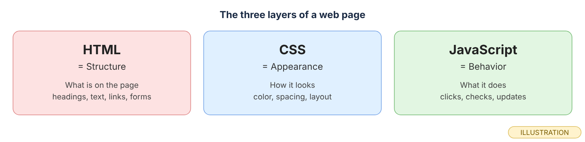
*HTML is what is on the page, CSS is how it looks, JavaScript is what it does. MDN's "What is JavaScript?" page calls these "the three layers of standard web technologies."*

## Before you start

1. Finish Module 0. Node must be installed: in a terminal, `node --version` should print a version starting with `v`.
2. In your course folder (for example `Documents\code559`), create a new folder called `practice-05`. This is a scratch folder for practice files. It sits next to `my-site`, not inside it.
3. Open `practice-05` in VS Code with **File → Open Folder…**, then open a terminal with **Terminal → New Terminal**.

> **Checkpoint.** Your terminal prompt ends in `practice-05>` and `node --version` prints a version.

## Core concepts

### 1. What is a program?

 A program is a list of instructions for the computer. In JavaScript, each instruction is usually one line.

 The computer runs the instructions **in order, from top to bottom**, one at a time. It does not skip ahead or guess what you meant. If line 2 has a mistake, the computer stops at line 2. Later modules add ways to repeat lines or choose between them, but the starting rule is always the same: top to bottom.

 In the next concept you will run a three-line script. The three lines of output come out in the same order as the three lines of code.

 Write three things you did this morning as three numbered steps. Swap two of them. Did the meaning change? Order matters to a program in the same way.

### 2. Where does JavaScript run?

 JavaScript was made for web browsers. Every browser, including Edge and Chrome, can run it. **Node** is a program that runs JavaScript outside a browser, in the terminal.

 The language is the same in both places. The browser runs JavaScript as part of a web page; you will use its **Console** to try one line at a time. Node runs a whole `.js` file from the terminal, with no web page at all. In this module you use both: Node for files, the Console for quick experiments.

<div role="separator" style="display:flex;align-items:flex-end;margin:1.5em 0;"></div>

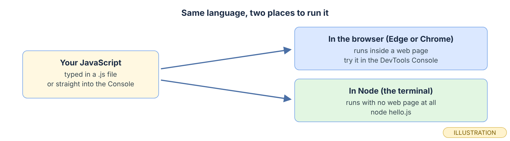
 *Same language, two places to run it. Modules 5 to 8 use both; Module 9 brings JavaScript into your pages.*

 Say which place you would use to (a) try `2 + 3` quickly, (b) run a saved file called `hello.js`. (Answers: the Console; Node.)

### 3. What are statements, semicolons and comments?

 A **statement** is one complete instruction, like a sentence. A **comment** is a note for humans that the computer skips.

 In this course every statement ends with a semicolon `;`, the way a sentence ends with a period. JavaScript can often add a missing semicolon for you (MDN's *Lexical grammar* page calls this "automatic semicolon insertion"), but writing them yourself keeps your code clear. A comment starts with `//`; MDN puts it this way: it "makes all text following it on the same line into a comment." Use comments to explain *why* a line is there.

 Here is the first script. Line 1 is a comment. Lines 2 to 4 are statements.

```js
// hello.js: my first script
console.log("Hello, world!");
console.log("This line runs second.");
console.log(2 + 3); // a number, not text
```

 Point at each semicolon and say "end of instruction." Then find the comment at the end of line 4.

### 4. How do you see a value?

 `console.log()` prints whatever you put between the parentheses.

 Text goes inside quotes: `"Hello, world!"`. A sum like `2 + 3` has no quotes, so JavaScript works it out first and prints the result, `5`. In Node, `console.log()` prints to the terminal. In the browser, it prints to the Console. It is the main way you will check your work in Modules 5 to 8: when you are unsure what a value is, log it.

 You will see the output in the next concept.

 Predict what `console.log(10 - 4);` prints. Then predict what `console.log("10 - 4");` prints. (One works out the sum; the other prints its characters exactly as typed. You will check both in the Exercise.)

### 5. How do you run a file with Node?

 In the terminal, `node` followed by a file name runs that file.

 Type `node hello.js` and press Enter. Node reads the file from top to bottom and runs each statement. Anything you `console.log()` appears in the terminal, and then the prompt comes back. The terminal must be in the folder that holds the file. If it is not, Node prints `Error: Cannot find module` and the path it tried.

<div role="separator" style="display:flex;align-items:flex-end;margin:1.5em 0;"></div>

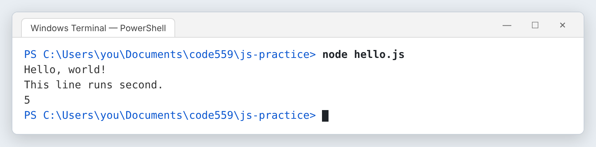
 *Three statements, three lines of output, in the same order. The comment printed nothing. On Windows the output is the same. (real output, rendered; captured on Linux, with the folder path changed to the course folder)*

 Look at the third output line. Why does it show `5` and not `2 + 3`?

### 6. How do you open the Console and try an expression?

 Every Edge and Chrome window has built-in developer tools, called **DevTools**. The **Console** is one of its panels.

 Open `index.html` from your `my-site` folder (or any other page) in Edge or Chrome (double-click it in File Explorer, or drag it onto a browser window). Press **F12** (or **Ctrl+Shift+J**) to open DevTools, then click the **Console** tab. (Both shortcuts are listed in Chrome's *Open Chrome DevTools* page and Microsoft's *Keyboard shortcuts* page for Edge DevTools.) Click next to the `>` sign at the bottom, type an expression, and press Enter. The Console shows the result on the next line.

<div role="separator" style="display:flex;align-items:flex-end;margin:1.5em 0;"></div>

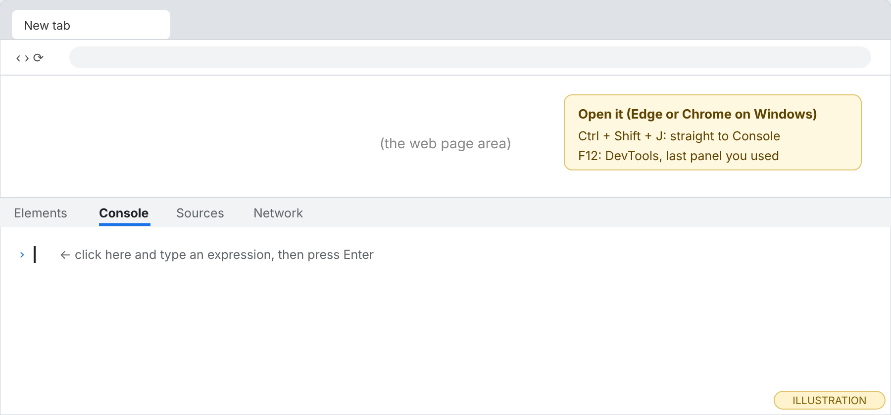
 *DevTools usually opens docked to the side or bottom of the window. Type next to the `>` sign.*

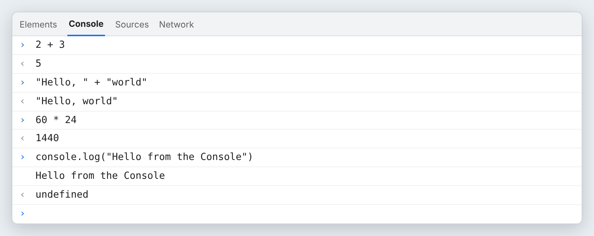
*Each expression gets an answer line. `console.log()` prints its text, then shows `undefined`: that is the Console reporting that `console.log()` itself hands back no value. It is not an error. Your Console may show text in single quotes instead of double; both mean text. (real output, rendered; evaluated in Chromium)*

**Predict first.** Write your prediction down before you type. In Edge and Chrome, the Console shows a gray preview of the result under the line you are typing, before you press Enter. This feature is called **Eager evaluation**, and it is on by default. If you want to predict first, turn it off: click the **Console settings** gear in the top-right corner of the Console and clear the **Eager evaluation** checkbox. (Chrome's and Microsoft's *Console features reference* pages both describe this setting.) One more thing: if you paste code into the Console, Edge or Chrome may block it and ask you to type `allow pasting` first. This warning protects people from pasting harmful code they do not understand. Typing the code yourself avoids it.

 Open the Console now and type `60 * 24`. The `*` sign means multiply, so that is the number of minutes in a day.

### 7. How do you read an error message?

 When JavaScript cannot run a line, it stops and prints an **error**. An error is not a punishment. It is a report.

 MDN's *JavaScript error reference* says each error "has a `name` and a `message`." A Node error has five parts. Read them in the same order every time, from the top:

1. **Where:** the file name and line number at the top.
2. **The line:** the code Node was running.
3. **The caret:** the `^` under the problem spot.
4. **Name and message:** the name is the word before the colon, such as `ReferenceError` (a name JavaScript does not recognize) or `SyntaxError` (the code is not valid JavaScript, so nothing in the file ran). The message is the words after the colon.
5. **The stack:** the lines starting with `at`. The first one repeats your file as `file:line:column`, and the rest point inside Node itself, so you can usually skip them. In a `SyntaxError`, every `at` line points inside Node, because your file never started running.

<div role="separator" style="display:flex;align-items:flex-end;margin:1.5em 0;"></div>

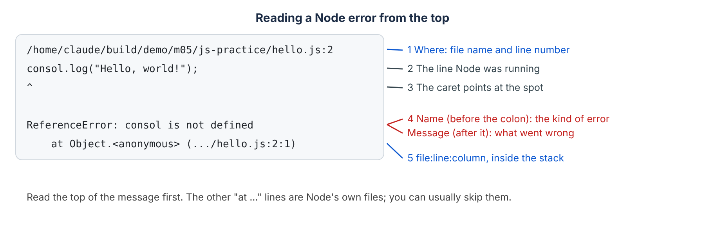
 *Read from the top down. This is the real error from the Exercise's break-it step, with the folder path changed to the course folder and shortened to `...\` on the stack line.*

In the Console, the same mistake shows a shorter error. It starts with `Uncaught`, which only means no code caught the error before it reached you.

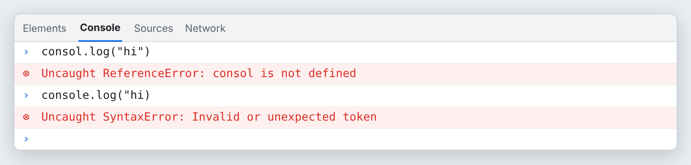
*Same names, same messages as in Node. The real Console also adds a small location link next to each error, and under the ReferenceError one stack line, `at <anonymous>:1:1` (line 1, column 1 of what you typed); this render shows only the name and message. (real output, rendered; evaluated in Chromium)*

 In the Console, type `consol.log("hi")` with the missing `e`. Say the error's name and message out loud.

### 8. What is the habit?

 Every piece of code in this course goes through five steps: **Predict, Run, Modify, Create, Debug.**

 **Predict:** before you press Enter, say what will happen. **Run:** run it and compare with your prediction. **Modify:** change one thing and predict again. **Create:** write a line of your own that does something similar. **Debug:** break it on purpose and read the message. The prediction is the important part. When your prediction is wrong, you have found exactly the thing you did not understand yet.

<div role="separator" style="display:flex;align-items:flex-end;margin:1.5em 0;"></div>

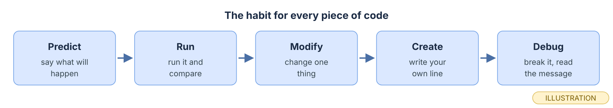
 *The habit for every piece of code from here on.*

 You will use all five steps in the Exercise, in order.

## Exercise

*Your hands, about 30 minutes (estimate).* Type it, do not paste it. Work in `practice-05`, your scratch folder.

1. **Create the file.** In VS Code, create `hello.js` in `practice-05`. Type the four lines from Core Concept 3 exactly. Save with Ctrl+S.
2. **Predict.** Before you run it, write down the three lines you expect to see, in order.
3. **Run.** In the terminal, type `node hello.js` and press Enter. Compare with your prediction.
4. **Modify.** Add a fifth line at the bottom: `console.log("I added this line.");` Save. Predict, then run again.

   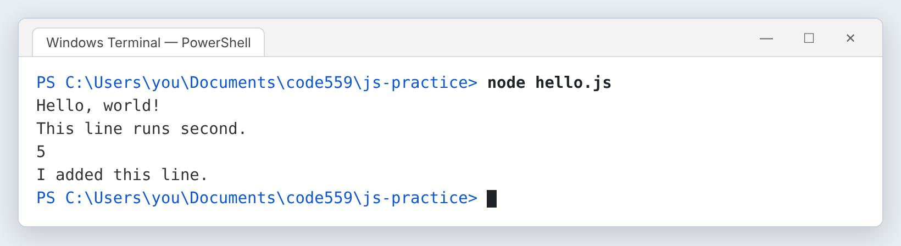
   *The new line appears last, because it is the last statement in the file. (real output, rendered; captured on Linux, with the folder path changed to the course folder)*

5. **Create.** Add a line of your own that logs a multiplication with `*`, for example the number of hours in a week. Predict the number first. Then add `console.log(10 - 4);` and `console.log("10 - 4");` and check your prediction from Core Concept 4.
6. **Break it on purpose: a misspelled name.** On line 2, delete the `e` so it reads `consol.log("Hello, world!");`. Save and run.

   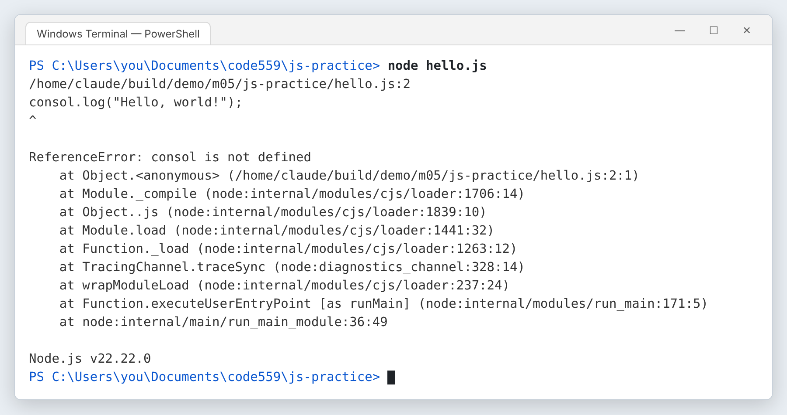
   *Node stopped at line 2, so nothing printed, not even the lines after it. Name: `ReferenceError`. Message: `consol is not defined`. The first line and the first `at` line show the path to your own `hello.js`. On Windows the paths start with your drive, for example `C:\Users\…`. The `node:internal` lines and the last line, `Node.js v22.22.0`, depend on the Node version, so yours may show different lines and numbers. With Node 24.21.0, everything down to the first `at` line was the same. (real output, rendered; captured on Linux, with the folder path changed to the course folder)*

   Find the five parts from Core Concept 7. Fix the spelling, save, and run again to prove it works.
7. **Break it again: a missing quote.** On line 3, delete the closing quote so it reads `console.log("This line runs second.);`. Save and run.

   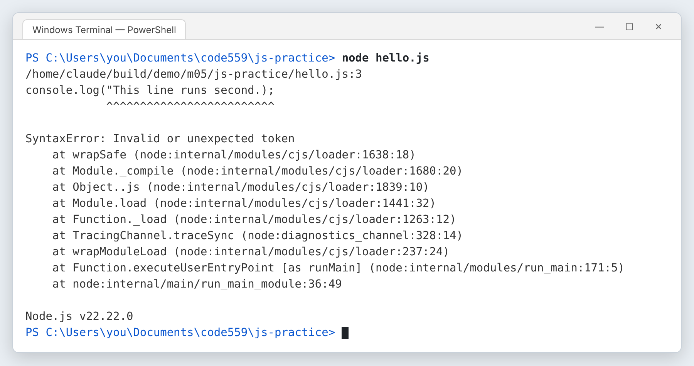
   *A `SyntaxError` is different: Node could not read the file at all, so not even line 2 printed. The carets underline everything from the open quote to the end of the line, because Node is still looking for the closing quote. (real output, rendered; captured on Linux, with the folder path changed to the course folder)*

   Fix it, save, and run once more.
8. **Try the Console.** Open any page in Edge or Chrome, press **F12** (or **Ctrl+Shift+J**), click the **Console** tab, and type `2 + 3`, then `"Hello, " + "world"`, then `consol.log("hi")`. Compare with the Console images in Core Concepts 6 and 7.

## Project (in the full packet)

The Project is a short **"about me in the Console"** script. When you run it with Node, it prints a tidy introduction in a few labeled lines: who you are, what you are learning, and one thing you want to build, with a blank line and a divider between sections so it reads like a small card in the terminal. You will plan it with comments first, predict its output before each run, and keep it as the first JavaScript file in your site's repository. The full brief, the step-by-step build, and the finishing work in Git are in the Module 5 packet. [Get the packet →](PACKET_LINK_MODULE_5)

## Common misconception

> *"An error message means I did something badly wrong. I should delete the line and start over."*

What would you say? Hint: count how many useful facts the ReferenceError in step 6 gave you, for free, before you had to look anything up.

## Summary

A program is a list of instructions that run in order, top to bottom. JavaScript runs in the browser and, through Node, in the terminal. HTML is structure, CSS is appearance and JavaScript is behavior. A statement is one instruction ending in a semicolon, and `//` starts a comment the computer skips. `console.log()` prints a value so you can see it. `node file.js` runs a file from the terminal in the file's folder. Ctrl+Shift+J opens the DevTools Console, where you type an expression and press Enter. A Node error has five parts, read from the top: where (file and line), the code line, the caret, the name and message (what kind of error and what went wrong), and the `file:line:column` in the stack. Predict → Run → Modify → Create → Debug is the habit for every piece of code.

## Check your understanding

1. In step 6, why did nothing print at all, even though the lines after line 2 were fine?
2. What is the difference between `console.log(10 - 4);` and `console.log("10 - 4");`?
3. **Why does it work?** You typed `console.log("Hello from the Console")` in the Console and saw the text and then `undefined`. Why does the `undefined` appear, and why is it not an error?

## Before next module

- [ ] `hello.js` runs with `node hello.js` and prints the lines you predicted
- [ ] You can open the Console with Ctrl+Shift+J and evaluate an expression
- [ ] You broke `hello.js` twice and can name the error each time (ReferenceError, SyntaxError)
- [ ] You can point to the five parts of a Node error
- [ ] If you did this module's packet project in my-site, saved it with the routine: git status → git add . → git commit -m "…" → git push → check the live page. (Your practice folder is not saved to GitHub.)

## Go further

- MDN: *What is JavaScript?* (Learn web development)
- MDN: *JavaScript error reference*, and its pages for *ReferenceError* and *SyntaxError*
- MDN: *Lexical grammar* (the sections on comments and automatic semicolon insertion)
- Chrome for Developers: *Open Chrome DevTools*
- Microsoft Edge Developer documentation: *Keyboard shortcuts*
- Chrome for Developers and Microsoft Edge Developer documentation: *Console features reference* (the Eager evaluation setting)
- freeCodeCamp: the free [JavaScript Certification](https://www.freecodecamp.org/learn/javascript-v9/) (checked 2026-10-11) has practice on this topic.

## What to keep

Keep `hello.js` in `practice-05`, and write down the names of the two errors you caused and what fixed each one. Then answer for yourself: **which step would be hardest to repeat without this post, and why?**

---

*Code559 is a 559 Solutions project. Portions adapted from Visual Studio Code documentation (CC BY 3.0 US), GitHub Docs (CC BY 4.0), and GitHub Skills (MIT). Screenshots used with permission from Microsoft.*

*Sources checked 2026-10-09: MDN "What is JavaScript?"; MDN "JavaScript error reference"; MDN "Lexical grammar"; Chrome for Developers "Open Chrome DevTools"; Microsoft Edge Developer documentation "Keyboard shortcuts". Checked 2026-10-11: Chrome for Developers "Console features reference" and "How Chrome DevTools helps to defend against self-XSS attacks"; Microsoft Edge Developer documentation "Console features reference" and "Run JavaScript in the Console".*
