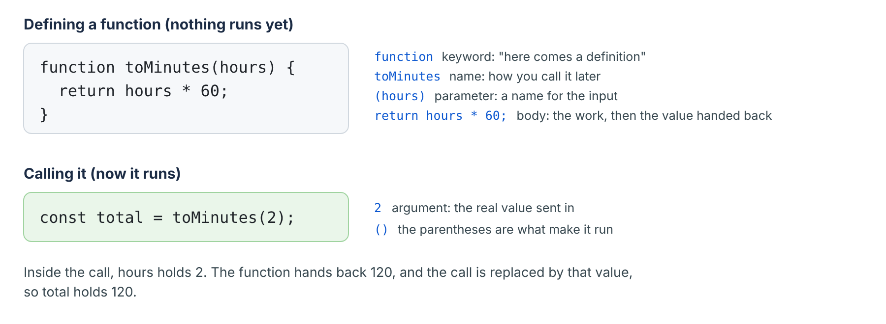
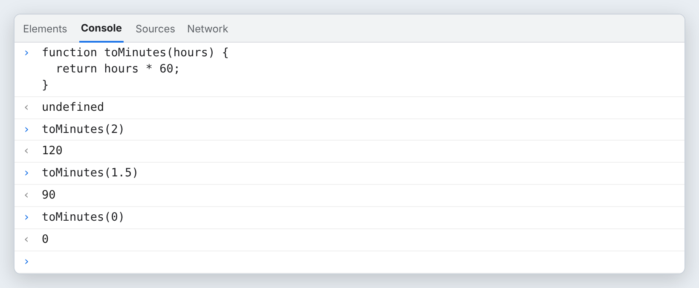
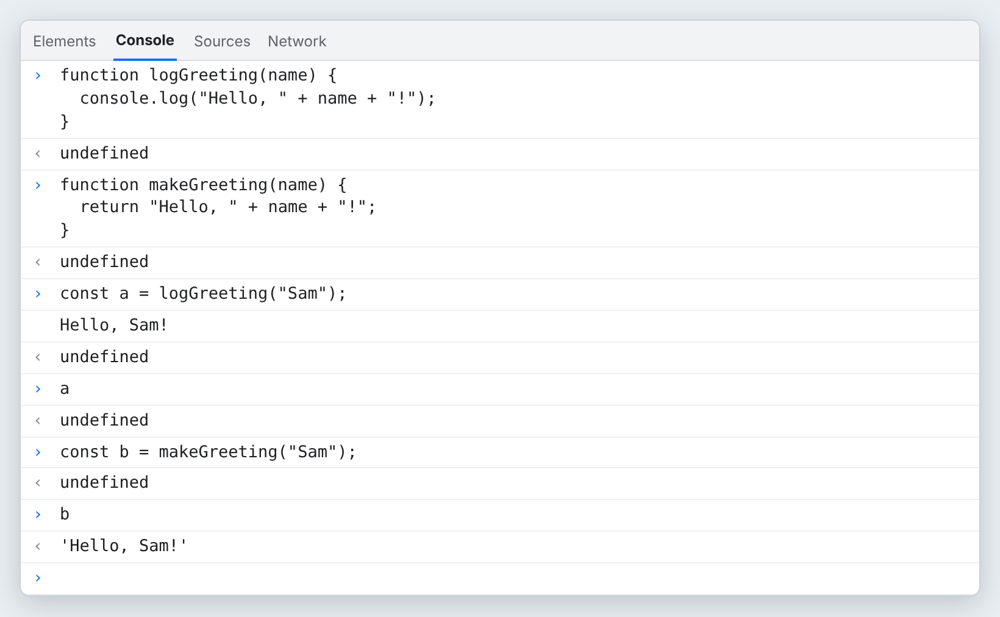
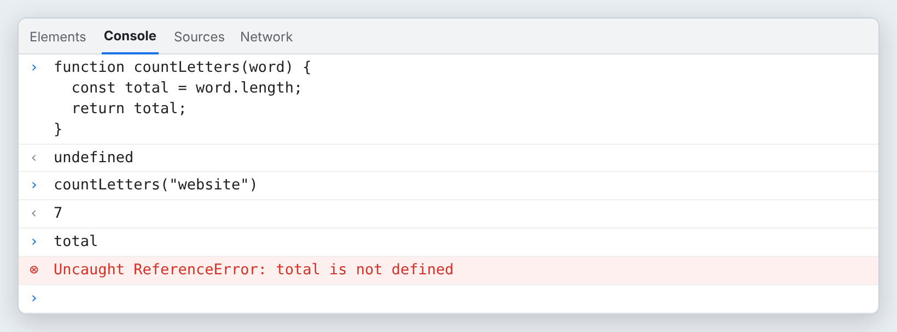
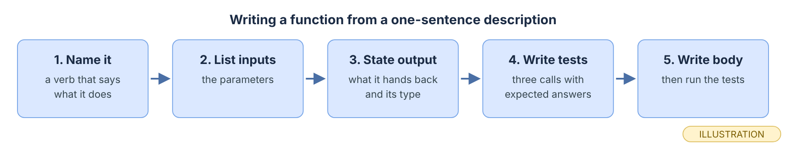
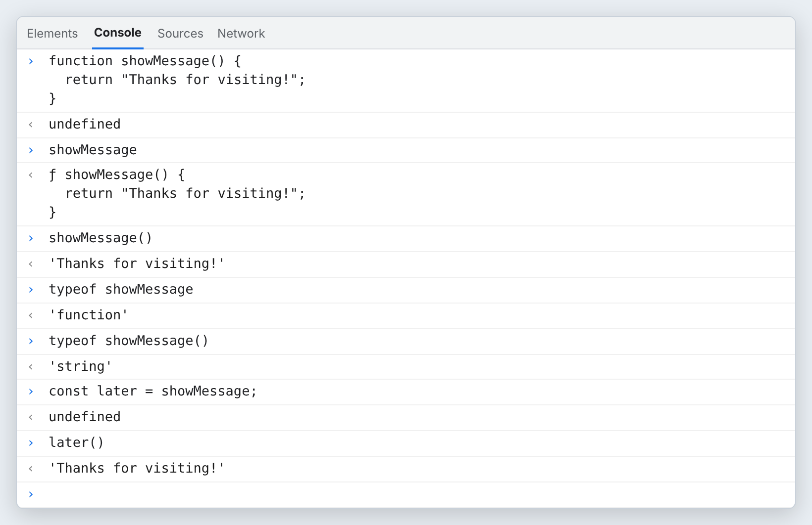
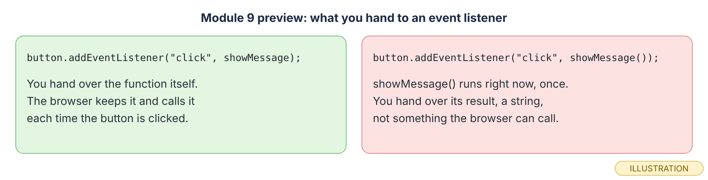
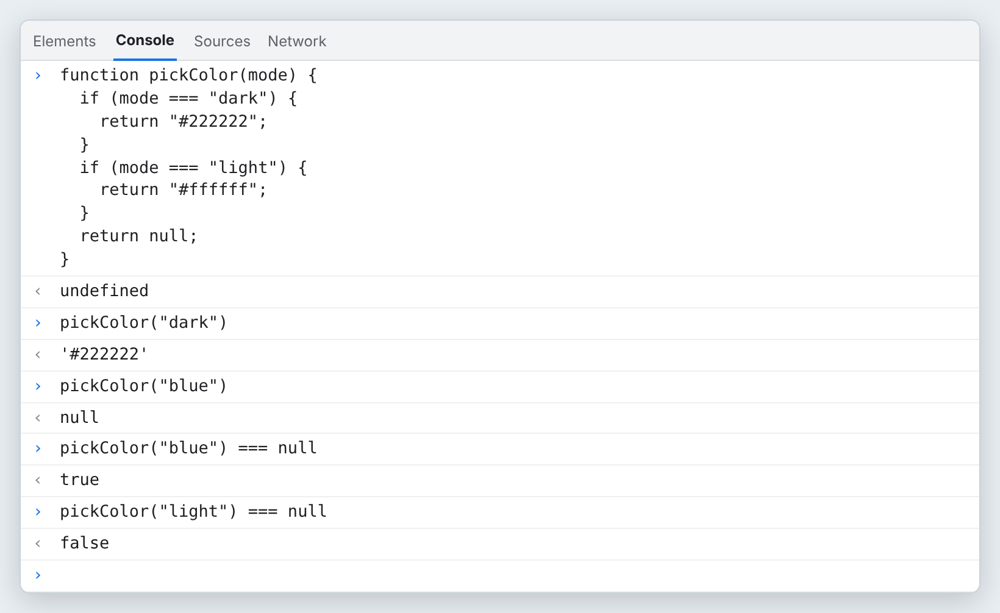
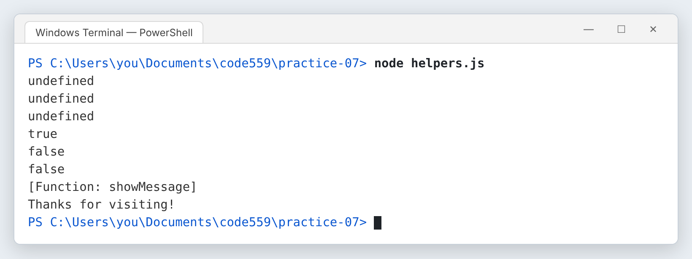

# Module 7 — Functions

*Name a set of instructions once, hand it inputs, and get a value back you can test.*

**In this module you will learn:**

- What a function is: a named, reusable set of instructions
- The difference between defining a function and calling it
- The difference between a parameter and an argument
- What `return` does, and why `console.log()` is not the same thing
- Basic local scope: why a variable made inside a function cannot be seen outside it
- How to test a function by itself, with several inputs, in the Console and in Node
- A five-step method for writing a function from a one-sentence description
- The difference between a function reference (`showMessage`) and a function call (`showMessage()`), and why event listeners in Module 9 need the first one
- How to return `null` when there is no answer, and check for it with `=== null`

## Why this matters

So far your JavaScript runs top to bottom, once. Every time you want the same work done again, you would have to type it again. A function fixes that. You write the steps once, give them a name, and run them whenever you want, with different inputs each time.

There is a second reason, and it matters more. A function that **hands a value back** can be tested by itself. You can call it with three made-up inputs and check three answers before any web page exists. That is how working developers check their code, and it is the shape of almost every practice question and interview task you will meet: "write a function that takes this and returns that."

This module stays in the Console and in Node. There is no web page yet. In Module 9 you connect functions to buttons, and the last concept here, reference versus call, is the bridge that makes that work.

## Before you start

1. Finish Module 6. You should be able to use `const` and `let`, compare values with `===` and `<`, and write an `if` statement.
2. In your course folder (for example `Documents\code559`), create a throwaway folder called `practice-07`. Nothing in it is published. Open it in VS Code with **File → Open Folder…**.
3. Open a terminal in VS Code with **Terminal → New Terminal**. Type `node --version`. Any `v` followed by numbers means Node is ready.
4. Open Edge or Chrome. Press **F12** (or **Ctrl+Shift+J**) to open DevTools, then click the **Console** tab. Anything you type there runs at once and nothing is saved. Keep it open as your scratch pad.

> **Checkpoint.** You have an empty `practice-07` folder open in VS Code, a terminal whose prompt ends in `practice-07>`, and a browser Console you can type into.

## Core concepts

### 1. What is a function?

 A function is a named, reusable set of instructions. You write the instructions once. After that, the name runs them.

 A function definition has four parts. The keyword `function` says a definition is coming. The **name** is how you run it later. The **parameters** in parentheses are names for the inputs. The **body** in curly braces is the work. The line that starts with `return` hands a value back.

<div role="separator" style="display:flex;align-items:flex-end;margin:1.5em 0;"></div>


 *Top: the definition. Bottom: a call. The parentheses after the name are what make it run.*

 Point at each part of `function toMinutes(hours) { return hours * 60; }` and say its name out loud: keyword, name, parameter, body.

### 2. What is the difference between defining and calling?

 Writing a function down and running it are two separate steps. MDN's *Functions* guide puts it this way: "Defining a function does not execute it."

 When you define `toMinutes`, JavaScript stores the instructions under that name and does nothing else. When you **call** it, by writing the name followed by parentheses, `toMinutes(2)`, the body runs. You can call one definition as many times as you like.

<div role="separator" style="display:flex;align-items:flex-end;margin:1.5em 0;"></div>

Typed into the Console for the picture below, in this order:

```js
function toMinutes(hours) {
  return hours * 60;
}
toMinutes(2)
toMinutes(1.5)
toMinutes(0)
```


 *The Console prints `undefined` after the definition. That is its comment on the line you typed, not an answer from your function. The three calls each hand back a number. (real output, rendered)*

 Type the definition into your browser Console, then call it with `toMinutes(3)`. Predict the answer before you press Enter.

### 3. What is a parameter, and what is an argument?

 They are two words for the two ends of the same input.

 A **parameter** is the name written in the definition: `hours`. An **argument** is the real value you give when you call: the `2` in `toMinutes(2)`. When the call runs, the parameter works like a variable that was just set to the argument. Call it again with `1.5`, and this time `hours` holds `1.5`.

 In the picture under Concept 1, `hours` is the parameter and `2` is the argument. Inside that one call, `hours * 60` becomes `2 * 60`.

 Predict what `toMinutes()` gives with **no** argument. Then try it. (You will see `NaN`, "not a number," because `hours` holds `undefined` and `undefined * 60` is not a number.)

### 4. What does `return` do, and why is `console.log()` not the same?

 `return` hands a value back to the line that called the function, and it ends the function right there. `console.log()` only **shows** a value on the screen.

 A shown value is gone as soon as you read it. A returned value can be stored in a variable, compared, joined to text, or passed to another function. If a function has no `return`, it still hands something back: `undefined`. This is the most common mistake at this stage. The function "works" because you see the right text, but the line that called it receives nothing.

<div role="separator" style="display:flex;align-items:flex-end;margin:1.5em 0;"></div>

Typed into the Console for the picture below, in this order:

```js
function logGreeting(name) {
  console.log("Hello, " + name + "!");
}
function makeGreeting(name) {
  return "Hello, " + name + "!";
}
const a = logGreeting("Sam");
a
const b = makeGreeting("Sam");
b
```


 *`logGreeting` shows the text and hands back `undefined`, so `a` holds `undefined`. `makeGreeting` shows nothing and hands back the text, so `b` holds `'Hello, Sam!'`. (real output, rendered)*

 In your Console, type `makeGreeting("Sam") + " Welcome back."` and predict the answer. Then try the same with `logGreeting`. Why does the second one end in `undefined Welcome back.`?

### 5. What is local scope?

 A variable created inside a function belongs to that function. Code outside cannot see it.

 MDN's *Functions* guide says "variables defined inside a function cannot be accessed from anywhere outside the function." That is a feature. It means two functions can each have a variable called `total` without stepping on each other. If you need a value from inside, `return` it, and store it where you called.

<div role="separator" style="display:flex;align-items:flex-end;margin:1.5em 0;"></div>

Typed into the Console for the picture below, in this order (`word.length` gives the number of characters in `word`; Module 8 covers `.length` in full):

```js
function countLetters(word) {
  const total = word.length;
  return total;
}
countLetters("website")
total
```


 *The function used `total` and handed back `7`. Outside, `total` does not exist, so JavaScript stops with a `ReferenceError`. (real output, rendered)*

 Fix it the right way: type `const letters = countLetters("website");` and then `letters`. You get the value without reaching inside.

### 6. How do you test a function by itself?

 You call it with several inputs, one after another, and compare each answer with what you expected.

 Pick at least three inputs: a normal one, a different normal one, and an edge. An **edge** is the value right at a boundary, like `0`, an empty string, or exactly the limit in an `if`. Edges are where mistakes hide. In the Console, you type each call. In a file, you put each call inside `console.log()` and run the file with Node, so the tests can be run again any time.

<div role="separator" style="display:flex;align-items:flex-end;margin:1.5em 0;"></div>

![A terminal running node helpers.js and printing 120, 90, 0, true, false, false, [Function: showMessage] and Thanks for visiting!](images/m07-node-tests.png)
 *One run, eight answers. The `false` for `isNarrow(600)` is the edge test: 600 is not less than 600. (real output, rendered; captured on Linux, with the folder path changed to the course folder)*

 For `toMinutes`, write down three inputs and the answer you expect for each before you run anything. That list is your test.

### 7. How do you write a function from a one-sentence description?

 This is the step most learners find hardest, because the description does not tell you where to start. Use the same five steps every time.

 Take this description: *"Write a function that takes a width in pixels and returns true when it is narrower than 600."*
**1. Name it** with a verb or a question: `isNarrow`.
**2. List the inputs**: one, a width, so one parameter, `width`.
**3. State the output and its type**: `true` or `false`, a Boolean.
**4. Write the test calls first**, with the answers you expect: `isNarrow(390)` → `true`, `isNarrow(800)` → `false`, `isNarrow(600)` → `false` (the edge).
**5. Write the body** last, then run the tests.

```js
function isNarrow(width) {
  return width < 600;
}
```

<div role="separator" style="display:flex;align-items:flex-end;margin:1.5em 0;"></div>


 *Steps 1 to 4 need no code at all. By the time you write the body, you already know what "working" means.*

 Use the five steps on this description, on paper first: *"Write a function that takes a first name and returns a greeting that says Welcome, then the name, then a full stop."*

### 8. What is the difference between `showMessage` and `showMessage()`?

 The name alone is a **reference** to the function. The name with parentheses is a **call**. They give you two completely different things.

 `showMessage` evaluates to the function itself, the stored instructions. Nothing runs. `showMessage()` runs the function and evaluates to whatever it returns, here a string. You can even store the function itself in another variable and call it later through the new name.

<div role="separator" style="display:flex;align-items:flex-end;margin:1.5em 0;"></div>

Typed into the Console for the picture below, in this order:

```js
function showMessage() {
  return "Thanks for visiting!";
}
showMessage
showMessage()
typeof showMessage
typeof showMessage()
const later = showMessage;
later()
```


 *Without parentheses you get the function. With them you get its answer. `typeof` proves it: `'function'` versus `'string'`. In Node, `console.log(showMessage)` prints `[Function: showMessage]` instead (see the Concept 6 image). (real output, rendered)*

This is the bridge to Module 9. There you will tell a button: "when you are clicked, run this function." The button needs **the function itself**, so it can call it later, every time someone clicks. It does not need the result of running it once, right now.


*A preview of Module 9. You do not need to type this yet. When we tried the right-hand version in Chromium, it refused with "TypeError: Failed to execute 'addEventListener' on 'EventTarget': parameter 2 is not of type 'Object'."*

 Before you press Enter on each, predict what `later` and `later()` will show.

### 9. How does a function say "there is no answer"?

 Sometimes a function is asked a question it cannot answer. It should say so clearly, with a value that means "nothing here." That value is `null`.

 Both `null` and `undefined` mean "no value," but they have different jobs. `undefined` is what you get by accident, such as a forgotten `return`. `null` is a value you hand back **on purpose**. The calling code then checks with `=== null` before it uses the answer. Do not use `0` or `""` for "no answer": those can be real answers.

<div role="separator" style="display:flex;align-items:flex-end;margin:1.5em 0;"></div>

Typed into the Console for the picture below, in this order:

```js
function pickColor(mode) {
  if (mode === "dark") {
    return "#222222";
  }
  if (mode === "light") {
    return "#ffffff";
  }
  return null;
}
pickColor("dark")
pickColor("blue")
pickColor("blue") === null
pickColor("light") === null
```


 *`"blue"` is not a mode this function knows, so it reaches the last line and returns `null`. The `=== null` check turns that into a plain `true` or `false` you can use in an `if`. (real output, rendered)*

 Write the `if` you would put in front of using the color: `if (color === null) { … }`. What should happen inside it?

## Exercise

*Your hands, about 45 minutes (estimate).* Type it, do not paste it. Work in `practice-07`. Nothing here is published.

1. **Create the file.** In VS Code, create `helpers.js` inside `practice-07`.
2. **Define and test `toMinutes`.** Type the function from Concept 1. Below it, type three test lines: `console.log(toMinutes(2));`, `console.log(toMinutes(1.5));` and `console.log(toMinutes(0));`. Write your three predictions in a comment above them, like `// expect 120, 90, 0`.
3. **Run it.** Save, then in the terminal type `node helpers.js`. Compare each line with your comment.
4. **Write `isNarrow` from its description.** Use the five steps from Concept 7. Write the three `console.log` test lines **before** the body. Run the file again.
5. **Reference versus call.** Add `showMessage` from Concept 8, then two lines: `console.log(showMessage);` and `console.log(showMessage());`. Predict both lines, then run. Your output should now match the picture under Concept 6.
6. **Break it on purpose.** In `toMinutes`, delete the word `return` so the body reads `hours * 60;`. Save and run.

   
   *The work `hours * 60` still happens, but nothing hands the answer back, so each call gives `undefined`. No error message. That is what makes this mistake easy to miss. (real output, rendered; captured on Linux, with the folder path changed to the course folder)*

   Put `return` back, run once more, and check that 120, 90 and 0 return.
7. **Scope, in the Console.** In the browser Console, type `countLetters` from Concept 5, call it, then type `total`. Read the whole red message. Which word in it tells you the problem?
8. **Your own.** Write one new function from this description, with its tests first: *"Write a function that takes a number of minutes and returns true when it is an hour or more."* Include the edge, `60`.

## Project (in the full packet)

The project is a small, tested `helpers.js` for your personal site. You write four helper functions from one-sentence descriptions, each with its test calls written first and run in Node: one turns a page name into its file name, one builds the text for a page title, one decides whether a screen width counts as narrow, and one returns `null` when it is asked about a page your site does not have. In Module 9 you use the same patterns on a web page, where a click runs a function.

The full brief, the step-by-step build, and the finishing work in Git are in the Module 7 packet. [Get the packet →](PACKET_LINK_MODULE_7)

## Common misconception

> *"My function works. I can see the right answer in the Console. Adding `return` is extra work."*

What would you say? Hint: store the result in a variable and look at what the variable holds. Then think about Module 9, where the code that calls your function is not you reading the screen.

## Summary

A function is a named, reusable set of instructions. Defining it stores the instructions; calling it with parentheses runs them. A parameter is the name in the definition, and an argument is the value you send in the call. `return` hands a value back and ends the function, while `console.log()` only shows a value, so a function that only logs gives `undefined` to whoever called it. Variables made inside a function stay inside it; outside, they cause a `ReferenceError`. You test a function by calling it with several inputs, including an edge, and comparing each answer with your prediction. To write a function from a description, name it, list its inputs, state its output, write the tests, and only then write the body. `showMessage` is the function itself and `showMessage()` is its result, and an event listener needs the first. A function returns `null` on purpose when there is no answer, and the caller checks with `=== null`.

## Check your understanding

1. `const x = logGreeting("Ana");` prints `Hello, Ana!` but `x` holds `undefined`. Why?
2. What is the difference between what `isNarrow` and `isNarrow(390)` evaluate to?
3. **What would you test** to be sure `isNarrow` is correct right at the boundary? Name the input and the answer you expect.

## Before next module

- [ ] `helpers.js` in `practice-07` runs with `node helpers.js` and every line matches your predictions
- [ ] You wrote `isNarrow` and the "an hour or more" function with their tests first
- [ ] You saw `undefined` appear when `return` was removed, and put it back
- [ ] You can explain, without notes, why a listener gets `showMessage` and not `showMessage()`
- [ ] If you did this module's packet project in my-site, saved it with the routine: git status → git add . → git commit -m "…" → git push → check the live page. (Your practice folder is not saved to GitHub.)

## Go further

- MDN: *Functions* (the JavaScript Guide page) — read "Defining functions," "Calling functions" and "Function scope"
- MDN: *return* (the statement reference page)
- freeCodeCamp: the free [JavaScript Certification](https://www.freecodecamp.org/learn/javascript-v9/) (checked 2026-10-11) has practice on this topic.
- [W3Schools JavaScript Functions](AFFILIATE_W3SCHOOLS_FUNCTIONS)

*Affiliate link: Code559 may earn a commission at no extra cost to you.*

## What to keep

Keep `helpers.js` with its predictions in comments, and your paper notes from the five-step method. Then answer for yourself: **which step would be hardest to repeat without this post, and why?**

---

*Code559 is a 559 Solutions project. Portions adapted from Visual Studio Code documentation (CC BY 3.0 US), GitHub Docs (CC BY 4.0), and GitHub Skills (MIT). Screenshots used with permission from Microsoft.*

*Sources checked 2026-10-09: MDN "Functions" (JavaScript Guide); MDN "return"; Chromium (via Playwright) for every Console result and the addEventListener TypeError; Node 22.22.0 for every terminal result. Checked 2026-10-11: MDN "String: length".*
