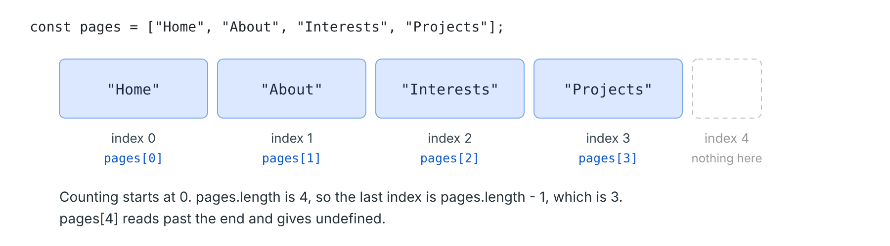
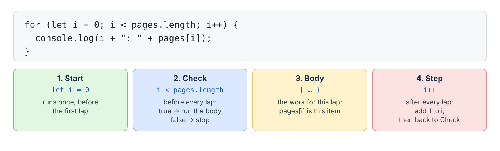
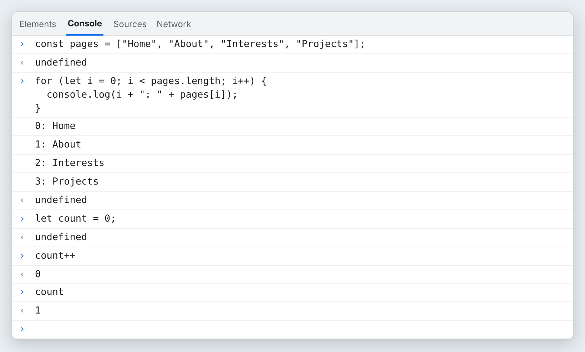
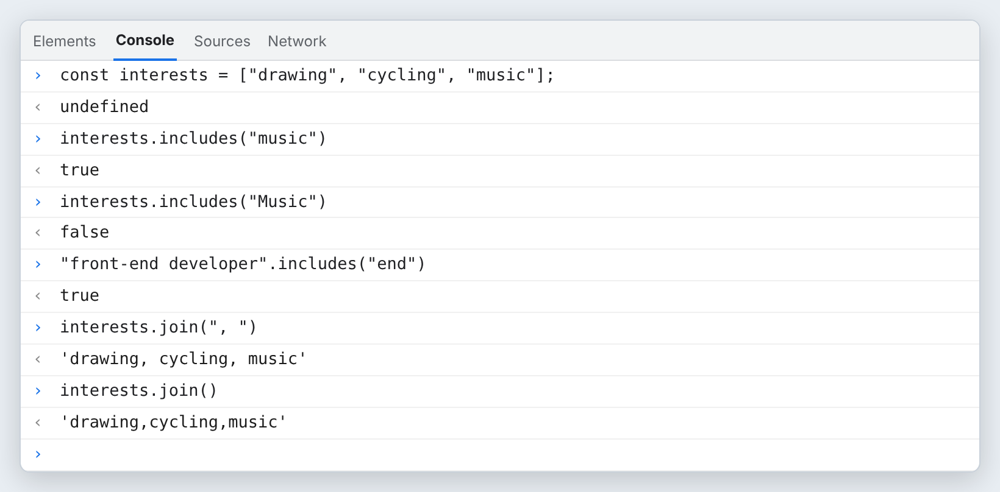
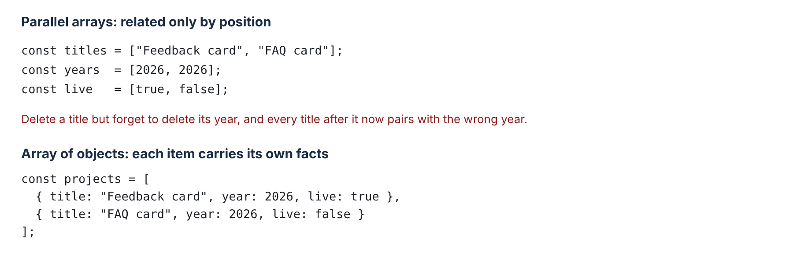
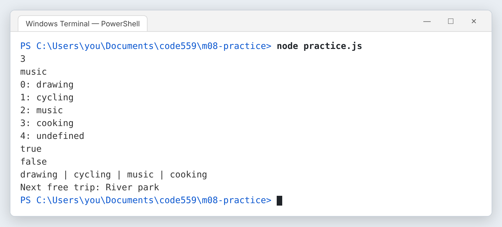

# Module 8 — Arrays, Loops, and Objects

*Keep many values in one place, visit each one in turn, and give each item named facts.*

**In this module you will learn:**

- What an array is, and why its indexes start at 0
- How `.length` works, and why the last item is at `length - 1`
- How to add an item to the end with `.push()`
- The traditional `for` loop, and what `i++` does
- How to put a condition inside a loop to count or pick items
- The `for...of` loop, for when you only need each item
- How `.includes()` checks arrays and strings, and how `.join()` turns an array into text
- Properties versus methods: `object.property` versus `object.method()`
- Objects as named bundles of properties, dot access, and arrays of objects
- When an array of objects beats several parallel arrays
- The logical operators `&&`, `||` and `!`

## Why this matters

Your site has several pages, several projects and several milestones. So far, every value in your JavaScript has lived in its own variable. That works for two or three values. It does not work for twenty, and it does not work when you do not know how many there will be.

This module gives you the three tools every data-driven page is built from. An **array** keeps a list in one variable. A **loop** visits every item in that list without you writing one line per item. An **object** gives each item named facts, like a title, a year and whether it is live. Put the three together and you have an array of objects, which is how most real web data is shaped.

You stay in the Console and Node one more time. In Module 9, the data you shape here becomes cards and rows on your real Projects and Milestones pages.

## Before you start

1. Finish Module 7. You should be able to write a function with a parameter and a `return`, and test it with several calls.
2. In your course folder, create a throwaway folder called `m08-practice`. Open it in VS Code with **File → Open Folder…**, then open a terminal with **Terminal → New Terminal**.
3. Open Edge or Chrome, press **F12**, and click the **Console** tab.
4. On paper, write down three of your own interests and two projects or milestones you would like on your site. You will use them instead of the examples.

> **Checkpoint.** You have an empty `m08-practice` folder open in VS Code, a terminal whose prompt ends in `m08-practice>`, a Console ready, and your own short list on paper.

## Core concepts

### 1. What is an array, and why does counting start at 0?

💡 An array is one variable that holds a list of values, in order. You write it with square brackets and commas.

❓ Each item has a position number called an **index**. The first index is `0`, not `1`. Think of the index as "how many steps from the start": the first item is zero steps away. You read an item with the array name and the index in square brackets: `pages[0]`.

<div role="separator" aria-label="Illustrate" style="display:flex;align-items:center;gap:0.75em;margin:1.5em 0;"><span style="flex:1;border-top:1px solid currentColor;opacity:0.35;"></span><span aria-hidden="true">👀</span><span style="flex:1;border-top:1px solid currentColor;opacity:0.35;"></span></div>


*Four items, indexes 0 to 3. There is no index 4.*

❗ Before you type anything, say what `pages[2]` holds.

### 2. What does `.length` tell you, and where is the last item?

💡 `.length` is the number of items in the array.

❓ Because counting starts at 0, the last index is always one less than the length. That is why `pages[pages.length - 1]` always gives the last item, however long the list grows. Reading at an index that does not exist is not an error. You get `undefined`, quietly.

<div role="separator" aria-label="Illustrate" style="display:flex;align-items:center;gap:0.75em;margin:1.5em 0;"><span style="flex:1;border-top:1px solid currentColor;opacity:0.35;"></span><span aria-hidden="true">👀</span><span style="flex:1;border-top:1px solid currentColor;opacity:0.35;"></span></div>

![The Console: pages[0] is 'Home', pages[3] is 'Projects', pages.length is 4, pages[pages.length - 1] is 'Projects', pages[4] is undefined, pages.push("Contact") returns 5, and pages now shows five items.](images/m08-array-basics.png)
*`pages[4]` gives `undefined`, not an error. Note what `.push()` prints: `5`, the new length, not the array. (real output, rendered)*

❗ Type the `pages` array into your Console and read `pages[pages.length]`. Predict first. Why is it `undefined`?

### 3. How do you add an item with `.push()`?

💡 `.push()` adds one or more items to the end of an array.

❓ The array changes in place. The value `.push()` hands back is the new length (MDN, *Array.prototype.push()*: "The new length property of the object upon which the method was called"). So do not write `pages = pages.push("Contact")`. That would try to replace your array with a number. Just call `pages.push("Contact")` on its own line. This works even though `pages` was made with `const`, because `const` stops you pointing the name at a different array; it does not stop the array's contents from changing.

👀 In the image above, `pages.push("Contact")` printed `5`, and the next line showed five items with `'Contact'` at the end.

❗ Push one of your own interests onto an array, then check `.length` went up by one.

### 4. How does a `for` loop visit every item?

💡 A loop runs the same block of code again and again. The traditional `for` loop counts, so it is a natural fit for indexes.

❓ The line `for (let i = 0; i < pages.length; i++)` has three parts between the parentheses, separated by semicolons. **Start**: `let i = 0` runs once. **Check**: `i < pages.length` runs before every lap; while it is `true`, the body runs; when it is `false`, the loop stops. **Step**: `i++` runs after every lap. `++` means "add 1 to this variable." It is short for `i = i + 1`. Inside the body, `pages[i]` is the item for this lap.

<div role="separator" aria-label="Illustrate" style="display:flex;align-items:center;gap:0.75em;margin:1.5em 0;"><span style="flex:1;border-top:1px solid currentColor;opacity:0.35;"></span><span aria-hidden="true">👀</span><span style="flex:1;border-top:1px solid currentColor;opacity:0.35;"></span></div>


*The check uses `<`, not `<=`. With 4 items, `i` takes the values 0, 1, 2 and 3, and the loop stops when `i` reaches 4.*


*Four laps, four lines. At the bottom, `count++` shows `0` because it hands back the old value and then adds 1. Asking for `count` on the next line shows the 1. Inside a loop you never use that handed-back value, so it does not matter there. (real output, rendered)*

❗ Change `i < pages.length` to `i < 2` and predict how many lines print.

### 5. How do you use a condition inside a loop?

💡 Put an `if` inside the loop body, and the loop can count or pick only some items.

❓ The pattern is: make a counter before the loop, check each item inside the loop, and add to the counter when the check is true. After the loop, the counter holds the answer. You used `if` in Module 6; nothing about it changes inside a loop.

👀 In the image under Concept 6, an array of practice minutes is checked day by day, and every `0` adds one to `restDays`. The answer is `2`.

❗ Change the check to `minutes[i] >= 30` and the name to `longDays`. Predict the answer before you run it. (It is 2: the 30 and the 45.)

### 6. When should you use `for...of` instead?

💡 MDN describes `for...of` as a loop that "operates on a sequence of values sourced from an iterable object." For arrays, that means: one lap per item, and the item itself in a variable.

❓ `for (const amount of minutes)` gives you each value directly, with no `i` and no square brackets. Use it when you only need the items. Use the counting `for` loop when you also need the position, for example to print `1:`, `2:`, `3:` beside each one.

<div role="separator" aria-label="Illustrate" style="display:flex;align-items:center;gap:0.75em;margin:1.5em 0;"><span style="flex:1;border-top:1px solid currentColor;opacity:0.35;"></span><span aria-hidden="true">👀</span><span style="flex:1;border-top:1px solid currentColor;opacity:0.35;"></span></div>

![The Console: a for loop counting zeros in [30, 0, 45, 20, 0] gives restDays 2, then a for...of loop prints 30 min, 0 min, 45 min, 20 min, 0 min.](images/m08-loop-if-forof.png)
*Top: a condition inside a counting loop. The `1` right after that loop is the Console showing the value of the last line that ran inside it; ask for `restDays` to get the answer. Bottom: `for...of` visits the same five values with less to type. (real output, rendered)*

❗ Rewrite the rest-day counter with `for...of`. You need `if (amount === 0)` inside.

### 7. How do `.includes()` and `.join()` help?

💡 `.includes()` answers "is this in here?" with `true` or `false`. `.join()` turns an array into one piece of text.

❓ `.includes()` works on arrays and on strings. On an array, it checks whole items. On a string, it checks for a piece of text anywhere inside. It is exact: `"Music"` and `"music"` are different. `.join()` puts the text you give it between items. With nothing in the parentheses, MDN says the items "are separated with a comma."

<div role="separator" aria-label="Illustrate" style="display:flex;align-items:center;gap:0.75em;margin:1.5em 0;"><span style="flex:1;border-top:1px solid currentColor;opacity:0.35;"></span><span aria-hidden="true">👀</span><span style="flex:1;border-top:1px solid currentColor;opacity:0.35;"></span></div>


*Capital letters matter to `.includes()`. And notice the difference between `join(", ")` and `join()`: the space after the comma only appears when you ask for it. (real output, rendered)*

❗ Join your own interests with `" · "` and with `" and "`. Which reads better as a sentence?

### 8. What is the difference between a property and a method?

💡 Arrays and strings carry named values you can read, and named actions you can run. A value is a **property**. An action is a **method**.

❓ You read a property with a dot and its name: `tags.length`. You run a method with a dot, its name and parentheses: `tags.push("js")`, `"  hello  ".trim()`. MDN's glossary defines a method as "a function which is a property of an object." So this is Module 7 again: a method name without parentheses is a reference to the function; with parentheses it is a call. `.trim()` returns a copy of the string without the spaces at both ends; you will lean on it in Module 10 to check form inputs.

<div role="separator" aria-label="Illustrate" style="display:flex;align-items:center;gap:0.75em;margin:1.5em 0;"><span style="flex:1;border-top:1px solid currentColor;opacity:0.35;"></span><span aria-hidden="true">👀</span><span style="flex:1;border-top:1px solid currentColor;opacity:0.35;"></span></div>

![The Console: tags.length is 2, tags.push("js") returns 3, tags.length is now 3, tags.length() throws TypeError: tags.length is not a function, "  hello  ".length is 9, .trim() gives 'hello', .trim().length is 5, and "hello".trim with no parentheses shows ƒ trim() { [native code] }.](images/m08-props-methods.png)
*Parentheses on a property are an error, because a number cannot be run. A method without parentheses gives you the function itself, the same thing you saw with `showMessage` in Module 7. (real output, rendered)*

❗ For each of these, say "property" or "method" before you type it: `pages.length`, `pages.push("Blog")`, `"Hi ".trim()`, `"Hi ".length`.

### 9. What is an object?

💡 An object is a named bundle of properties. Where an array is a list in order, an object is a set of labeled facts about one thing.

❓ You write an object with curly braces. Each property is a name, a colon and a value, separated by commas: `{ title: "Feedback card", year: 2026, live: true }`. You read a property with a dot: `project.title`. A value can be anything, including an array, so `project.tags.length` reads the length of the array stored in `tags`. Asking for a property that does not exist gives `undefined`, just like reading past the end of an array.

<div role="separator" aria-label="Illustrate" style="display:flex;align-items:center;gap:0.75em;margin:1.5em 0;"><span style="flex:1;border-top:1px solid currentColor;opacity:0.35;"></span><span aria-hidden="true">👀</span><span style="flex:1;border-top:1px solid currentColor;opacity:0.35;"></span></div>

![The Console: project.title is 'Feedback card', project.tags.length is 2, project.status is undefined; then an array of two project objects, projects[1].title is 'FAQ card', and a for...of loop prints Feedback card (2026) and FAQ card (2026).](images/m08-objects.png)
*`projects[1].title` reads from left to right: the array, then item 1, then its `title`. The loop at the bottom visits each object and reads two of its properties. (real output, rendered)*

❗ Make an object for one of your own projects or milestones, with at least a `title` and a `year`. Read each property back.

### 10. When does an array of objects beat parallel arrays?

💡 Parallel arrays are several arrays where item 0 of each belongs together, item 1 of each belongs together, and so on.

❓ They work until something changes. Delete an item from one array and forget the other, and every item after it is paired with the wrong facts, with no error to warn you. An array of objects keeps each item's facts together, so they cannot drift apart. Use an array of objects whenever each item has two or more facts.

<div role="separator" aria-label="Illustrate" style="display:flex;align-items:center;gap:0.75em;margin:1.5em 0;"><span style="flex:1;border-top:1px solid currentColor;opacity:0.35;"></span><span aria-hidden="true">👀</span><span style="flex:1;border-top:1px solid currentColor;opacity:0.35;"></span></div>


*The same two projects, stored two ways. In the bottom version, adding a fact means adding one property, not a whole new array.*

❗ Take your paper list of projects or milestones and write it as an array of objects.

### 11. How do `&&`, `||` and `!` combine true and false?

💡 Logical operators join two checks into one, or flip one.

❓ `&&` (AND) is `true` only when **both** sides are `true`. `||` (OR) is `true` when **at least one** side is `true`. `!` (NOT) flips `true` to `false` and `false` to `true`. You will use them in `if` statements, such as "the project is live AND it is from this year." MDN adds one detail: with values that are not `true` or `false`, these operators hand back one of the values themselves (for example, `"Home" && "About"` gives `'About'`). In this course you will use them with `true` and `false`.

<div role="separator" aria-label="Illustrate" style="display:flex;align-items:center;gap:0.75em;margin:1.5em 0;"><span style="flex:1;border-top:1px solid currentColor;opacity:0.35;"></span><span aria-hidden="true">👀</span><span style="flex:1;border-top:1px solid currentColor;opacity:0.35;"></span></div>


*The first three lines are the full truth tables. Only one `&&` row is `true`; only one `||` row is `false`. Then a real use: `year === 2026` is `false`, so the `&&` fails and the `||` passes. (real output, rendered)*

❗ Predict `!live && year === 2025`, then type it to check.

## Exercise

*Your hands, about 50 minutes (estimate).* Type it, do not paste it. Work in `m08-practice`. Use your own interests and places instead of the examples if you like; the shape is what matters.

1. **Create `practice.js`** and type an array of three interests. Below it, log its `.length` and its last item using `length - 1`.
2. **Push one more** interest with `.push()`.
3. **Loop with indexes.** Write a `for` loop that logs each item with its index in front, like `0: drawing`.
4. **Check and join.** Log `interests.includes(…)` for one item you have and one you do not. Then log `interests.join(" | ")`.
5. **An array of objects.** Type this, with your own place names if you prefer:

   ```js
   const places = [
     { name: "City library", visited: true, free: true },
     { name: "Art museum", visited: false, free: false },
     { name: "River park", visited: false, free: true }
   ];

   for (const place of places) {
     if (!place.visited && place.free) {
       console.log("Next free trip: " + place.name);
     }
   }
   ```

   Read the `if` out loud before you run it: "not visited, and free."
6. **Run it.** Save, then type `node practice.js` in the terminal. Predict every line first. With the example data you should get 10 lines, ending in `Next free trip: River park`.
7. **Break it on purpose.** In the `for` loop from step 3, change `i < interests.length` to `i <= interests.length`. Save and run.

   
   *One character added, one extra lap. On the last lap `i` is 4, which equals the length, and `interests[4]` is `undefined`. No error message, just a wrong line. This is called an off-by-one error. (real output, rendered; captured on Linux with Node 22.22.0. Node prints the same lines on Windows.)*

   Change `<=` back to `<`, run again, and check the `undefined` line is gone.
8. **Your own.** Below everything, write a loop that counts how many places are `free` and logs the count. With the example data, the answer is 2.
9. **Modify.** Change the `if` in step 5 from `&&` to `||`. Predict which places print now, then run it.

## Project (in the full packet)

The project is a `site-data.js` file for your personal site: your real Projects and Milestones written as two arrays of objects (title, year, a short description, tags, and whether each one is live), plus a few small functions that summarize the data, written from one-sentence descriptions and tested in Node. One counts the live projects, one lists every title as a single line of text, and one collects the milestones from a given year. In Module 9, the Projects and Milestones pages read this file and build themselves from it.

The full brief, the step-by-step build, and the finishing work in Git are in the Module 8 packet. [Get the packet →](PACKET_LINK_MODULE_8)

## Common misconception

> *"An array with 4 items ends at index 4."*

What would you say? Hint: look at what `pages[4]` printed in the Concept 2 image, and count how many steps the first item is from the start.

## Summary

An array keeps a list of values in order, and its first index is 0. `.length` is the number of items, so the last item is at `length - 1`, and reading past the end gives `undefined`. `.push()` adds to the end and hands back the new length. The traditional `for` loop has a start, a check and a step, and `i++` adds 1 to `i` after every lap. An `if` inside a loop lets you count or pick items. `for...of` gives you each item directly when you do not need its index. `.includes()` answers `true` or `false` for arrays and strings, exactly, and `.join()` turns an array into text with the separator you choose. A property is a value you read with `object.property`; a method is an action you run with `object.method()`. An object is a named bundle of properties read with dot access, and an array of objects keeps each item's facts together where parallel arrays can drift apart. `&&` needs both sides true, `||` needs one, and `!` flips a value.

## Check your understanding

1. `tags.length()` throws a `TypeError`, but `tags.push("js")` works. Why does one need parentheses and the other must not have them?
2. You have six projects in an array. Which index holds the last one, and how would you write that so it still works when you add a seventh?
3. **What value does this variable hold** after this code runs? `let n = 0; for (const p of places) { if (p.visited || p.free) { n++; } }` (use the three places from the Exercise)

## Before next module

- [ ] `practice.js` runs with `node practice.js` and every line matches your predictions
- [ ] You saw the extra `undefined` line from `<=` and fixed it
- [ ] You can say, for `.length`, `.push()` and `.trim()`, which is a property and which are methods
- [ ] Your own projects or milestones are written on paper (or in a file) as an array of objects
- [ ] Saved this module's work to GitHub with the routine: git status → git add . → git commit -m "…" → git push → check the live page

## Go further

- MDN: *Array.prototype.push()*, *Array.prototype.includes()*, *Array.prototype.join()*
- MDN: *for...of*; and search "for statement" for the counting loop
- MDN: *Logical AND (&&)*, and the matching *Logical OR (||)* and *Logical NOT (!)* pages
- MDN Glossary: *Method*; and *String.prototype.trim()*
- freeCodeCamp: the modules on arrays, loops and objects in the JavaScript curriculum, with their quizzes **[unverified: exact current module names in the curriculum]**
- [W3Schools JavaScript Arrays](AFFILIATE_W3SCHOOLS_ARRAYS)

*Affiliate link: Code559 may earn a commission at no extra cost to you.*

## What to keep

Keep `practice.js` and your array of objects for your own projects or milestones; the Module 8 project starts from it. Then answer for yourself: **which step would be hardest to repeat without this post, and why?**

---

*Code559 is a 559 Solutions project. Portions adapted from Visual Studio Code documentation (CC BY 3.0 US), GitHub Docs (CC BY 4.0), and GitHub Skills (MIT). Screenshots used with permission from Microsoft.*

*Sources checked 2026-10-09: MDN "Array.prototype.push()"; MDN "Array.prototype.includes()"; MDN "Array.prototype.join()"; MDN "for...of"; MDN "Logical AND (&&)"; MDN Glossary "Method"; MDN "String.prototype.trim()"; Chromium (via Playwright) for every Console result; Node 22.22.0 for every terminal result.*
