# Module 9 — DOM and Events

*Find elements, decide what they should do, and connect that to a click.*

**In this module you will learn:**

- The three layers of a page: HTML is structure, CSS is appearance, JavaScript is behavior
- How to connect `script.js` to a page, and why it must load after the HTML: bottom of `<body>` or `defer`
- What `querySelector()` gives you: the first match, or `null`
- What `querySelectorAll()` gives you: a collection, and how to loop through it with `for...of`
- Why you store element references in `const` variables
- How to change text with `textContent`, and why this course avoids `innerHTML` for text
- How `addEventListener("click", handler)` works, and why it needs `toggleDetails`, not `toggleDetails()`
- `classList.add()`, `.remove()` and `.toggle()`
- The `hidden` property for showing and hiding
- How to build page items from an array of objects with `createElement()` and `append()`
- The pattern every script in this course follows: find elements → define behavior → connect events
- Why a real `<button>` works with Enter and Space for free

## Why this matters

In Modules 5 to 8 you learned the JavaScript language in the Console and in Node. Your code could add, compare, loop and return values. But no visitor ever saw any of it. This module connects that language to a real page. After it, a click on your site can show a hidden paragraph, change a button's text, or build a list from data.

The browser turns your HTML into a tree of objects called the **DOM** (Document Object Model). JavaScript can find any object in that tree, read it and change it. Everything in this module is one of three moves: find an element, change something about it, or wait for the visitor to do something and then change it.

You also learn a habit that keeps scripts readable: every script in this course is organized the same way, in three blocks. When something breaks, you know where to look.

## Before you start

1. Finish Module 8. You should be able to write a function, loop over an array with `for...of`, and read a property from an object with a dot (`interest.name`).
2. In your course folder (for example `Documents\code559`), create a throwaway folder called `m09-practice`. Nothing in it is published. Open it in VS Code with **File → Open Folder…**.
3. Find any small image (a PNG or SVG icon) and copy it into `m09-practice` with the name `icon-star.svg` (or keep its own name and change the file name in the code later). The renders below use a small orange star. If you have no image, skip it; the code still works.
4. Keep Edge or Chrome open. You will use **F12 → Console** to read messages and to test lines.

> **Checkpoint.** You have an `m09-practice` folder open in VS Code, an image in it, and you can open the Console in your browser.

## Core concepts

### 1. What does each layer of a page do?

 A web page is built from three languages, and each has one job.

 **HTML is structure**: what is on the page (a heading, a button, a paragraph). **CSS is appearance**: how it looks (colors, spacing, layout). **JavaScript is behavior**: what happens when something happens (a click, a key press, a form being sent). Keep the jobs apart. A paragraph that should start hidden is marked in HTML with `hidden`. Its color lives in CSS. The decision to show it lives in JavaScript.

<div role="separator" style="display:flex;align-items:flex-end;margin:1.5em 0;"></div>

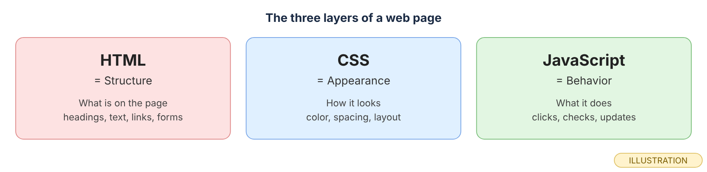
 *Three files, three jobs. When you are not sure where a line belongs, ask which of the three jobs it does.*

 For each of these, name the layer: "the button is blue," "there is a button," "clicking the button shows a paragraph."

### 2. How do you connect `script.js`, and when does it run?

 You connect a script with a `<script>` tag and a `src`, the same way you connected a stylesheet with `<link>` in Module 2.

 A plain `<script src="script.js">` runs **the moment the browser reaches it**, before it reads the rest of the HTML. If that tag is in the `<head>`, your script runs while the `<body>` does not exist yet. Every `querySelector()` finds nothing and gives back `null`. There are two fixes. You can put the tag at the very bottom of `<body>`, after all the HTML. Or you can keep it in the `<head>` and add `defer`. MDN describes `defer` as meaning "the script is meant to be executed after the document has been parsed, but before firing `DOMContentLoaded`" (MDN, *&lt;script&gt;: The Script element*). This course uses `defer`, so the head holds both the stylesheet and the script:

```html
<link rel="stylesheet" href="style.css">
<script src="script.js" defer></script>
```

Two notes from the same MDN page: `defer` only works on a script with a `src`, not on code written between the tags, and deferred scripts run in the order they appear.

 Here is the exercise page with the script in the `<head>` and **no** `defer`.

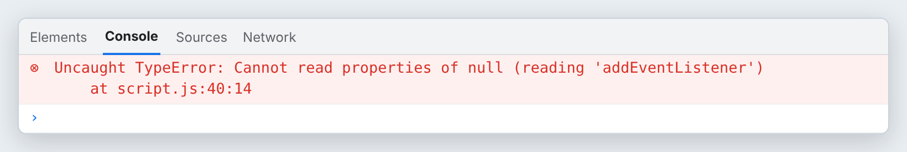
*`querySelector()` did not fail. It returned `null`, because the button did not exist yet. The error only appears on line 40, the first time the script tries to use that `null`. (real output, rendered; captured in Chromium 141. The message and location come from the page error Chromium reported; line 40 is `toggleButton.addEventListener(…)`.)*

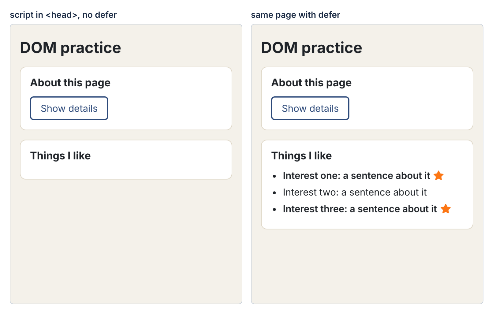
*Same files, one word different. Without `defer` the script stopped at the error, so the list was never built. With `defer` everything runs. Labels added above each render. (real: rendered in Chromium)*

 Say in one sentence why `null` appears even though the button is in your HTML.

### 3. What does `querySelector()` give you, and why store it?

 `document.querySelector()` takes a CSS selector, the same kind you write in a stylesheet, and finds an element.

 MDN: it "returns the first Element within the document that matches the specified CSS selector… If no matches are found, `null` is returned" (MDN, *Document: querySelector() method*). So `"#toggle-btn"` finds the element with that id, `".item"` finds the **first** element with that class, and a typo finds nothing and gives `null`. You store what it finds in a `const`, once, at the top of your script, so every function below can use the name:

```js
const toggleButton = document.querySelector("#toggle-btn");
```

The variable does not hold a copy. It holds a **reference** to the real element on the page. Change `toggleButton.textContent` and the page changes.

 See the first and fourth lines in the image under Concept 4.

 Predict what `document.querySelector("#toggle-button")` gives on the exercise page, where the id is `toggle-btn`.

### 4. What does `querySelectorAll()` give you, and how do you loop through it?

 When you want every match, not just the first, use `querySelectorAll()`.

 It gives back a **NodeList**, a collection of elements in page order. MDN calls it "a static (not live) NodeList" and adds that when nothing matches you get "an empty NodeList," not `null` (MDN, *Document: querySelectorAll() method*). A NodeList has a `.length` and works with the `for...of` loop from Module 8, so you can visit each element in turn. The difference matters: with no match, `querySelector()` gives `null`, and `querySelectorAll()` gives an empty list whose `.length` is `0`.

<div role="separator" style="display:flex;align-items:flex-end;margin:1.5em 0;"></div>

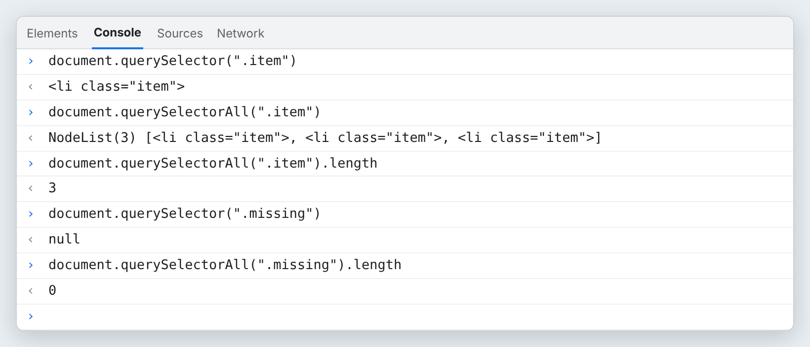
 *One element versus a collection, and `null` versus an empty list. (real output, rendered; evaluated in Chromium 141. Real DevTools shows each element as an expandable tag with its text; this frame shows only the opening tag.)*

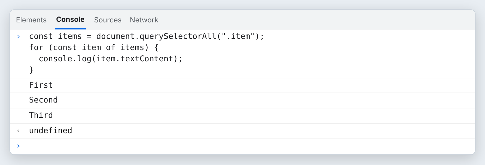
*The same `for...of` you used on arrays. Each lap, `item` holds the next element. (real output, rendered; evaluated in Chromium 141)*

 Predict what `document.querySelectorAll("li").length` gives on the exercise page after the list is built.

### 5. How do you change text, and why not `innerHTML`?

 `textContent` reads or replaces the text inside an element.

 Set `toggleButton.textContent = "Hide details";` and the button says exactly that. There is another property, `innerHTML`, that reads its text **as HTML** and builds elements from it. MDN advises against using it for text: "it deals with raw HTML rather than plain text and can be susceptible to XSS attacks" and "it is still less semantic and slower because it needs to invoke the HTML parser" (MDN, *Node: textContent property*). XSS means someone gets their own code to run on your page through text you display. For this course the rule is simple: **text goes in with `textContent`.** New elements are made with `createElement()` (Concept 9).

<div role="separator" style="display:flex;align-items:flex-end;margin:1.5em 0;"></div>

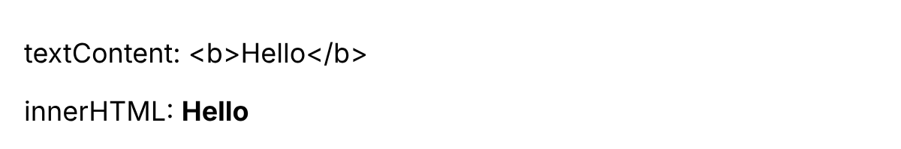
 *`textContent` shows what you gave it, character for character. `innerHTML` turned the same characters into a real bold element. That is useful for HTML you wrote, and risky for text a visitor typed. (real: rendered in Chromium)*

 If a visitor types `<b>hi</b>` into a form, which property shows it safely as plain characters?

### 6. How does `addEventListener()` work, and why no parentheses?

 `addEventListener()` tells an element: "when this event happens to you, run this function."

 It takes two things: the event name as a string, and the function to run. MDN says the listener "must be `null`, an object with a `handleEvent()` method, or a JavaScript function" (MDN, *EventTarget: addEventListener() method*). That is Module 7's lesson in action. `toggleDetails` is the function itself. `toggleDetails()` runs the function **now** and hands over whatever it returns, which here is `undefined`. So:

```js
toggleButton.addEventListener("click", toggleDetails);   // right: hands over the function
toggleButton.addEventListener("click", toggleDetails()); // wrong: runs it once, now
```

The browser keeps the function and calls it each time the click happens. You do not call it. The click does.

 You will see the wrong version for real in the Exercise, step 9.

 Answer the standing question for this module: **what causes this function to run?** For `toggleDetails`, the answer is "a click on the button," not "the line that mentions it."

### 7. How do you add, remove and toggle a class?

 Every element has a `classList`, a list of its CSS classes that JavaScript can change.

 MDN: it "contains a live DOMTokenList collection representing the class attribute of the element," changed with "the `add()`, `remove()`, `replace()`, and `toggle()` methods" (MDN, *Element: classList property*). `add("is-open")` puts the class on. `remove("is-open")` takes it off. `toggle("is-open")` flips it: on if it was off, off if it was on, and it returns `true` or `false` to tell you which. `contains("is-open")` only asks. This is how JavaScript and CSS share the work: CSS says what `.is-open` looks like, and JavaScript only decides when the class is there.

<div role="separator" style="display:flex;align-items:flex-end;margin:1.5em 0;"></div>

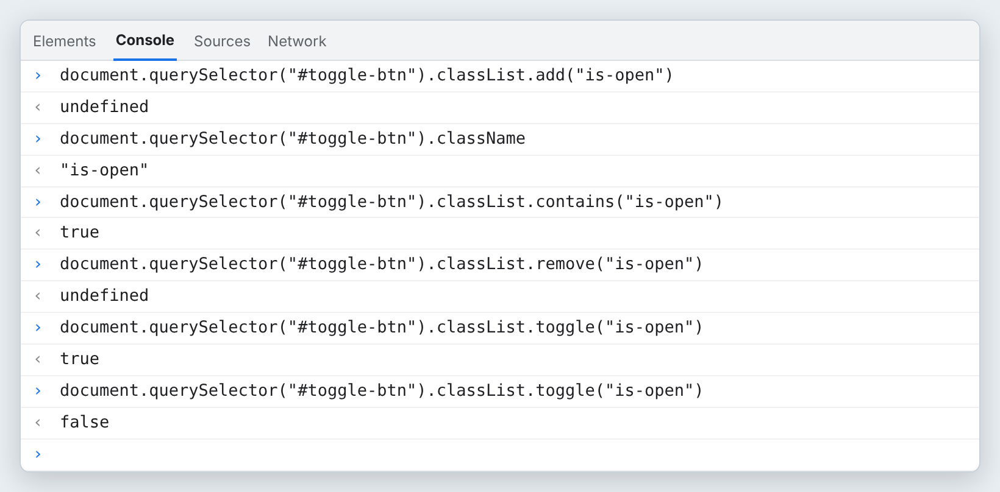
 *`add` and `remove` give back nothing. `toggle` tells you the new state: `true` means the class is now on. (real output, rendered; evaluated in Chromium 141)*

 After three `toggle("is-open")` calls in a row on a button that started without the class, is the class on or off?

### 8. How do you show and hide something?

 The `hidden` attribute you used in Module 4 has a matching JavaScript property.

 `details.hidden = true` hides it; `details.hidden = false` shows it. To flip it, use `!` from Module 8: `details.hidden = !details.hidden;`. The text stays in the HTML the whole time; only whether it is shown changes. One trap: MDN warns that "changing the value of the CSS `display` property on a hidden element will override the hidden state" (MDN, *hidden* global attribute). Checked in Chromium: a paragraph with `hidden` and `display: block` in its style had a computed `display` of `"block"`, so it showed. If `hidden` "does nothing," look for a `display` rule on that element.

<div role="separator" style="display:flex;align-items:flex-end;margin:1.5em 0;"></div>

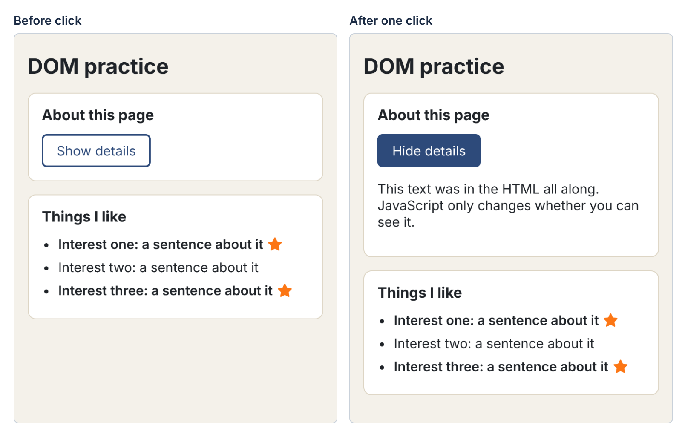
 *One click did three things: `hidden` turned off, the text changed with `textContent`, and `classList.toggle("is-open")` made the button dark. Labels added above each render. (real: rendered in Chromium)*

 Which single line in `toggleDetails` would you delete to make the button change color but never show the paragraph?

### 9. How do you build page items from an array of objects?

 In Module 8 you stored data in an array of objects. Now each object becomes a list item on the page.

 `document.createElement("li")` makes a new, empty element. It is not on the page yet. You fill it (with `textContent`, `classList`, `src`, `alt`), and then `list.append(item)` puts it inside the list, after anything already there. MDN: `append()` "inserts a set of Node objects or strings after the last child of the Element" (MDN, *Element: append() method*). A `for...of` loop does this once per object:

```js
function buildList() {
  for (const interest of interests) {
    const item = document.createElement("li");
    item.textContent = interest.name + ": " + interest.note;
    if (interest.favorite) {
      item.classList.add("favorite");
      const star = document.createElement("img");
      star.src = "icon-star.svg";
      star.alt = "favorite";
      item.append(star);
    }
    list.append(item);
  }
}
```

The HTML holds only an empty `<ul id="interest-list"></ul>`. The data decides how many items appear.

 In the right half of the image under Concept 2, three objects became three list items, and the two with `favorite: true` got a bold class and a star.

 Predict what changes on the page if you add a fourth object with `favorite: false`.

### 10. How is every script in this course organized?

 Scripts get long. A fixed order makes them easy to read and easy to fix.

 Every script has three blocks, marked with comments. **1. Find elements**: every `querySelector()`, stored in `const`, at the top. **2. Define behavior**: the functions, which say what should happen but do not run yet. **3. Connect events**: the `addEventListener()` lines, plus any function that should run once at load, like `buildList()`. When a button does nothing, check block 3. When you get `null`, check block 1.

<div role="separator" style="display:flex;align-items:flex-end;margin:1.5em 0;"></div>

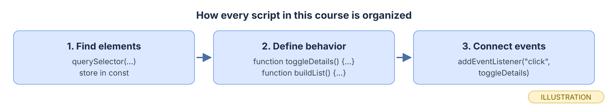
 *Find, define, connect. The Exercise script follows this order exactly.*

 In the Exercise script, find the comment that starts each block before you type anything else.

### 11. Why does a real button work with the keyboard for free?

 Some visitors never use a mouse. They move with Tab and press Enter or Space.

 A native `<button>` already does this. MDN's button-role page lists Enter and Space as the keys that activate a button and notes that, for native buttons, `onclick` fires for mouse clicks and when the user presses Space or Enter (MDN, *ARIA: button role*). A `<div>` with a click listener does not. Even with `tabindex="0"` so it can take focus, Enter and Space do nothing unless you write extra code. Use `<button type="button">` for anything a visitor clicks that is not a link, and you get focus, keys and a screen-reader name without writing them.

 A test page with one real button and one `<div tabindex="0">`, each with a click listener that logs a line. Tab to the button, press Enter, press Space; Tab to the div, press Enter, press Space.

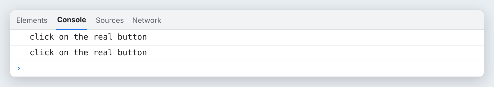
*Two key presses on the button gave two clicks. Two key presses on the div gave none. (real output, rendered; key presses sent to Chromium 141 with Playwright)*

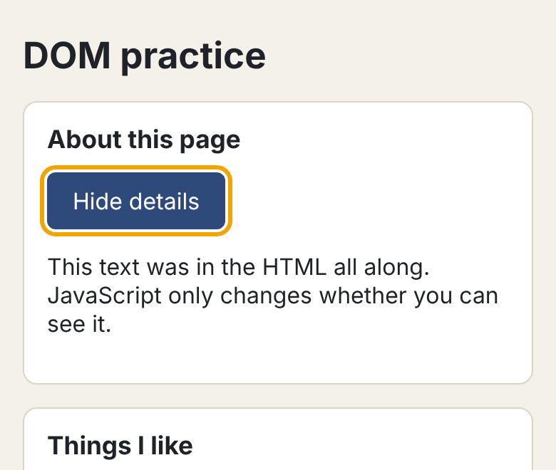
*Tab moved focus to the button (the orange ring is the `:focus-visible` style), and Enter ran the same `toggleDetails` a mouse click runs. (real: rendered in Chromium)*

 You will test this yourself in Exercise step 8.

## Exercise

*Your hands, about 60 minutes (estimate).* Type it, do not paste it. Work in `m09-practice`. Nothing here is published.

1. **Create the HTML.** Make `index.html` in `m09-practice`:

   ```html
   <!DOCTYPE html>
   <html lang="en">
   <head>
     <meta charset="UTF-8">
     <meta name="viewport" content="width=device-width, initial-scale=1.0">
     <title>DOM practice</title>
     <link rel="stylesheet" href="style.css">
     <script src="script.js" defer></script>
   </head>
   <body>
     <main>
       <h1>DOM practice</h1>

       <section class="card">
         <h2>About this page</h2>
         <button id="toggle-btn" type="button">Show details</button>
         <p id="details" hidden>This text was in the HTML all along. JavaScript only changes whether you can see it.</p>
       </section>

       <section class="card">
         <h2>Things I like</h2>
         <ul id="interest-list"></ul>
       </section>
     </main>
   </body>
   </html>
   ```

2. **Add some CSS.** Make `style.css`. The behavior does not depend on it, so you may style it your own way, but it needs a `button.is-open` rule and a `:focus-visible` rule so you can see the class and the focus:

   ```css
   body { margin: 0; font-family: "Segoe UI", Arial, sans-serif; background: #f4f1ea; color: #1f2328; }
   main { max-width: 560px; margin: 0 auto; padding: 24px 16px; }
   h1 { font-size: 1.6rem; margin: 0 0 16px; }
   h2 { font-size: 1.1rem; margin: 0 0 12px; }
   .card { background: #fff; border: 1px solid #ddd5c4; border-radius: 10px; padding: 16px; margin-bottom: 16px; }
   button { font: inherit; padding: 8px 16px; border: 2px solid #2d4a7a; border-radius: 6px; background: #fff; color: #2d4a7a; cursor: pointer; }
   button.is-open { background: #2d4a7a; color: #fff; }
   button:focus-visible { outline: 3px solid #f0a500; outline-offset: 2px; }
   #interest-list { margin: 0; padding-left: 20px; }
   #interest-list li { margin-bottom: 8px; }
   #interest-list li.favorite { font-weight: 600; }
   #interest-list img { margin-left: 6px; vertical-align: -2px; }
   ```

3. **Type the script.** Make `script.js`. Type the three comments first, then fill each block. Change the three interests to your own words.

   ```js
   // 1. Find elements
   const toggleButton = document.querySelector("#toggle-btn");
   const details = document.querySelector("#details");
   const list = document.querySelector("#interest-list");

   const interests = [
     { name: "Interest one", note: "a sentence about it", favorite: true },
     { name: "Interest two", note: "a sentence about it", favorite: false },
     { name: "Interest three", note: "a sentence about it", favorite: true }
   ];

   // 2. Define behavior
   function toggleDetails() {
     console.log("toggleDetails ran");
     details.hidden = !details.hidden;
     if (details.hidden) {
       toggleButton.textContent = "Show details";
     } else {
       toggleButton.textContent = "Hide details";
     }
     toggleButton.classList.toggle("is-open");
   }

   function buildList() {
     for (const interest of interests) {
       const item = document.createElement("li");
       item.textContent = interest.name + ": " + interest.note;
       if (interest.favorite) {
         item.classList.add("favorite");
         const star = document.createElement("img");
         star.src = "icon-star.svg";
         star.alt = "favorite";
         item.append(star);
       }
       list.append(item);
     }
   }

   // 3. Connect events
   toggleButton.addEventListener("click", toggleDetails);
   buildList();
   ```

4. **Predict, then run.** Before you open the page, write down: how many list items will appear, and which ones get a star? Then open `index.html` with Live Preview (or in the browser) and open the Console. Check your prediction against the left half of the image under Concept 8.
5. **Click.** Click **Show details** twice. Predict the Console first: how many `toggleDetails ran` lines after two clicks? (Two: one per click.)
6. **Use `querySelectorAll()` in the Console.** Type `document.querySelectorAll("#interest-list li").length`. Then loop over it:

   ```js
   for (const item of document.querySelectorAll("#interest-list li")) { console.log(item.textContent); }
   ```

   Does the star image appear in the logged text? (It does not. An `` has no text content; its `alt` is an attribute.)
7. **Modify.** Add a fourth interest object to the array. Save. The page should show four items without any change to the HTML.
8. **Keyboard test.** Click in the address bar, then press **Tab** until the button has a focus ring. Press **Enter**. Press **Space**. Each press should toggle the paragraph and add a line to the Console.
9. **Break it on purpose.** In block 3, add parentheses: `toggleButton.addEventListener("click", toggleDetails());`. Save. Before you reload, predict: will the paragraph start hidden? Then reload and click the button twice.

   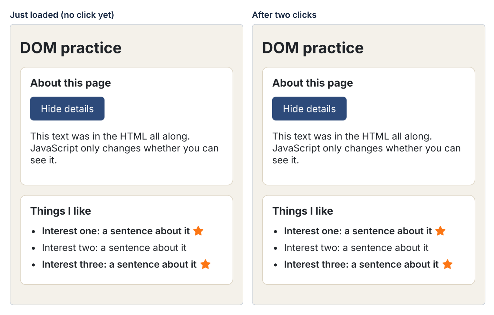
   *With the parentheses, `toggleDetails()` ran once while the page loaded, so the paragraph opened by itself. The listener received `undefined`, so clicks do nothing. The Console shows exactly one `toggleDetails ran` line and no red error. Labels added above each render. (real: rendered in Chromium)*

   No error message is the dangerous part. Your clue is the Console: one line at load, none on click. Remove the parentheses, save, and check that clicks work again.
10. **Optional second break.** Delete the word `defer` from the `<script>` tag. Reload and read the red message. Find the line number it names, and explain why `toggleButton` is `null`. Put `defer` back.

## Project (in the full packet)

Three projects use this module on your own site. The **interests gallery** shows one image at a time from an array, with Previous and Next buttons that wrap around from the last image to the first and back. The **feedback card** from Module 4 gets its JavaScript: it reads the chosen rating, shows it in the thank-you message, and swaps the form for the thank-you section. And an **FAQ accordion about you**, where each question is a button that opens and closes its own answer with a plus or minus icon, works the same with a mouse and a keyboard.

The full brief, the step-by-step build, and the finishing work in Git are in the Module 9 packet. [Get the packet →](PACKET_LINK_MODULE_9)

## Common misconception

> *"My button does nothing, so my function must be wrong."*

What would you say? Hint: a function can be perfect and never run. Check the Console for a `null` error first, then check block 3 for parentheses, then check that the selector in block 1 matches the id in the HTML.

## Summary

HTML is structure, CSS is appearance, and JavaScript is behavior. A script in the `<head>` needs `defer`, or it runs before the body exists and every `querySelector()` gives `null`. `querySelector()` gives the first match or `null`; `querySelectorAll()` gives a NodeList, empty when nothing matches, that you loop through with `for...of`. You store each element reference in a `const` at the top of the script. `textContent` puts in text exactly as written, which is why text never goes in with `innerHTML` in this course. `addEventListener("click", toggleDetails)` hands the browser the function so the click can run it; with parentheses it runs once at load and clicks do nothing. `classList.add()`, `.remove()` and `.toggle()` switch CSS classes on and off. The `hidden` property shows and hides an element, unless a CSS `display` rule overrides it. `createElement()` and `append()` build page items from an array of objects. Every script follows the same order: find elements, define behavior, connect events. A native `<button>` responds to Enter and Space with no extra code; a `<div>` does not.

## Check your understanding

1. `document.querySelector(".card")` gives one element, but your page has three cards. Why, and what would you use to get all three?
2. A paragraph has `hidden`, and `details.hidden = true` runs, but the paragraph still shows. Where would you look first?
3. **What causes this function to run?** In the Exercise, `buildList()` and `toggleDetails` are both in block 3. What makes each one run, and how many times?

## Before next module

- [ ] Your `m09-practice` page builds its list from the array and the button toggles the paragraph
- [ ] You saw the `null` TypeError when `defer` was missing, and fixed it
- [ ] You saw `toggleDetails()` run once at load with no error, and fixed it
- [ ] The button works with Tab, Enter and Space
- [ ] You can say the three blocks of a script in order without looking
- [ ] Saved this module's work to GitHub with the routine: git status → git add . → git commit -m "…" → git push → check the live page

## Go further

- MDN: *&lt;script&gt;: The Script element* (the `defer` attribute)
- MDN: *Document: querySelector() method* and *Document: querySelectorAll() method*
- MDN: *Node: textContent property* (the section "Differences from innerHTML")
- MDN: *EventTarget: addEventListener() method*
- MDN: *Element: classList property*; *HTMLElement: hidden property*; *hidden* (global attribute)
- MDN: *Element: append() method*
- MDN: *ARIA: button role* (the keyboard table, and why a native `<button>` is preferred)
- freeCodeCamp: the DOM manipulation and events material in the JavaScript curriculum **[unverified: exact current module name in the curriculum]**
- [W3Schools JavaScript HTML DOM](AFFILIATE_W3SCHOOLS_DOM)

*Affiliate link: Code559 may earn a commission at no extra cost to you.*

## What to keep

Keep `m09-practice` with its three-block `script.js`, and a note of the two breakages you caused: what you changed, what you saw, and what the clue was. Then answer for yourself: **which step would be hardest to repeat without this post, and why?**

---

*Code559 is a 559 Solutions project. Portions adapted from Visual Studio Code documentation (CC BY 3.0 US), GitHub Docs (CC BY 4.0), and GitHub Skills (MIT). Screenshots used with permission from Microsoft.*

*Sources checked 2026-10-09: MDN "&lt;script&gt;: The Script element"; MDN "Document: querySelector() method"; MDN "Document: querySelectorAll() method"; MDN "Node: textContent property"; MDN "EventTarget: addEventListener() method"; MDN "Element: classList property"; MDN "HTMLElement: hidden property"; MDN "hidden" (HTML global attribute); MDN "Element: append() method"; MDN "&lt;button&gt;: The Button element"; MDN "ARIA: button role". Every page render, Console result and key-press result was captured in Chromium 141.0.7390.37 (via Playwright) on Linux.*
