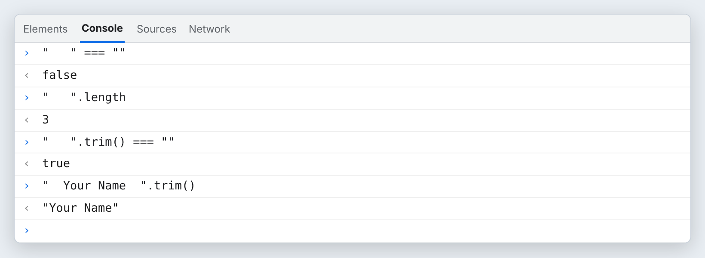
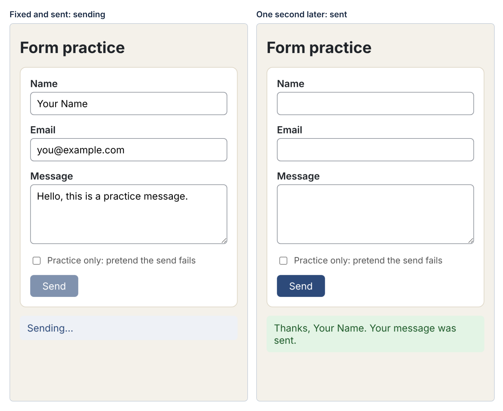
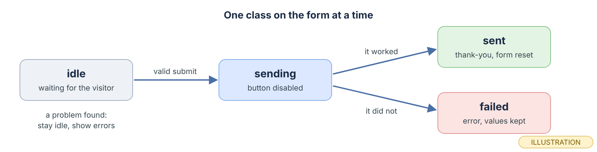
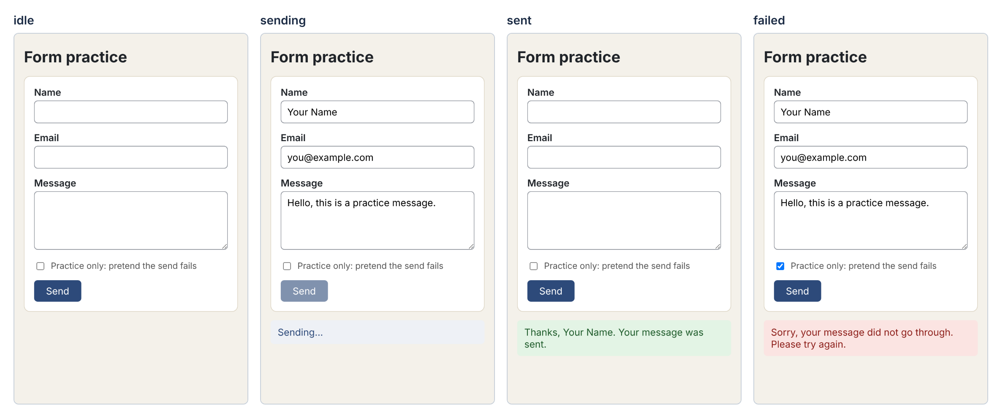
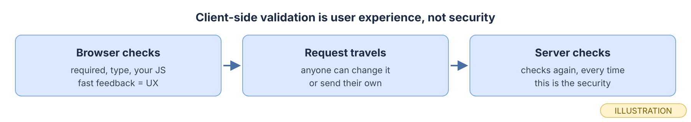
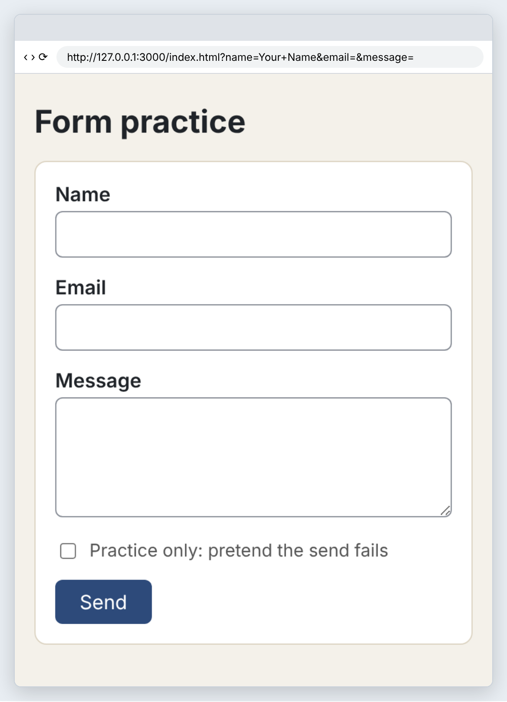
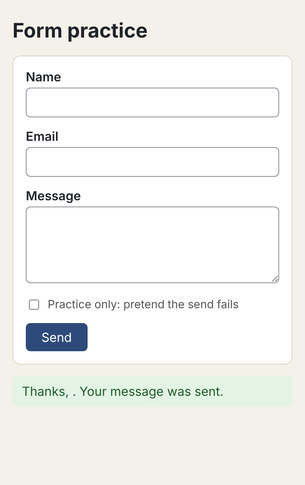

# Module 10 — Forms and Validation with JavaScript

*Catch the form before it leaves, check what the visitor typed, and say clearly what to fix.*

**In this module you will learn:**

- How to handle a form with `addEventListener("submit", …)` and stop the page from reloading with `event.preventDefault()`
- How to read what a visitor typed with `.value`
- Why `.trim()` matters, and how to check for an empty value
- What the browser checks for you: `required`, `type="email"`, `minlength`, `pattern`
- When to add your own JavaScript checks, and what `novalidate` does
- How to show an error message that a screen reader also hears, with `aria-describedby`, and why ARIA is used only when native HTML is not enough
- How to move focus to the first field with a problem with `.focus()`
- How to confirm success with a status message and clear the form with `.reset()`
- How to show form states (`idle`, `sending`, `sent`, `failed`) as classes with `classList`
- Why client-side validation is user experience, not security, and what server-side validation means

## Why this matters

In Module 4 you built forms in HTML, and the browser already refused an empty `required` field. In Module 9 you learned to find elements and react to a click. A form needs both, plus one more thing: when the visitor presses **Send**, the browser's default is to send the form and load a new page. If you want to check the answers and show a message on the same page, your JavaScript has to step in first.

Good form messages are a kindness. "Please enter your email address," right under the email box, with the cursor already in that box, saves the visitor from guessing. Bad messages, or messages only some visitors can perceive, make people give up.

This module stays on your own computer. Nothing is sent anywhere. A one-second timer stands in for a server so you can practice the states a real form goes through. The last concept explains why the checks you write here protect nobody, and why that is fine.

## Before you start

1. Finish Module 9. You should be able to find an element with `querySelector()`, change it with `textContent` and `classList`, and connect a function with `addEventListener()`.
2. In your course folder (for example `Documents\code559`), create a throwaway folder called `m10-practice`. Nothing in it is published. Open it in VS Code with **File → Open Folder…**.
3. Open the page with **Live Preview** this time, not by double-clicking the file. A real page address (`http://127.0.0.1:3000/…` is Live Preview's default) lets you see what a form adds to the address bar. Live Preview's default port is 3000 according to its `package.json`; yours may differ if 3000 is busy.

> **Checkpoint.** You have an empty `m10-practice` folder open in VS Code, and you know how to open a file with Live Preview and open the Console.

## Core concepts

### 1. How do you catch a form before it leaves?

 A form fires a `submit` event when the visitor presses a submit button or presses Enter in a field.

 Listen on the **form**, not the button. MDN: "The submit event fires on the `<form>` element itself, and not on any `<button>` or `<input type="submit">` inside it" (MDN, *HTMLFormElement: submit event*). The browser hands your function an **event object**, usually named `event`. Its method `preventDefault()` "tells the user agent that the event is being explicitly handled, so its default action… should not be taken" (MDN, *Event: preventDefault() method*). For a form, the default action is sending the data and loading a page. So the first line of every submit handler in this course is the same:

```js
function handleSubmit(event) {
  event.preventDefault();
  // now check the fields
}

form.addEventListener("submit", handleSubmit);
```

Notice the pattern from Module 9: `handleSubmit` with no parentheses. The browser calls it, and it passes in `event`.

 You will see what happens without this line, for real, in the Exercise break-it step.

 Answer the standing question: **what causes this function to run?** Name two different things a visitor can do that fire `submit`.

### 2. How do you read what the visitor typed, and why trim it?

 Every input and textarea has a `.value`, the text in it right now, as a string.

 `nameInput.value` gives whatever is in the box, spaces included. A visitor who presses the space bar three times has typed `"   "`, which is **not** the empty string `""`. So a check like `if (nameInput.value === "")` lets three spaces through. `.trim()` "removes whitespace from both ends of this string and returns a new string, without modifying the original string" (MDN, *String.prototype.trim()*). Trim first, then check: `const name = nameInput.value.trim();` and `if (name === "")`. Note the parentheses: `.value` is a property you read, `.trim()` is a method you call, the same difference you met with `.length` and `.push()` in Module 8.

<div role="separator" style="display:flex;align-items:flex-end;margin:1.5em 0;"></div>


 *Three spaces have a length of 3, so they are not empty. After `.trim()`, they are. (real output, rendered; evaluated in Chromium 141)*

One detail, checked in Chromium: an `<input type="email">` already strips spaces from both ends of its value (`"  you@example.com  "` came back as `"you@example.com"`), but `type="text"` and `<textarea>` do not (`"  Your Name  "` came back unchanged). Trim every field anyway. It costs nothing and you never have to remember which type does what.

 Predict: what is `"  hi  ".trim().length`?

### 3. What does the browser already check for you?

 HTML has validation built in. You used `required` in Module 4.

 MDN lists the attributes: `required` ("needs to be filled in before the form can be submitted"), `minlength` and `maxlength` (length of text), `min` and `max` (numbers), `type` ("a number, an email address, or some other specific preset type"), and `pattern` ("a regular expression that defines a pattern the entered data needs to follow") (MDN, *Client-side form validation*). With these on a form and no JavaScript, pressing Send on an empty required field shows the browser's own message bubble and **stops the submit**. Checked in Chromium: with `novalidate` removed, a click on Send fired the `submit` event 0 times and moved focus to the empty Name field. You can read the browser's verdict yourself from the Console:

<div role="separator" style="display:flex;align-items:flex-end;margin:1.5em 0;"></div>


 *`checkValidity()` returns `true` or `false` using the HTML rules. `validationMessage` is the text the browser would show in its bubble; the exact wording differs between browsers and languages. (real output, rendered; evaluated in Chromium 141)*

 Which attribute would you add to make a "Message" textarea refuse anything under 10 characters?

### 4. When do you write your own checks?

 The built-in bubbles work, but you cannot style them, and they disappear after a moment.

 When you want your own messages on the page, you add `novalidate` to the `<form>`. MDN: it "stops the form from showing its own error message bubbles, and allows us to instead display the custom error messages in the DOM," and it "doesn't disable support for the constraint validation API" (MDN, *Client-side form validation*). So you keep the attributes (they still describe the rules, and `checkValidity()` still uses them) and your `submit` handler does the checking. In the Exercise, JavaScript checks three things: the trimmed name is not empty; the email is not empty, and `emailInput.checkValidity()` is `true` (the browser's own `type="email"` rule); the trimmed message is at least 10 characters long. Use built-in checks where they fit, and your own JavaScript where you need a rule HTML cannot say, like "not just spaces."

 See the image under Concept 6.

 With `novalidate` on, what happens if your `submit` handler does no checking at all?

### 5. How do you show an error that everyone can perceive?

 An error message must be seen **and** heard. A red border alone tells a screen-reader user nothing, and color alone fails visitors who do not see red.

 Put an empty element for the message right after each field, and tie it to the field with `aria-describedby`:

```html
<input id="email" name="email" type="email" required aria-describedby="email-error">
<p id="email-error" class="error"></p>
```

MDN: `aria-describedby` "lists the ids of the elements that describe the object" (MDN, *ARIA: aria-describedby attribute*). When the field gets focus, a screen reader reads its label, then its description, which is your message. JavaScript fills the message with `textContent` and adds a class for the red border; it clears both when the field is fixed. Checked in Chromium's accessibility tree: after the email error appeared, the email field was a "textbox" named "Email" with the description "That email address looks incomplete. Check the @ and the part after it."

This is the only ARIA in the form, on purpose. MDN quotes the first rule of ARIA: "If you can use a native HTML element or attribute with the semantics and behavior you require already built in… then do so" (MDN, *ARIA*). The `<label for>` already names each field. `required` already says it is required. `aria-describedby` is here because HTML has no native way to say "this paragraph is the error for that input." **ARIA only when native HTML is not enough.**

 The image under Concept 6 shows two filled message elements.

 Why is the message element in the HTML from the start, empty, instead of created by JavaScript when the error happens? (Hint: `aria-describedby` points to an id. What has to exist for it to point at?)

### 6. Where should the cursor go when something is wrong?

 After a failed submit, the visitor's next question is "what do I fix?" Move them there.

 Every element that can take focus has a `.focus()` method. The checking function in the Exercise, `findFirstProblem()`, checks every field, shows every message, and **returns the first field with a problem, or `null`** if there is none, the same return-`null` pattern from Module 7. The submit handler then calls `firstProblem.focus()`. Focus lands in the field, a keyboard user can type the fix at once, and a screen reader reads the label and the error together.

<div role="separator" style="display:flex;align-items:flex-end;margin:1.5em 0;"></div>


 *Name was fine, so the first problem is Email, and that is where focus went (the orange ring). Both problems are listed at once, so the visitor fixes everything in one pass. Labels added above each render. (real: rendered in Chromium)*

 If all three fields had problems, which field would receive focus? Why that one?

### 7. How do you confirm success and clear the form?

 When everything passes, say so, clearly, and get the form ready for the next message.

 The confirmation goes into a status element that is in the HTML from the start: `<p id="status" role="status"></p>`. MDN's live-regions guide describes `role="status"` as "an area of the screen that provides an updated status of some kind"; it is a polite live region, which the guide says a screen reader speaks "whenever the user is idle." The same guide warns: "Establish the live region before updating its content… The most reliable way to ensure that live regions are registered is to include them in the initial markup" (MDN, *ARIA live regions*). Then `form.reset()`, which "restores a form element's default values" (MDN, *HTMLFormElement: reset() method*). Read anything you want to show (like the name) **before** you reset, or it will be gone.

<div role="separator" style="display:flex;align-items:flex-end;margin:1.5em 0;"></div>


 *The fixed form went through `sending` and then `sent`. The name in the thank-you line was read before `form.reset()` emptied the fields. Labels added above each render. (real: rendered in Chromium)*

 Put these in order: `form.reset()`, read the name, show the thank-you message.

### 8. How do you show what state the form is in?

 A real form is not just "filled" or "empty." It is waiting, or busy, or done, or it failed.

 Give the form exactly one state class at a time and let CSS draw each state. One small function does it, using two `classList` methods from Module 9:

```js
function setState(stateName) {
  form.classList.remove("idle", "sending", "sent", "failed");
  form.classList.add(stateName);
}
```

`remove()` accepts several class names at once; classes that are not there are ignored. While sending, the button is also disabled with `sendButton.disabled = true`, so a second click cannot send twice. In the Exercise, `setTimeout(finishSending, 1000)` waits one second and then calls `finishSending`, a stand-in for a server's answer. (Same rule as listeners: you pass `finishSending`, not `finishSending()`.) A practice checkbox lets you choose whether the pretend send fails, so you can see every state. In a later module, a real server replaces the timer. **Nothing in this module leaves your computer.**

<div role="separator" style="display:flex;align-items:flex-end;margin:1.5em 0;"></div>


 *Four states, one class at a time. When the send fails, the values stay, so the visitor does not retype a long message.*


*The same page in each of the four states, driven only by the class on the `<form>` and the text in `#status`. Labels added above each render. (real: rendered in Chromium)*

 Which CSS selector in the Exercise colors the status message red? Find it before you type the CSS.

### 9. Why is client-side validation not security?

 Everything in this module runs in the visitor's browser. The visitor controls that browser.

 MDN is direct: client-side validation "should not be considered an exhaustive security measure," because it "is too easy to bypass," and "Your apps should always perform validation, including security checks, on any form-submitted data on the server-side as well" (MDN, *Client-side form validation*). Anyone can open DevTools and delete your `required` attributes, switch off JavaScript, or skip your page entirely and send data straight to the server. So the rule for this course is: **client-side validation is user experience, not security.** It helps honest visitors fix mistakes quickly. **Server-side validation** means the program that receives the data checks it again, every time, before trusting it. Writing that program is outside this course's core; you only need to know it must exist.

<div role="separator" style="display:flex;align-items:flex-end;margin:1.5em 0;"></div>

![The Console on the practice page: the form's checkValidity() is false; a for...of loop over querySelectorAll("[required]") removes each required attribute; checkValidity() is now true.](images/m10-bypass-console.png)
 *One line in the Console, using Module 9's `querySelectorAll()` and `for...of`, switched the browser's rules off. The empty form now counts as valid. (real output, rendered; evaluated in Chromium 141)*


*Your checks live in the first box. Only the last box protects anything.*

 A friend says, "My form has `required` on every field, so no one can send me an empty message." What one sentence do you say back?

## Exercise

*Your hands, about 75 minutes (estimate).* Type it, do not paste it. Work in `m10-practice`. Nothing here is published, and nothing is sent anywhere.

1. **Create the HTML.** Make `index.html`:

   ```html
   <!DOCTYPE html>
   <html lang="en">
   <head>
     <meta charset="UTF-8">
     <meta name="viewport" content="width=device-width, initial-scale=1.0">
     <title>Form practice</title>
     <link rel="stylesheet" href="style.css">
     <script src="script.js" defer></script>
   </head>
   <body>
     <main>
       <h1>Form practice</h1>
       <form id="contact-form" class="idle" novalidate>
         <div class="field">
           <label for="name">Name</label>
           <input id="name" name="name" type="text" required aria-describedby="name-error">
           <p id="name-error" class="error"></p>
         </div>
         <div class="field">
           <label for="email">Email</label>
           <input id="email" name="email" type="email" required aria-describedby="email-error">
           <p id="email-error" class="error"></p>
         </div>
         <div class="field">
           <label for="message">Message</label>
           <textarea id="message" name="message" rows="4" required minlength="10" aria-describedby="message-error"></textarea>
           <p id="message-error" class="error"></p>
         </div>
         <div class="field check">
           <input id="pretend-fail" type="checkbox">
           <label for="pretend-fail">Practice only: pretend the send fails</label>
         </div>
         <button id="send-btn" type="submit">Send</button>
       </form>
       <p id="status" role="status"></p>
     </main>
   </body>
   </html>
   ```

   Notice: `novalidate` on the form, `class="idle"` to start, each field's `aria-describedby` naming the empty `<p>` under it, and the `#status` paragraph outside the form, right after it.

2. **Add the CSS.** Make `style.css`. The last block is the state styles. `.sent + #status` means "the `#status` element right after a form with the class `sent`."

   ```css
   body {
     margin: 0;
     font-family: "Segoe UI", Arial, sans-serif;
     background: #f4f1ea;
     color: #1f2328;
   }
   main { max-width: 520px; margin: 0 auto; padding: 24px 16px; }
   h1 { font-size: 1.6rem; margin: 0 0 16px; }
   form {
     background: #fff;
     border: 1px solid #ddd5c4;
     border-radius: 10px;
     padding: 16px;
   }
   .field { margin-bottom: 14px; }
   label { display: block; font-weight: 600; margin-bottom: 4px; }
   .check { display: flex; gap: 8px; align-items: center; }
   .check label { font-weight: 400; margin: 0; font-size: 0.9rem; color: #555; }
   input[type="text"], input[type="email"], textarea {
     box-sizing: border-box;
     width: 100%;
     font: inherit;
     padding: 8px 10px;
     border: 1px solid #8a8f98;
     border-radius: 6px;
   }
   input:focus-visible, textarea:focus-visible, button:focus-visible {
     outline: 3px solid #f0a500;
     outline-offset: 2px;
   }
   .invalid { border: 2px solid #b3261e; }
   .error { color: #b3261e; margin: 4px 0 0; font-size: 0.95rem; }
   .error:empty { display: none; }
   button {
     font: inherit;
     padding: 8px 20px;
     border: 0;
     border-radius: 6px;
     background: #2d4a7a;
     color: #fff;
     cursor: pointer;
   }
   /* Form states */
   .sending button { opacity: 0.6; cursor: wait; }
   #status { margin: 14px 0 0; padding: 10px 12px; border-radius: 6px; }
   #status:empty { display: none; }
   .sent + #status { background: #e3f4e5; color: #1e5b2a; }
   .failed + #status { background: #fbe4e2; color: #8c1d18; }
   .sending + #status { background: #eef1f6; color: #2d4a7a; }
   ```

3. **Type the script.** Make `script.js`. Type the three block comments first. Then fill block 1, then the small functions in block 2, then `findFirstProblem`, then `handleSubmit`, then block 3.

   ```js
   // 1. Find elements
   const form = document.querySelector("#contact-form");
   const nameInput = document.querySelector("#name");
   const emailInput = document.querySelector("#email");
   const messageInput = document.querySelector("#message");
   const nameError = document.querySelector("#name-error");
   const emailError = document.querySelector("#email-error");
   const messageError = document.querySelector("#message-error");
   const pretendFail = document.querySelector("#pretend-fail");
   const sendButton = document.querySelector("#send-btn");
   const statusMessage = document.querySelector("#status");

   // 2. Define behavior
   function setState(stateName) {
     form.classList.remove("idle", "sending", "sent", "failed");
     form.classList.add(stateName);
   }

   function showError(input, errorElement, text) {
     errorElement.textContent = text;
     input.classList.add("invalid");
   }

   function clearError(input, errorElement) {
     errorElement.textContent = "";
     input.classList.remove("invalid");
   }

   // Checks every field. Returns the first field with a problem, or null.
   function findFirstProblem() {
     let firstProblem = null;
     clearError(nameInput, nameError);
     clearError(emailInput, emailError);
     clearError(messageInput, messageError);

     const name = nameInput.value.trim();
     if (name === "") {
       showError(nameInput, nameError, "Please enter your name.");
       firstProblem = nameInput;
     }

     const email = emailInput.value.trim();
     if (email === "") {
       showError(emailInput, emailError, "Please enter your email address.");
       if (firstProblem === null) { firstProblem = emailInput; }
     } else if (!emailInput.checkValidity()) {
       showError(emailInput, emailError, "That email address looks incomplete. Check the @ and the part after it.");
       if (firstProblem === null) { firstProblem = emailInput; }
     }

     const message = messageInput.value.trim();
     if (message.length < 10) {
       showError(messageInput, messageError, "Please write at least 10 characters.");
       if (firstProblem === null) { firstProblem = messageInput; }
     }

     return firstProblem;
   }

   function finishSending() {
     if (pretendFail.checked) {
       setState("failed");
       statusMessage.textContent = "Sorry, your message did not go through. Please try again.";
     } else {
       setState("sent");
       statusMessage.textContent = "Thanks, " + nameInput.value.trim() + ". Your message was sent.";
       form.reset();
     }
     sendButton.disabled = false;
   }

   function handleSubmit(event) {
     event.preventDefault();
     statusMessage.textContent = "";
     const firstProblem = findFirstProblem();
     if (firstProblem !== null) {
       setState("idle");
       firstProblem.focus();
       return;
     }
     setState("sending");
     statusMessage.textContent = "Sending...";
     sendButton.disabled = true;
     // Stand-in for a real server: wait one second, then finish.
     setTimeout(finishSending, 1000);
   }

   // 3. Connect events
   form.addEventListener("submit", handleSubmit);
   ```

4. **Predict, then test empty.** Open the page with Live Preview and open the Console. Predict what happens when you press **Send** with every field empty: how many messages, and where does the cursor go? Then press Send.
5. **Test the tricky values.** Type three spaces in Name, `you@` in Email and `hi` in Message. Press Send. Compare with the right half of the image under Concept 6 (that one had a real name, so Name passed).
6. **Fix and send.** Fix all three fields and press Send. Watch for `Sending...` and the faded button, then the green thank-you one second later. The fields should be empty.
7. **Test the failure.** Fill the form again, tick **Practice only: pretend the send fails**, and press Send. Your values should still be there under the red message.
8. **Keyboard only.** Reload. Use only Tab, typing and Enter to fill the form with one mistake and submit it. Pressing Enter in a text field submits the form too. Does focus land on the mistake?
9. **Break it on purpose.** In `handleSubmit`, comment out the first line: `// event.preventDefault();`. Save. Type a name, leave the rest empty, and press Send. Watch the address bar.

   
   *Your handler ran and even wrote the error messages, but then the browser did its default: it sent the form by adding `name=value` pairs to the address and loaded the page again. The new page starts fresh, so the name you typed and every message are gone. The `?name=Your+Name&email=&message=` part is real, captured from Chromium after the click; the frame around it is drawn. (page real: rendered in Chromium; browser frame drawn)*

   The clue is the address bar, not the Console: nothing went red. Remove the `//`, save, reload (and delete the `?…` part of the address), and test again.
10. **Optional second break.** In `findFirstProblem`, change `const name = nameInput.value.trim();` to `const name = nameInput.value;`. Type three spaces as the name, fill the rest correctly, and press Send.

    
    *Three spaces are not `""`, so the check passed and the form "sent" with no name. The thank-you line still trims, so the visitor sees "Thanks, ." (real: rendered in Chromium)*

    Put `.trim()` back.

## Project (in the full packet)

The project is the **Contact page** of your personal site, finished: your Module 4 form gets the full validation cycle from this module, with messages written in your own voice, focus on the first problem, a confirmation that names the visitor, the four form states styled to match your site, and a keyboard-only test you write down and run. It still sends nothing; it is ready for a real server when you have one.

The full brief, the step-by-step build, and the finishing work in Git are in the Module 10 packet. [Get the packet →](PACKET_LINK_MODULE_10)

## Common misconception

> *"If my JavaScript checks every field, the data that reaches me will always be clean."*

What would you say? Hint: look again at the image under Concept 9. Who controls the browser your checks run in?

## Summary

A form fires `submit` on the form itself, and `event.preventDefault()` stops the browser from sending it and reloading the page. `.value` gives what the visitor typed as a string, and `.trim()` removes spaces at both ends so that three spaces count as empty. HTML's `required`, `type`, `minlength` and `pattern` check input with no JavaScript and block the submit. `novalidate` turns off the browser's bubbles so your own messages can appear on the page, while `checkValidity()` still uses the HTML rules. Each error message sits in an element tied to its field with `aria-describedby`, the one place native HTML is not enough. `.focus()` moves the visitor to the first field with a problem. A `role="status"` element in the initial HTML announces the confirmation, and `.reset()` clears the form after you have read what you need. One state class at a time, set with `classList`, lets CSS show `idle`, `sending`, `sent` and `failed`. Client-side validation is user experience, not security; the server must always check again.

## Check your understanding

1. Your submit handler shows the right errors, but they flash and vanish, and the address bar gains a `?`. What is missing?
2. **What value does this variable hold?** A visitor types two spaces, then `Ana`, then one space into Name. What does `nameInput.value` hold, and what does `nameInput.value.trim()` hold?
3. Why does the Exercise keep the `required` and `minlength` attributes even though `novalidate` is on and JavaScript does the checking?

## Before next module

- [ ] Your `m10-practice` form shows every problem at once and puts focus on the first one
- [ ] Three spaces in Name are refused
- [ ] You saw all four states: idle, sending, sent, failed
- [ ] You saw the page reload and lose its messages without `preventDefault()`, and fixed it
- [ ] You can say in one sentence why client-side validation is not security
- [ ] Saved this module's work to GitHub with the routine: git status → git add . → git commit -m "…" → git push → check the live page

## Go further

- MDN: *Client-side form validation* (Learn web development, Forms), the whole page, including "Validating forms using JavaScript"
- MDN: *HTMLFormElement: submit event* and *Event: preventDefault() method*
- MDN: *String.prototype.trim()*
- MDN: *HTMLFormElement: reset() method*
- MDN: *ARIA: aria-describedby attribute*; *ARIA live regions*; *ARIA* (the "Before using ARIA" section and the first rule of ARIA)
- freeCodeCamp: the form-validation material in the JavaScript curriculum **[unverified: exact current module name in the curriculum]**
- [W3Schools JavaScript Form Validation](AFFILIATE_W3SCHOOLS_FORMS)

*Affiliate link: Code559 may earn a commission at no extra cost to you.*

## What to keep

Keep `m10-practice` with its finished `script.js`, and write down the five tests from steps 4 to 8 as one line each: what you did, what you expected, what happened. Module 11 turns that list into a test plan. Then answer for yourself: **which step would be hardest to repeat without this post, and why?**

---

*Code559 is a 559 Solutions project. Portions adapted from Visual Studio Code documentation (CC BY 3.0 US), GitHub Docs (CC BY 4.0), and GitHub Skills (MIT). Screenshots used with permission from Microsoft.*

*Sources checked 2026-10-09: MDN "Client-side form validation"; MDN "HTMLFormElement: submit event"; MDN "Event: preventDefault() method"; MDN "String.prototype.trim()"; MDN "HTMLFormElement: reset() method"; MDN "ARIA: aria-describedby attribute"; MDN "ARIA live regions"; MDN "ARIA"; microsoft/vscode-livepreview `package.json` on GitHub (default `livePreview.portNumber` is 3000). Every page render, Console result and accessibility-tree check was captured in Chromium 141.0.7390.37 (via Playwright) on Linux, with the page served from a local test server at 127.0.0.1:3000.*
